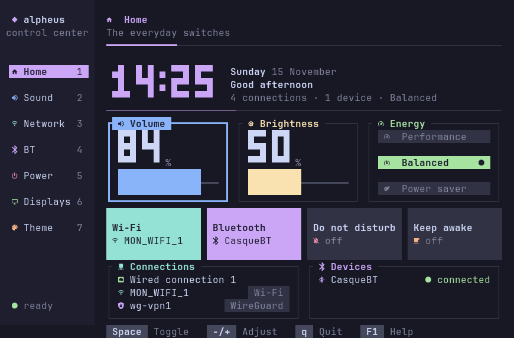
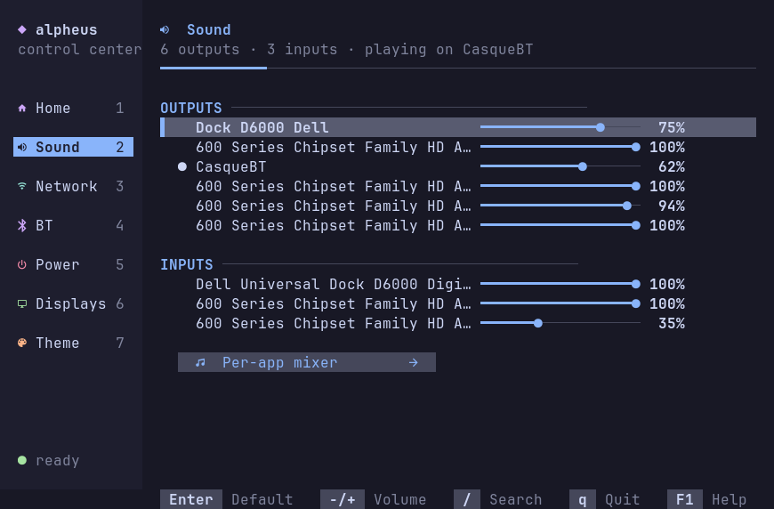
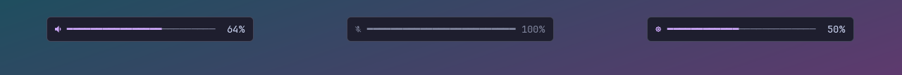
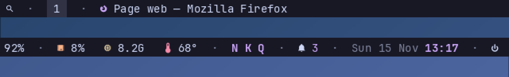
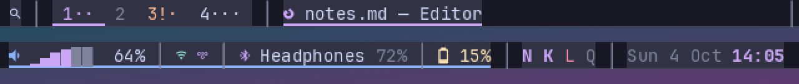

# alpheus

> *Alpheus*: the pistol shrimp, tiny and the fastest in the ocean.

A **lightweight, terminal-spirited** Wayland desktop shell, written in
Rust: what DankMaterialShell or Noctalia bring (bar, centralized settings,
notifications, OSD), **without their weight**. Aimed at modest hardware
with modern features.

Hyprland, Sway, Mango and niri. Mouse and keyboard everywhere.

Sleep and screen power-off remain the job of dedicated tools (hypridle,
swayidle…): alpheus never touches them. On some outputs (DisplayLink in
particular), a misplaced power-off can freeze the machine.

> **Status**: ongoing personal project, used daily by its author on NixOS.
> It still depends on a few scripts from her configuration (`wm-set`,
> `shell-ctl`…); making them optional, with a neutral fallback, is the next
> step before use elsewhere.

## Memory

What a desktop shell keeps resident: alpheus at rest against other shells, and
component by component, with the method and the tests that produce the
figures, in [`docs/measurements.md`](docs/measurements.md#memory).

## Features compared

alpheus against DankMaterialShell, Noctalia, ashell and the waybar stack,
feature by feature, in [`docs/comparison.md`](docs/comparison.md).

## What's in the repository

A Cargo workspace of four crates:

| Crate | Role |
|---|---|
| `alpheus` | **Control center** as a TUI (ratatui), opened on demand |
| `alpheus-daemon` (binary `alpheus-demon`) | **Resident daemon**: the bar, one per screen (layer-shell) |
| `alpheus-launch` | **Scripting bridge** to the daemon's launcher, notifications, OSD and quick panel (`--toggle`, `--dmenu`, `--dnd`, `--quick`…) |
| `alpheus-common` | Shared foundation: command execution, configuration, theme, access to system tools |

The TUI doesn't embed Wayland, the daemon doesn't embed ratatui: a test
checks this.

### The control center (`alpheus`)

Eight tabs: **Home**, **Sound**, **Network**, **BT** (Bluetooth), **Power**,
**Displays** (enable, place, set resolution and scale, profiles, with
automatic rollback after 15 s if not confirmed; the daemon speaks the output
protocol and holds that countdown, so it works under every compositor that
implements `zwlr_output_manager_v1`, and a profile matching the connected
screens is applied on hotplug), **Theme** (choose a
theme, the light/dark mode, the module colours and the bar style, with a preview; `--tab theme`) and **Diag**
(session health, failed units, the journal, a boot report, a bug report: see below; `--tab diagnostics`).

**The rail.** In a terminal of at least 84 columns and 26 rows (an 87×26
window is enough) the tabs become a left rail: the brand, then icon,
name and number per tab, the active one filled with the theme's accent
container, and the status line at its foot. Each tab has its own hue (Home the
accent, Sound blue, Network cyan, BT purple, Power red, Displays green, Theme
orange, Diag yellow) for its header, headings, gauges and switches; a hue is only ever the
ink of a glyph or a heading, never of text on a fill (labels on a button, a
chip or a tag are `fg`). Its controls are drawn in the
theme: selection bands, knob gauges for volume and brightness, switches,
glyph buttons. Below that size the classic top tab bar and rows are drawn, as
before except for three changes: the keycaps' order, the Displays row dropping
its scale column at 80 columns, and the Theme tab's caption hiding when the
rows need its room.

**The Home dashboard.** When the Home body is at least 64 columns by 20 rows
(87×26 with the rail leaves a 67×20 body), Home is a dashboard: a block-digit
clock with the date, a greeting and a one-line summary, a card per setting
(volume, brightness, energy profile) with large digits and a gauge, four tiles
(Wi-Fi, Bluetooth, Do not disturb, Keep awake) filled with their hue when on,
the connections and the devices. It shows only what the control center already reads, the
same keys and clicks reach the same items as in the classic rows, and it
opens in well under 100 ms.

**Shapes.** The theme's `style` (see [Bar styles](#bar-styles)) shapes the
control center too: `islands` cuts round caps and rounded frames, `powerline`
arrow tips, `underline` drops the fills for coloured, underlined text,
`floating` draws double frames with drop shadows, and `flat` and
`translucent` stay square. `islands` and `powerline` use Nerd Font glyphs
(U+E0B0, U+E0B4, U+E0B6), like the bar: in a terminal without a Nerd Font they
show as boxes; `flat` needs none.






| Key | Action |
|---|---|
| `1`…`8`, `Tab` / `Shift+Tab` | switch tabs |
| `Ctrl+P` | command palette (fuzzy search) |
| `/`, `Ctrl+F` | search a list |
| `F1`, `?` | help |
| `Esc` | go back; `q` quits |

`alpheus --tab <name>` opens directly on a tab (`home`, `sound`, `network`,
`bluetooth`, `power`, `displays`, `appearance`, `diagnostics`; `theme` is accepted for
`appearance`, `diag` for `diagnostics`).

**The Diag tab.** Nothing is read until it is shown, and leaving it stops the reads not yet sent (one already running finishes).
One list, in sections: the **session health** (the compositor's socket answers, `WAYLAND_DISPLAY`
is reachable, the systemd user environment names this session's display and compositor, no failed
user unit, the alpheus daemon answers, plus `[[diagnostics.checks]]` of your own; a failing one
shows its fix as text, never runs it), the **failed units** of both managers, the units
**restarting in a loop**, the **crashes** of the last seven days (`coredumpctl`) and the **boot**
time. On a failed or looping unit `Enter` opens its journal, `r` restarts it (asked first) and `c`
clears its failed state (also asked first on a system unit); a user unit runs through the tab's worker, a system one in the tab's own
window so that systemd's password prompt appears there (alpheus never runs `sudo` or `pkexec`;
`[diagnostics] system_actions = false` hides both keys on system units). The **journal view** has
eight presets (errors this boot, USB, suspend and resume, out of memory, thermal and throttling,
NetworkManager, live journal, the logs of a service), `u` filters by unit, `p` cycles the priority,
`/` filters the text, `f` follows (one bounded read a second while the view is open, no resident
`journalctl`; pressed again after a failed read, it reads again), `PgUp`/`PgDn`/`Home`/`End` and
the wheel scroll, `Esc` clears a filter first and then goes back (in the unit picker it closes the
picker, and back to the overview when no unit was chosen yet; `Backspace` on an empty picker clears
the unit). `/`, `u`, `p` and `f` are the view's own letters: a key you bound to another action wins. The **boot report** shows `systemd-analyze`'s time, blame and
critical chain. The **bug report** (versions, failed units, loops, crashes, this boot's errors) is
shown in full, redacted, and copied through `[diagnostics] copy` (`wl-copy` by default; the text
goes on its standard input) only when you press Enter in the report or click Copy. Redaction is a safety net: it
replaces your user name, home, host name and machine id, MAC and IP addresses, UUIDs and anything
shaped like an e-mail address; **Wi-Fi network names and USB serial numbers are not touched**. Read
it before copying. Reading the system journal needs the `wheel`, `adm` or `systemd-journal` group
(the header says "your own messages only" otherwise). Every string from systemd or the journal is
cleaned of control characters before it reaches a cell. `F5` (the `refresh` binding; not in the journal view, which reads for itself) reads everything again.

### The bar (`alpheus-demon`)

In the default `flat` style, a line of monospace characters on the theme's bar colour, modules separated by
a dim dot (`  ·  `), the active workspace on the theme's accent (see [Themes](#themes) and [Bar styles](#bar-styles)).





Shipped: **launcher** (an icon that opens it, first module by default),
**workspaces** (one dot per window, empty workspace dimmed, the active one
on `accent_container`, urgent in `urgent`, click to go there, wheel to move to the next one), **active
window** (app icon and title), **media** (`▶ Title` while a player plays, `⏸ Title` paused, hidden when nothing plays; middle click play/pause, wheel next/previous; a left click opens a popup with the artist, the elapsed time and a progress bar, ⏮ ⏯ ⏭, and the players to choose from),
**privacy** (nothing while nothing is captured; then one glyph per capture in an own block: `󰍬` microphone in orange, `󰄀` camera in green, `󰍹` screen in red, whatever `module_colors` says; the microphone glyph is dim while the default source is muted. Read from PipeWire's graph by the `pw-dump` child the sound module already runs, so a meter (pavucontrol, cava), a filter chain or a loopback never lights it, and an app muting itself in its own call still does; a screen cast announced by niri or Hyprland lights the screen too. A glyph goes 0.5 s after its capture ends, never blinking on a renegotiation. A left click opens a popup listing the apps by name (`(unnamed)` when only the compositor knows); a middle click mutes or unmutes the default microphone. A camera opened directly (`/dev/video*` outside PipeWire) lights it too: the daemon watches the device nodes with inotify (`[privacy] dev_dir`, `proc_dir`: where video devices and processes are listed) and, 300 ms after an open or close, scans its own user's `/proc/<pid>/fd` for a link to a `video*` node (never opening one; PipeWire, WirePlumber and the daemon itself excluded). **Not seen:** wf-recorder under Sway and Mango, which announce nothing, a camera held by another user's process, and a same-user process named `pipewire` or `wireplumber`; under Hyprland, a cast running before the daemon started shows only through PipeWire (niri reports it at connection). **Known:** on boards whose hardware codec nodes are named `video*` (some ARM boards), a codec in use also lights the camera; the nodes are never opened to tell them apart),
**shield** (nothing unless `[shield]` is set in `bar.toml` and the mode is on; then `󰒘`, always green, in an own block right after the privacy indicators, removed on a narrow bar just before them. Its state is a file: the mode is on while `flag` exists, watched through the theme watch's one inotify instance, so a change made in a terminal shows at once. A left click opens the quick panel on the Shield row (with the `quick` module): Space switches it with the `on` or `off` command, which asks for authorisation itself (`pkexec` shows polkit's dialog), `…` until the flag follows, `failed` for 4 s on a refusal; Enter opens the detail, the USB devices blocked since the mode went on (read once each time it opens), Enter on one runs `allow` with its id. `alpheus-launch --shield` does the same from a script, and the notices come from alpheus's own server; see [Shield mode](#shield-mode)), **volume** (an icon and the percentage, wheel ±5 %; with the quick panel, a left click opens it and a right click the TUI's sound tab, else a right click
mutes), **network** (link icon, VPN count), **Bluetooth** (device and its
battery), **battery** (laptop and peripherals; `warn` below 20 %, `error` below 10 %), **resources** (CPU, memory, temperature: each an icon and a figure; a left click opens a popup with each item's figure and a graph of its last 60 samples, drawn in pixels (`last N min`: 60 × `interval` seconds), and a `Monitor…` row; the right click runs `[actions] resources`; the 60 samples are kept in a fixed ring of about 3 KB, fed by the tick that already runs, so nothing more wakes; `[resources] show` adds `net` (the default route's interface, receive and send rates; IPv4 only), `disk` ($HOME's filesystem, percent used, rounded up like `df`) and `gpu` (the GPU's temperature, from its hwmon); all read at the same tick, nothing more is read for an item left out. `disk` calls `statvfs` on `$HOME` at each pass, on the event loop: a hung network `$HOME` would block the bar. Reading a discrete GPU's hwmon can wake it on a hybrid laptop: set `gpu_sensor` to the integrated GPU's driver (`i915`, `xe`, `amdgpu`) to read that one instead), **tray** (status icons of running apps as Nerd
Font glyphs — or a letter —, left click activates, right click opens the
app's menu in a popup, keyboard and mouse),
**notifications** (a bell with the unread count, crossed under do-not-disturb, dim while another
server holds the name; a left click opens the panel — the player, the last 50 notifications, Do not
disturb, Clear all — a middle click toggles do-not-disturb; bubbles top centre on the focused output:
a left click runs the app's default action, a right click dismisses, critical ones stay until
clicked), **OSD** (a pill bottom centre on the focused output for the volume and mute, read from PipeWire's own state — any app, any key, a headset's buttons — with the new sink's name when the default sink switches; for the microphone only when its mute flips, never for a change of its level, which call apps (WebRTC) adjust on their own; and for the laptop's brightness on `alpheus-launch --osd brightness`, read once from sysfs, never written; it goes 1.3 s after the last change and never takes a click), **quick settings** (a panel under the volume, network or Bluetooth module, or `alpheus-launch --quick [sound|wifi|bluetooth]`: the volume with its output devices and, for a Bluetooth headset, its Hi-Fi/Mic mode (a switch of its PipeWire profile with `wpctl set-profile`), the backlight, the Wi-Fi (the radio, and a detail of the visible networks: saved ones connect by their profile, open ones by name, a new WPA-personal one with a password typed in the panel and handed to `nmcli` on its standard input; a failed new network's profile is removed; `More…` opens nmtui), the Bluetooth (power, and a detail of the paired devices and of the nearby ones found while it is open: connect or disconnect, pair a new one — a keyboard's code to type or a code to confirm shown in the panel by alpheus's own pairing agent, then trusted and connected —, and forget one after `Forget? ⏎`; the Bluetooth module's left click opens it), the microphone and a `Mixer…` row that opens wiremix in a terminal (`[quick] mixer`; `[]` hides it), do-not-disturb (Space toggles; Enter or → opens a detail: Off, 30 minutes, 1 hour, 2 hours, Until `[quick] dnd_until`, Until I turn it off; a timed one reads `until HH:MM` on the row), the power profile from power-profiles-daemon, keep-awake and night light as commands of your own, and lock, log out, reboot and power off — reboot and power off ask once more; every change is a command such as `wpctl`, `brightnessctl` or `powerprofilesctl`, never a write of the bar's own; a row whose tool, device or command is missing does not show (except the default `Mixer…`, not checked: without wiremix its terminal closes at once)), **displays** (nothing drawn: the daemon reads the screens through `zwlr_output_manager_v1` for the Displays tab, holds the tab's 15 s trial and applies the matching `displays.toml` profile on hotplug, 500 ms after the screens settle, at most 3 times a minute per set of screens (one held back is applied when the minute ends); a trial still open when the daemon stops is rolled back, one lost to a crash is not, and a try still waiting for the compositor at shutdown may keep its layout; `[displays] auto = false` keeps the tab and drops the hotplug behaviour), **clock** (a click opens the
month's calendar), **timer** (a dim `󰔛` while idle, in its own yellow block just before the clock; `[timer] idle = "hidden"` draws nothing then. Running: the minutes left, rounded up (`󰔛 25m`, `󰔛 1h05`); a Pomodoro shows `󰔟` while working and `󰅶` on a break; the stopwatch `󱎫 12m`; paused `󰏤 24m`, dim; ended `󰂞 done` in the warn colour. The chip changes once a minute, never each second. A left click opens a popup (Timer ‹ 10 min › with ← → and the wheel, Pomodoro, Stopwatch; while one runs Pause or Resume, Add 1 min or Skip, Stop; the time ticks each second only while it is open), a middle click pauses or resumes. The end is a notification from alpheus's own server (kept in the history only under do-not-disturb, which also mutes the sound) and `[timer] sound`, an argv run at each end; the state survives a restart in `$XDG_STATE_HOME/alpheus/timer`), **failed** (`󰀦 N` in the error colour, drawn only above 0: systemd's `NFailedUnits` for the system manager plus the user manager, each read through one `Get` of that property on the D-Bus connections the bar already has, never the Manager's other properties; a left click opens the Diag tab. By default (`[failed] subscribe = false`) the count is read at start, on resume, on `alpheus-launch --failed-refresh` and the Diag tab's refresh, and piggybacked on another domain's wake-up at most once a minute, never with a timer of its own; with `true` alpheus calls `Subscribe()` once on each manager so that systemd sends the change at once (the icon is instant, and systemd and dbus-daemon then serialize their signals for every client on that bus; the piggyback is skipped). If the session link closes, the user count stays as last known (the link is never reconnected). A systemd1 that fails to answer leaves the count unknown for that read (one rate-limited log line, the session and the other modules unaffected). A count going unknown keeps its last value. `[failed] user_units = false` leaves the session bus alone; `notify = true` sends one notification when the total rises), **power** (⏻ at the bar's end: a menu with Lock, Log out, Reboot and Power off, run with the quick panel's `[quick]` commands; reboot and power off ask once more, and a double click never confirms; an entry with no command does not show, nor the button without any). Clicking a module opens the matching tab
clicked), **OSD** (a pill bottom centre on the focused output for the volume and mute, read from PipeWire's own state — any app, any key, a headset's buttons — with the new sink's name when the default sink switches; for the microphone only when its mute flips, never for a change of its level, which call apps (WebRTC) adjust on their own; and for the laptop's brightness on `alpheus-launch --osd brightness`, read once from sysfs, never written; it goes 1.3 s after the last change and never takes a click), **quick settings** (a panel under the volume, network or Bluetooth module, or `alpheus-launch --quick [sound|wifi|bluetooth|vpn]`: the volume with its output devices and, for a Bluetooth headset, its Hi-Fi/Mic mode (a switch of its PipeWire profile with `wpctl set-profile`), the backlight, the Wi-Fi (the radio, and a detail of the visible networks: saved ones connect by their profile, open ones by name, a new WPA-personal one with a password typed in the panel and handed to `nmcli` on its standard input; a failed new network's profile is removed; `More…` opens nmtui), the Bluetooth (power, and a detail of the paired devices and of the nearby ones found while it is open: connect or disconnect, pair a new one — a keyboard's code to type or a code to confirm shown in the panel by alpheus's own pairing agent, then trusted and connected —, and forget one after `Forget? ⏎`; the Bluetooth module's left click opens it), the VPN (a row under Bluetooth with the active profile, else `off`; Space brings the last used one up or down, and a detail lists the NetworkManager VPN profiles, OpenVPN-style and WireGuard alike, to bring one up or down with `nmcli connection up|down uuid`, no secret ever read or typed in the panel; `More…` opens nmtui-edit; a failing `nmcli` itself is not seen: the profile shows `…` until NetworkManager says otherwise or 20 s pass (60 s while it reports the connection activating), then `failed`, on the row too; a profile that needs a secret no agent provides (a password asked each time, with no secret agent running) fails, and `More…` (nmtui-edit) is where to store the secret), the microphone and a `Mixer…` row that opens wiremix in a terminal (`[quick] mixer`; `[]` hides it), do-not-disturb (Space toggles; Enter or → opens a detail: Off, 30 minutes, 1 hour, 2 hours, Until `[quick] dnd_until`, Until I turn it off; a timed one reads `until HH:MM` on the row), the power profile from power-profiles-daemon, keep-awake and night light as commands of your own, and lock, log out, reboot and power off — reboot and power off ask once more; every change is a command such as `wpctl`, `brightnessctl` or `powerprofilesctl`, never a write of the bar's own; a row whose tool, device or command is missing does not show (except the default `Mixer…`, not checked: without wiremix its terminal closes at once)), **displays** (nothing drawn: the daemon reads the screens through `zwlr_output_manager_v1` for the Displays tab, holds the tab's 15 s trial and applies the matching `displays.toml` profile on hotplug, 500 ms after the screens settle, at most 3 times a minute per set of screens (one held back is applied when the minute ends); a trial still open when the daemon stops is rolled back, one lost to a crash is not, and a try still waiting for the compositor at shutdown may keep its layout; `[displays] auto = false` keeps the tab and drops the hotplug behaviour), **clock** (a click opens the
month's calendar), **power** (⏻ at the bar's end: a menu with Lock, Log out, Reboot and Power off, run with the quick panel's `[quick]` commands; reboot and power off ask once more, and a double click never confirms; an entry with no command does not show, nor the button without any). Clicking a module opens the matching tab
of the control center (with the quick panel: the right click on volume, network and Bluetooth). One bar per screen, screens plugged and unplugged
are tracked live. On a narrow screen, secondary modules disappear;
workspaces and the clock remain.

The lock screen is paused (the wallpaper, swaybg, is optional): the focus is
polishing the bar, the launcher, the notifications and the control center.

At rest the bar never wakes up except for its timers (the clock, and the
resources every 2 s when shown): measured 0 wake-ups at rest, ≈ 8.0 MB
of memory at start (≈ 8.4–8.5 MB with a tray of 10 items, launcher module off) and ≈ 9.6–9.7 MB under load,
on three outputs. The
compositor is only **read** (Hyprland's or niri's event stream, Sway's i3 IPC, Mango's watch sockets); switching
workspace goes through a configurable command. Sound comes from
`pw-dump`, network, battery and Bluetooth from D-Bus (read-only, and no service is ever D-Bus-activated, with one exception: when the battery is wanted and UPower has no owner — it is activated only on demand on some systems, NixOS among them — the daemon asks the bus for UPower once per session start, so the battery shows without another client starting it first; the quick panel's Bluetooth acts through a second system-bus connection (BlueZ's own calls and its pairing agent), open only while its detail is open or a call is in flight),
resources from `/proc`. The tray talks to the session bus
(StatusNotifierItem, dbusmenu): one connection on the bar's own loop, no
thread. The media module speaks MPRIS on that same connection (or on one of its own when the tray is off,
shared with the light/dark portal): players found at start and on arrival, their changes read from
signals, never polled; while its popup is open the time ticks once a second, and only then.
The notifications module is the `org.freedesktop.Notifications` server on that same connection. It
waits in the D-Bus queue while another server (mako) holds the name, and takes over as soon as it is
released; a mako started after it is refused and exits. Text is capped and cleaned: markup is
stripped, never rendered, and images are skipped unread. A noisy app is rate-limited, and the bubbles
exist only while one shows. One timer is armed for the earliest expiry, and none at rest. **Rules** (`[[notifications.rules]]`, at most 32, the first match wins) are applied to each notification before anything else: `action = "mute"` shows no bubble but keeps it in the history and counts it unread, `action = "drop"` ignores it entirely (the sender is answered as usual, nothing is stored), `urgency = "low"|"normal"|"critical"` replaces the app's own; the app name is compared whole, in any case, and never logged. **Battery alerts** (`[battery] warn = [20, 10, 5]`, with `battery` and `notifications` in `modules`) are notifications from `alpheus` itself when the battery, discharging, crosses a threshold from UPower's state the bar already reads (no new timer, thread or match rule); one per threshold, all armed again once it charges, the lowest one critical; given only while the server holds the name, and offered again when it starts. With `[notifications] dnd_while_sharing = true` (and `privacy` and `notifications` in `modules`), do-not-disturb turns on while a screen capture runs and off when it ends, unless you set it yourself meanwhile (your choice wins). A timed do-not-disturb whose end falls during a share hands over to sharing instead of turning off: it stays on, and the capture's end turns it off. Scripts drive it through `alpheus-launch`: `--dnd on|off|toggle` sets
do-not-disturb (kept across restarts, in `$XDG_STATE_HOME/alpheus/dnd`; `--dnd on --for 30m` (`2h`, `1h30m`; 1 minute to 24 hours) or `--dnd on --until 22:30` (local time, tomorrow if already past) ends it by itself: one timer, armed only while it runs, and a restarted daemon keeps the end or turns it off if it passed; `off` and `toggle` cancel it, an older daemon exits 3); an alpheus older than this feature reads any state file as plain on, so a rollback keeps do-not-disturb on (untimed) until you toggle it, `--clear-notifications`
empties the history; exit code 2 when the notifications module is not in `bar.toml`, 3 when the bar
is not running. `--osd brightness` shows the backlight's level (exit 0 also when there is none to
show, or the `osd` module is off; 3 when the bar is not running). `--calc` opens the launcher in calculator mode (closed: it opens; open, whatever its mode, apps box or script menu: it closes, as `--toggle` does, and a `--calc` less than 250 ms after the one that opened it is ignored; exit 3 when the bar is not running or older than `--calc`). `--windows` opens the window switcher (see [The launcher](#the-launcher)); a second `--windows` while it is open steps to the next window, and it replaces any other open launcher, cancelling a waiting `--dmenu` (a password prompt included); exit 3 when the bar is not running or older than `--windows`. `--quick [sound|wifi|bluetooth]` opens or closes the quick panel on the focused output (`wifi`, `bluetooth`: on that detail; exit 0 also without the `quick` module; 3 when the bar is not running or older than `--quick` (or than its `wifi` or `bluetooth` word)); a `--quick` arriving less than 250 ms after the one that opened the panel is ignored, so a compositor that re-fires a press bind does not close it at once. `--timer start <duration>` (`90s`, `25m`, `1h30m`, or a bare number of minutes: 1 second to 24 hours), `--timer pomodoro`, `--timer stopwatch`, `--timer pause|resume|toggle|stop|skip` (on whatever runs; nothing to act on is no error) and `--timer popup` (opens or closes the popup under the chip, the keyboard taken without a grab; a second within 250 ms of its own open is ignored) drive the focus timer (exit 2 without the `timer` module, 3 when the bar is not running or older than `--timer`). A known
show, or the `osd` module is off; 3 when the bar is not running). `--calc` opens the launcher in calculator mode (closed: it opens; open, whatever its mode, apps box or script menu: it closes, as `--toggle` does, and a `--calc` less than 250 ms after the one that opened it is ignored; exit 3 when the bar is not running or older than `--calc`). `--windows` opens the window switcher (see [The launcher](#the-launcher)); a second `--windows` while it is open steps to the next window, and it replaces any other open launcher, cancelling a waiting `--dmenu` (a password prompt included); exit 3 when the bar is not running or older than `--windows`. `--notes` opens or closes the quick notepad (see [The quick notepad](#the-quick-notepad); a `--notes` less than 250 ms after the one that opened it is ignored; exit 3 when the bar is not running or older than `--notes`). `--quick [sound|wifi|bluetooth]` opens or closes the quick panel on the focused output (`wifi`, `bluetooth`: on that detail; exit 0 also without the `quick` module; 3 when the bar is not running or older than `--quick` (or than its `wifi` or `bluetooth` word)); a `--quick` arriving less than 250 ms after the one that opened the panel is ignored, so a compositor that re-fires a press bind does not close it at once. A known
show, or the `osd` module is off; 3 when the bar is not running). `--calc` opens the launcher in calculator mode (closed: it opens; open, whatever its mode, apps box or script menu: it closes, as `--toggle` does, and a `--calc` less than 250 ms after the one that opened it is ignored; exit 3 when the bar is not running or older than `--calc`). `--quick [sound|wifi|bluetooth|vpn]` opens or closes the quick panel on the focused output (`wifi`, `bluetooth`, `vpn`: on that detail; exit 0 also without the `quick` module; 3 when the bar is not running or older than `--quick` (or than its `wifi`, `bluetooth` or `vpn` word)); a `--quick` arriving less than 250 ms after the one that opened the panel is ignored, so a compositor that re-fires a press bind does not close it at once. `--shield on|off|toggle|status|allow` drives Shield mode (see [Shield mode](#shield-mode); exit 2 when `[shield]` is not set, the state cannot be read, a command is already running, or `allow` is asked with the mode off or nothing to run; 3 when the bar is not running or older than `--shield`), `--clipboard` opens or closes the clipboard history in the launcher's box (any other open launcher is replaced; a `--clipboard` less than 250 ms after the one that opened it is ignored) and `--clipboard-clear` forgets every unpinned entry without touching the current clipboard (exit 2 when `[clipboard] enabled` is not set or the compositor offers no data-control protocol, 3 when the bar is not running or older than the verb). A known
limitation: right-to-left titles (Arabic, Hebrew) are drawn in logical order, not reordered. On Hyprland (any version; hyprwm/Hyprland#15729, fixed upstream in 0.56.2), the bar's keyboard interactivity stays None while a menu or the calendar grabs — detected from its `hyprland_*` globals.

### Event hooks

`[hooks]` in `bar.toml` runs a command when something changes. Each key is an argv, run as given
(no `~` or `$VAR` expansion: a hook that wants a shell says `["sh", "-c", "…"]`); absent or `[]`
means no hook. Every hook gets `ALPHEUS_EVENT=<key>`, plus:

| Key | Fires when | Variables | Needs in `modules` |
|---|---|---|---|
| `started` | once, when the daemon has started its sources | none | always |
| `theme_mode` | the mode in effect changes (the portal's word in `auto`, or a `theme.toml` change) | `ALPHEUS_MODE` = `dark` \| `light` | always |
| `dnd` | do-not-disturb turns on or off, by any path | `ALPHEUS_DND` = `on` \| `off` | `notifications` |
| `battery_charge` | the laptop battery's charge state changes | `ALPHEUS_CHARGE` = `charging` \| `discharging` \| `full` \| `pending`, `ALPHEUS_PERCENT` | `battery` |
| `battery_level` | the battery's whole percentage changes | the same (`ALPHEUS_CHARGE` may also read `unknown`) | `battery` |
| `power_profile` | the power profile changes | `ALPHEUS_POWER_PROFILE` = `power-saver` \| `balanced` \| `performance` | `quick` |
| `network` | the primary connection goes online or offline, or changes kind | `ALPHEUS_NETWORK` = `online` \| `offline`, `ALPHEUS_LINK` = `wifi` \| `ethernet` \| `vpn` \| `other` \| `none` | `network` or `quick` |
| `vpn` | a VPN becomes active, or the last one goes | `ALPHEUS_VPN` = `on` \| `off` | `network` or `quick` |
| `bluetooth` | the adapter powers on or off, or a device connects or disconnects | `ALPHEUS_BLUETOOTH` = `on` \| `off` \| `connected` \| `disconnected`, `ALPHEUS_DEVICE` (the device's name, the last two only; unset for a name that is a Bluetooth address) | `bluetooth` or `quick` |
| `privacy` | the microphone, camera or screen indicator turns on or off | `ALPHEUS_CAPTURE` = `microphone` \| `camera` \| `screen`, `ALPHEUS_STATE` = `on` \| `off` | `privacy` |
| `shield` | Shield mode turns on or off, by any path | `ALPHEUS_SHIELD` = `on` \| `off` | `[shield]` set in `bar.toml` |
| `failed_units` | the total of failed units (system plus user manager) changes | `ALPHEUS_FAILED` (the total), `ALPHEUS_FAILED_SYSTEM`, `ALPHEUS_FAILED_USER` (each unset until that manager has answered once; afterwards its last known value) | `failed` |
| `displays` | a `displays.toml` profile was applied on hotplug | `ALPHEUS_DISPLAY_PROFILE` (the profile's name) | `displays` |

```toml
[hooks]
started = ["notify-send", "alpheus is up"]
dnd = ["sh", "-c", "echo \"$ALPHEUS_DND\" > ~/.cache/dnd-led"]
theme_mode = ["sh", "-c", "gsettings set org.gnome.desktop.interface color-scheme \"prefer-$ALPHEUS_MODE\""]
```

- **Edges only.** A hook fires on a change, never for the start-up state: each event's first value
  is only a seed, and for the first 3 s after the daemon starts an edge only moves its seed (the
  portal's first answer, the first `pw-dump` graph). `started` is the one exception.
  `failed_units` seeds each manager apart: a user count that answers after the first 3 s is a seed
  too, not a change.
- **A hook never adds a source.** Events come from what the configured `modules` already read; one
  whose module is off never fires, and the daemon says so once at start
  (`hooks: power_profile never fires (needs quick)`). A source that is down is not a state: nothing
  fires for it.
- **Rate limit.** Per event, five runs at once, then one every 3 s; a run with no token is dropped,
  with one log line per episode. A hook that re-triggers its own event settles at one run per 3 s.
- **Finding the program.** The first word is an absolute path or a bare name looked up on the
  daemon's own `$PATH` (not your shell's); relative paths (`./x`) and `~` are not expanded or found.
  Quote variables in `sh -c` (`"$ALPHEUS_DEVICE"`): a name may hold spaces.
- **A scope.** The command runs detached in its own `systemd-run --user --scope` when a user manager
  runs (as the launcher's apps), so it never dies with the bar, and bare otherwise. The event's data
  reaches it only through the environment, never as an argument; device and profile names are
  cleaned and cut to 255 bytes. A hook variable the event does not set is removed from the
  environment, so an inherited one never passes for the event's. A Bluetooth device whose name
  is only its address gets no `ALPHEUS_DEVICE`; one that is renamed from an address-like alias to
  its real name fires a disconnect and a connect (rename churn).
- **Nothing logged but the event.** `hook: <key>`, `hook: <key> failed (program not found)`,
  `throttled`; never the command, an argument or a value.
- **A change takes effect after `shell-ctl reload-bar`** (bar.toml is read at start).

### The launcher

A centred box (apps, open windows, `$PATH` commands, a script/dmenu mode
for shell scripts), opened and closed by the daemon itself — nothing of
it stays resident while closed, not even a thread.


`Tab`/`Shift+Tab` switches modes (All, Apps, Windows, Commands); typing
ranks results with [nucleo](https://github.com/helix-editor/nucleo)
(Helix's fuzzy matcher) plus frecency (most-used first on an empty
query). `Enter` runs a command or typed shell text in a held terminal
(stays open to read the output); `Ctrl+Enter` runs it detached. `alpheus-launch`
bridges to it over an owner-only socket (`toggle`, `close`, `--dmenu`
with fuzzel's exit codes, plus exit code 3 — daemon unreachable — the
only case where a script falls back to another menu). Measured in
**release** (headless sway, 300 synthetic apps): opening costs ≈ 1.9–2.1 MB
of PSS over closed, median open latency ≈ 0.8–1.3 ms, 50 open/close cycles
grow PSS by well under the 1 MB budget (measured 148–220 KB across runs),
0 wake-ups in 5 s at rest after use (2 in one of three runs). A 100,000-line dmenu peaks at
+6.6–6.8 MB and drops back to +0.5 MB a second after it is cancelled.

**Calculator.** A query that looks like arithmetic shows one row above the other results (or alone with `alpheus-launch --calc`). `+ - * / % ^`, parentheses, `x` as a multiplication, `0x`/`0b`/`0o` and `_` in numbers, `pi` and `e`, and `sqrt`, `cbrt`, `abs`, `ln`, `log`, `log2`, `exp`, `sin`, `cos`, `tan`, `asin`, `acos`, `atan`, `round`, `floor`, `ceil`, `min`, `max`. Integers are exact (128 bits) and fall back to floating point on overflow; results keep 12 significant digits. `%` is the truncated remainder, as in C and Rust: `-7 % 3` is `-1`. A result computed from hexadecimal, binary or octal input also shows `0x…` and `0b…`. Units convert with `<value> <unit> to <unit>` (or `in`): length (`mm cm m km inch ft yd mi`), mass (`mg g kg t oz lb`), temperature (`c f k`), data (`b kb mb gb tb pb`, `kib … pib`) and time (`ms s min h d`). Inches are typed `inch` (or `inches`): `in` is the keyword, so `12 in to cm` gives no row. A word such as `e`, `pi`, `2048`, `7zip` or `1password` never shows the row. `Enter` copies the answer (`3.10685596119 mi`), `Ctrl+Enter` copies `5 km to mi = 3.10685596119 mi`, through `copy = ["wl-copy"]` in `launcher.toml` (`[]` hides the action); the copy is not recorded in the history. Nothing resident, nothing per keystroke beyond the parse.

**Prefixes.** A query that starts with `?`, `:` or `$` in the All mode lists only that prefix's rows (never under `--password`, in the Apps, Windows and Commands modes, or in script and dmenu menus, where they are plain text). A prefix alone shows a hint line, not a row.

- `? rust ratatui` shows `Search the web: rust ratatui`; Enter opens `search` (default `https://duckduckgo.com/?q={query}`, the text percent-encoded as one parameter) through `open` (default `["xdg-open"]`, the URL as the last argument), in a systemd scope like an app, so the browser never dies with the bar. `search = ""` or `open = []` turns the prefix off, and a `?` query is then searched as text. Never recorded in the history.
- `:heart` lists the emoji whose name matches (Unicode 16.0, the 1,906 fully-qualified ones without skin tones, a table in the binary's read-only data, paged in only when used; the launcher's fuzzy matcher over the name, at most `rows`). Enter copies the emoji through `copy` (`wl-copy`), `Ctrl+Enter` copies its name. Sequences (a family, a flag, a keycap) show as their pieces but are copied whole. Colour needs an emoji font in `[font] fallback` of `bar.toml` (for example `["DejaVu Sans Mono", "Noto Color Emoji"]`, the key replacing the default): the default monospace font has few. `:!x` is the matcher's negation, and an accented needle matches literally.
- `"` lists the clipboard history (see [Clipboard history](#clipboard-history)); only while `[clipboard] enabled = true`, otherwise plain text.
- `$ sleep 5 && notify-send hi` shows `Run in a shell: …`; Enter runs `sh -c -- <text>` detached in a scope, `Ctrl+Enter` in `terminal_hold`. The text is never recorded or logged.

`:` and `$` are always claimed as prefixes: a query that starts with one never ranks apps (set `[prefixes]` to something else if you search names that start with them, a configured mode prefix is taken first). The attribution of the emoji names is in `NOTICE`.

**Window switcher.** `alpheus-launch --windows` (bind it to Alt+Tab in your compositor: `bind=ALT,Tab,spawn,alpheus-launch --windows` in Mango, `bindsym Mod1+Tab exec alpheus-launch --windows` in Sway) opens the windows with the previous one selected, so Enter goes back to the last window. A second `--windows` while it is open, and `Tab`, step down (`Shift+Tab` up), wrapping, so holding the modifier and pressing the key again walks the list; only a `--windows` within 250 ms of the switcher's own open is ignored (Hyprland re-fires a press bind on release). Esc closes. No modes row, no thumbnails, no scan of apps or `$PATH`, nothing resident.

**Command sources.** A menu script's lines can be searched next to the apps.
A `[[sources]]` table in `launcher.toml` names a `list` command and a `run` command. `list` runs once per open, on the thread that already scans the applications, after them: 1 s at most, 2,000 lines, 256 KiB. `run` receives the chosen line as one argument, never through a shell; it is the cleaned line (controls and invisible formatting characters removed, U+2028 and U+2029 turned into a space), not the script's raw bytes.

A line `Captures · Screenshot zone` shows as **Screenshot zone**, then `Captures` dimmed. It is found by typing either part. It is never listed on an empty query, in another mode or behind a prefix. Its use is remembered for the ranking like an app's.

```toml
[[sources]]
name = "Tools"                     # 1 to 32 characters, unique, no control character (logs, history)
list = ["my-menu", "--list"]       # argv, no shell
run  = ["my-menu", "{line}"]       # "{line}": the chosen line, as one argument
```

A source that fails, hangs or floods is cut off and logged once. The launcher opens as usual.
Whatever the list command started is killed with it when the read ends. If the daemon itself is
killed mid-read, the list command dies too, but processes it left in the background do not; a
systemd unit with `KillMode=control-group` (the default) cleans them up.

While the launcher is open, each kept line costs about three times its text (the line, its entry
and its path): ≈ 6–8 MB at the bounds (8 sources × 256 KiB) plus the ranker, released on close. A
300-line source costs ≈ 0.5 MB (table above).

`alpheus-launch --dmenu` takes fuzzel's dmenu options that scripts use:

| Option | What it does |
|---|---|
| `-p`, `--prompt TEXT` | text shown before the input |
| `--index` | print the chosen line's 0-based position on standard input instead of its text, empty lines counted as fuzzel does (`-1`, exit 0, for typed text that matches no line, as fuzzel) |
| `--password` | draw one `•` per typed character, show no list (standard input is read and ignored), print the text as typed; never logged nor kept in the history, wiped from memory on close; not with `--index` |
| `--visible N` | with an empty query, list only the first N non-empty lines; typing searches every line (a script's home menu: its categories first, every entry by typing); not with `--password` |
| `--placeholder TEXT`, `--width N`, `--lines N` | accepted and ignored (the box keeps its own size) |

A running `alpheus-demon` older than `--index`/`--password`/`--visible` (upgraded but not restarted) refuses
them: `alpheus-launch` then exits 3, like an unreachable daemon, so a script falls back to another
menu with the same options.

### The Tools menu

One box for "do something to my session", in the launcher's own box (nothing resident while closed, no thread, no new crate): `alpheus-launch --tools` (bind it yourself: Mango `bind=SUPER,x,spawn,sh -c 'alpheus-launch --tools; [ $? -eq 3 ] && tools-menu'`, Sway `bindsym $mod+x exec …`; exit 3 means the daemon is too old or not running, the one case to fall back on another menu) opens it, and `/` typed as the whole query in Mod+Space jumps into it.

- **Browsing.** With the query empty it lists categories (`Quick settings`, `Control center`, `Utilities`, `Session`, and your own). Enter or → opens one, ← or Esc goes back up, Esc at the root closes. Every action closes the box.
- **Searching.** Typing searches every entry of every category at once, the category dimmed after the entry, fixed choices as `Entry · Choice`; inside a category or a choices list it filters that level. Entries also rank in Mod+Space's normal search, as `[[sources]]` lines do.
- **Built-ins** (nothing to declare; each shows only when it can work): Sound, Wi-Fi, Bluetooth, VPN, Shield, Do not disturb, Keep awake and Night light (with the quick panel's switch, from `[quick]`), the control center's tabs (through `[actions] open_tab`, else the launcher's terminal and `alpheus --tab <name>`), Notes, Timer, Clipboard, Emoji, Lock, the Power menu and an optional `Reload the bar`. They replay the daemon's own verbs, so no process starts and each verb's rules apply. `[tools] builtins = false` shows none, `hide = ["tab.power", …]` hides some, `root = ["keep_awake"]` also lists some at the root.
- **Your entries.** `[[tools.entry]]` in `launcher.toml` (below): an argv with no shell, optionally in the terminal (`terminal`) or the held one (`hold`), `confirm` (the first Enter turns the row into `Name? ⏎`; a second one between 0.4 s and 3 s later runs it, a double Enter never does), `state` (an argv run when the box opens: exit 0 shows the quick panel's `ON` switch, any other exit `off`, a hung one is killed at 1 s and shows nothing), and `choices` or `choices_cmd` (the lines a command prints when the entry is opened, filterable) with `{choice}` standing for the chosen line as one whole argument.
- **Bounds.** 16 categories, 128 entries, 32 fixed choices per entry, 16 states; past a bound the first ones are kept, with one log line of counts. A command's list or state read is cut at 1 s, 2,000 lines and 256 KiB. Names, commands and lines are never logged (an entry is named by its position in the file).
- **`alpheus-launch --power`** opens the ⏻ menu (lock, log out, reboot, power off) under the bar's right end, with or without the `power` module; exit 2 when no `[quick]` session command is set.
- **The `/` caveat.** A typed path (`/etc/hosts`) in Mod+Space's All mode jumps into the Tools menu; `[prefixes] tools = ""` gives the key back. A `tools` prefix the file never sets that clashes with your `commands` or `windows` prefix is turned off with a note; one the file sets is refused.
- **Moving from a menu script.** `[[sources]]` keeps working beside it (an entry in both shows twice in Mod+Space's search: drop the source once the menu is yours).

### The quick notepad

`alpheus-launch --notes` toggles one pad of plain text, drawn as the launcher's box (60 columns, 14 text rows) on the focused output. Bind it yourself, for example Mango `bind=SUPER,n,spawn,alpheus-launch --notes` or Sway `bindsym $mod+n exec alpheus-launch --notes`. It closes on Esc, on the verb again, on a click outside and when the keyboard focus leaves; every close saves. Keys: characters, Enter, Tab (four spaces), Backspace, Delete, Ctrl+Backspace/Delete (a word), arrows, Ctrl+arrows (words), Home/End, Ctrl+Home/End, Page Up/Down, Shift to select, Ctrl+A, Ctrl+C and Ctrl+X (through `copy` of `launcher.toml`, default `wl-copy`), Ctrl+V (the Wayland clipboard). The text is in `$XDG_STATE_HOME/alpheus/notes.txt` (owner only, written atomically), read at each open and dropped at each close; 64 KiB at most. Nothing is resident while it is closed: no surface, no keyboard, no timer, no text.

Known limits: one pad (no several notes, colours or pinning); no undo; no mouse selection (a click places the caret, the wheel scrolls); copy and cut are capped at 4 KiB, and a cut whose copy program fails after it started loses the text (the program is only known to have started); a save that fails at close keeps the text in memory for the next open, which shows it `not saved` as long as the file is as the pad last read or saved it (device, inode, modification time and size); if the file changed meanwhile (written elsewhere, replaced, removed, now refused), the file wins: it opens as usual, the kept text is dropped unwritten and the help row says `earlier unsaved text not written: the file changed` (the log says `notes: not saved (<kind>)`); that text, up to 64 KiB, is the one thing of the pad resident while it is closed, and only after such a failure; but a save that fails while the bar stops loses it; paste works with every `wl_data_device` version, but a compositor offering only version 1 cannot release the device, so one protocol object per open stays on the server until the bar exits (wlroots compositors, Sway and Mango among them, offer version 3; verified headless on Sway only); no `fsync` (the rename is atomic); something else writing the file while the pad is open is overwritten by the pad's next save.

A file the pad cannot safely take over opens it read only (moves, selection and copy work; edits and paste are refused, the reason on the help row) and is never overwritten: over 64 KiB or not UTF-8 shows its first 64 KiB (invalid bytes as �); a file with tabs, carriage returns or control characters (edited elsewhere) shows them cleaned; a file that is not ours (a symlink, another owner, a directory open to others) or cannot be read shows nothing. A panic in the pad saves its text and closes it; the log names the place, never the text (the bar's panic hook never prints a panic's message, and neither the pad's nor the launcher's guard logs it: `notes error in <what>`, `launcher error in <what>`).

### Clipboard history

Off by default. `[clipboard] enabled = true` in `bar.toml` (read at start: `shell-ctl reload-bar` or a restart after changing it) makes the daemon follow the Wayland clipboard through `ext-data-control-v1` (or `zwlr_data_control_manager_v1` v1 where that is all the compositor has). **Text only**: every copy is read once, at most 4,096 bytes (a longer text is skipped, never cut), valid UTF-8, not only whitespace; the last 50 are kept in memory, newest first, a repeat moves to the top. **Nothing is written to disk**: the history is lost when the daemon stops. The primary selection (mouse selection) is never read, and images are never read.

Open it with `alpheus-launch --clipboard` (bind it yourself: Mango `bind=SUPER,v,spawn,alpheus-launch --clipboard`, Sway `bindsym $mod+v exec alpheus-launch --clipboard`) or type `"` in Mod+Space. Enter copies the entry back and closes; Ctrl+Enter or a right click pins or unpins it (10 pins at most, kept first and never evicted); Delete forgets it; the last row, `Clear history`, asks (`Clear? ⏎`; a second Enter confirms, but only from 0.4 s after the question, and a held Enter never confirms; any other key or a click cancels it) and keeps the pins; `alpheus-launch --clipboard-clear` does the same from a script. Both verbs exit 2 when the history is off and when the compositor offers no data-control protocol (3 when the bar is not running). After Enter the daemon itself owns the clipboard (so it empties if the daemon stops), with no `wl-copy` left running.

**What is never stored.** A copy whose offer carries the password-manager hint (`x-kde-passwordManagerHint`, or macOS's and Windows' concealed types) is skipped without its text ever being received: KeePassXC, `wl-copy --sensitive` (so `pass`) and, per a user report, the Bitwarden desktop app set it. Anything copied while an alpheus `--dmenu --password` prompt is open, or in the 5 s after it closes, is skipped too (a tool that prompts for a password and copies it without the hint more than 5 s after the prompt closed, such as a slow gpg or pinentry decrypt, is not covered). **What is stored.** A copy **without** a hint **is stored**, in memory, with its text: a password manager that sets none puts its passwords in the history. Not verified: 1Password for Linux, the Bitwarden browser extension (browsers refuse custom types), Firefox's and Chromium's own password-field copies, gopass. Delete or `--clipboard-clear` forgets such an entry; log lines and the debug output never carry any clipboard text. **Device lifetime.** When the compositor finishes the data device the history attaches to a new one once; if the seat is removed it attaches to another seat.

### Shield mode

A security mode for public networks, with the work split in two. **Your system configuration does the root work** (a firewall chain, stopping sshd and Avahi, USBGuard's policy) behind one privileged command you already have; **alpheus does everything visible**: it shows the state, switches it, lists the USB devices USBGuard blocks, allows one, tells you and fires a hook. Nothing in alpheus is distribution-specific: the state is "a file exists", the actions are argv arrays, and the device list is USBGuard's `list-devices` text, which alpheus parses itself. It never runs anything but the argv you configured (no sudo, no polkit API, no firewall or USBGuard call of its own) and never watches USB plugs in the background. With no `[shield]` table nothing exists: no watch, no glyph, no row, and every verb answers `shield is not configured in bar.toml` (exit 2). **Configured** means `flag`, `on` and `off` are all set; the keys are in the [`bar.toml` reference](#configure). `on_text` and `off_text` are the notices' bodies.

- **State.** `flag` existing is on, absent is off, anything else unreadable (shown `·`, nothing runs). Its directory is watched in the theme watch's inotify instance (no new descriptor, thread or polling; a directory that other programs keep busy, such as `/tmp`, wakes the loop for each change in it, so give the flag a directory of its own); when that is impossible one log line says so and the flag is read at each panel open and after each command alpheus runs. The first reading is a seed: no notice and no hook for it.
- **The bar and the panel.** The `shield` module is drawn only while on. In the quick panel the Shield row sits under the VPN row: Space runs `off` or `on` (`…` until the flag follows; `failed` for 4 s when the command exits non-zero, is killed or the flag does not follow, with one log line of fixed words, never a device name or a command); Enter or → opens the blocked devices (`Reading…`, `No blocked device`, `Cannot list the devices`, or `Shield is off`), at most 32 rows with the `vid:pid` muted; Enter on one runs `allow` with its USBGuard id, then reads the list again. The configured command (for example `pkexec`) may show polkit's own dialog: a command may take 60 s (typing a password) and it survives the panel closing; its output goes to `/dev/null`, so a privileged helper is never cut half way by a closed pipe.
- **Verbs.** `alpheus-launch --shield on|off|toggle` answer once the command has started (the outcome reaches you through the switch, the notice and the log, never the exit code; already in the asked state: nothing runs); `status` prints `Shield: on|off` then the blocked devices as `<vid:pid>  ·  <name>` (exit 0 either way, `Shield: unknown` exits 2); `allow` opens the blocked devices as a picker in the launcher's box (`<vid:pid>  ·  <name>`, the checked ids first) and runs `allow` for the chosen one (Escape exits 1; nothing blocked gives the `No blocked USB device` notice, exit 0). A daemon older than the verb exits 3, the one code a caller falls back on.
- **Notices.** `Shield on` / `Shield off` (your `on_text` / `off_text`, at any change, whoever made it), `Shield unchanged` (a failed switch), `USB device allowed` (naming the device), `USB device not allowed`, `No blocked USB device`: through alpheus's own notification server, one log line `shield: no notification (not serving)` when it is not serving.
- **Hook.** `[hooks] shield` runs on each change with `ALPHEUS_SHIELD=on|off`, under the hooks' rules.
- **Costs.** Commands and reads run on a short-lived thread (`alpheus-shield`, alive only while one runs: one command and one read at a time, a read bounded to 2 s, 64 KiB and 1,024 lines); one timer, armed only while a switch waits for its flag (5 s after a clean exit, 60 s while the command still runs). Figures in the memory table above.

### Themes

Colours come from a **theme**: one of fifteen compiled-in presets, or your
wallpaper through [matugen](https://github.com/InioX/matugen). Each has a dark
and a light variant. The mode follows the desktop (the portal's
`org.freedesktop.appearance` `color-scheme`, read by the bar, which passes it
on to the control center) or is fixed. The bar, its popups, the launcher and the
control center change together. The bar picks up a new
`theme.toml`, `colors.toml` or `colors-light.toml` by itself, without a
restart: one inotify watch, nothing wakes at rest. If `~/.config/alpheus` is
itself a symlink (home-manager), the watch follows it to its target, so
replacing the link is not seen until the bar restarts (the bar logs it once at start).


```toml
# ~/.config/alpheus/theme.toml — every key optional
theme = "catppuccin"   # a preset below, or "wallpaper"
mode  = "auto"         # "auto" (follow the desktop), "dark", "light"
module_colors = "icons" # "none", "icons" (default), "full", "pills": see Module colours below
style   = "flat"        # "islands", "powerline", "floating", "underline", "translucent": see Bar styles below
opacity = 0.8           # translucent only

[colors]               # override any role, whatever the theme and mode
# accent = "#ff9e64"
```

With no `theme.toml`, or no `theme` key in it, alpheus uses `wallpaper` when
`~/.config/alpheus/colors.toml` exists (what it did before themes existed),
and `catppuccin` otherwise. An unknown name falls back to `catppuccin`, with
one line in the log.

| `theme` | Dark | Light |
|---|---|---|
| `catppuccin` | Mocha | Latte |
| `gruvbox` | dark | light |
| `tokyo-night` | Night | Day |
| `rose-pine` | main | Dawn |
| `everforest` | dark medium | light medium |
| `kanagawa` | Wave | Lotus |
| `solarized` | dark | light |
| `nord` | Nord | dark only |
| `dracula` | Dracula | dark only |
| `ember` | Ember | Ember |
| `glacier` | Glacier | Glacier |
| `ink` | Ink | Ink |
| `hicon` | High contrast | High contrast |
| `sorbet` | Sorbet | Sorbet |
| `phosphor` | Phosphor | dark only |

A preset with no light variant stays dark in light mode. Every preset is
checked for legibility in both modes by a test using WCAG contrast:
- text reaches 4.5:1 on the bar and the popups;
- secondary text and the state colours reach 3:1 on the bar;
- `fg` reaches 3.5:1 on the `raised` and `pill` fills, and the six presets added in the UI refresh keep secondary text and the module hues at 3:1 on `pill` (secondary text also on `raised`); where a hue or secondary text falls short on a fill, the control center draws that glyph or word in `fg` instead (a test checks every pair the rail and its tabs draw, in every preset and mode).

Where an official colour falls short in a light variant, alpheus uses a
darker shade of it. Nord's bar sits on `nord0` rather than `nord1`, so that
its red stays readable.

A theme is 16 colours, named by use:

| Role | Used for |
|---|---|
| `bar_bg` | the bar's background |
| `pill_bg` | raised cells of the bar (a visible workspace); the blocks of the block styles |
| `popup_bg` | menus, calendar, tooltip, launcher |
| `raised` | reserved for hover; powerline's alternate blocks; a visible workspace inside a block |
| `selection` | the selected row |
| `fg`, `fg_dim` | text, secondary text (frames are `fg_dim` at 40 %) |
| `on_accent` | text on an accent |
| `accent`, `accent_container` | the clock, the active workspace |
| `accent2` | checks and radios in menus |
| `accent2_container` | reserved (no surface uses it yet; delivery 2) |
| `ok`, `warn`, `error`, `urgent` | states: low battery is `warn`, critical `error`, an urgent workspace `urgent` |

#### Module colours

A theme also carries **seven hues**: `red`, `orange`, `yellow`, `green`,
`cyan`, `blue` and `purple`. Each preset takes them from its own palette
(darker shades in the light variants where the official one is too pale to
read, 3:1 on the bar at least). `module_colors` in `theme.toml` decides how
much of each module wears its hue:

| `module_colors` | Look |
|---|---|
| `none` | no hue: the bar looks as before the hues existed |
| `icons` (default) | each module's icon takes its hue |
| `full` | the icon and the module's text |
| `pills` | each block filled with its hue (block styles, see Bar styles below) |

The mapping is fixed:

| Module | Hue |
|---|---|
| window title (its icon) | purple |
| media | purple |
| sound | blue |
| network | cyan |
| Bluetooth | purple |
| battery | green |
| CPU (its icon and figure) | orange |
| RAM | yellow |
| temperature | red |

Workspaces, the clock, the tray icons, the notification bell
(its count in the accent), the launcher button and the separators keep their colours. **States win over the hue**: a low (`warn`) or
critical (`error`) battery, a hot temperature, a network with limited
connectivity, a muted volume, an offline or
down module, an urgent workspace and a tray item that needs attention keep
their state colours whatever `module_colors` says. A charging battery is
green at any level (its glyph shows it charges, so it never warns); under `none` it
keeps the accent. The Theme tab of the
control center has a "Module colours" row (None, Icons, Full, Pills) with a preview.

A colour file may carry the seven hues as optional keys (`red = "#f38ba8"`,
and so on); a hue that is absent is derived from Catppuccin's (Mocha for dark,
Latte for light) mixed 30 % toward the accent, so it stays in tune with the
theme. `[colors]` in `theme.toml` can override a hue like any role.

#### Bar styles

The bar has six shapes. `flat`, the default, is the bar as it always was.

```toml
# ~/.config/alpheus/theme.toml
style   = "islands"  # "flat" (default), "islands", "powerline", "floating", "underline", "translucent"
opacity = 0.8        # translucent only: 0.3 to 1.0 (clamped, with one line in the log)
```

Only `translucent` uses `opacity`; a value out of range still logs its warning under any other style.

| `style` | Look |
|---|---|
| `flat` | one line on the bar colour, modules separated by a dim dot |
| `islands` | each group of modules in its own rounded block; the bar between them is transparent |
| `powerline` | full-height blocks joined by arrows, alternating two tones |
| `floating` | one rounded bar, 6 px from the top and sides of the screen, with a light shadow |
| `underline` | blocks one step lighter than the bar, a thin line under it, the active workspace in the accent, underlined |
| `translucent` | the bar at `opacity` over the wallpaper, solid blocks |







*The six styles on catppuccin (dark), over a fictional wallpaper (sample data, real font, zoomed ×2, each bar split in two halves).*

The groups are the workspaces, the window title, the status modules (sound, network, Bluetooth,
battery), the resources, the tray, the clock and the launcher button. A module that is absent
makes no block. The text inside each block is the same in every style; only the background
changes.

`module_colors = "pills"` fills each block with the hue of its first module. Its text and icons
take whichever of the bar colour or the text colour reads better on that hue, and states still win
(a low battery stays `warn`). Pills apply to `islands`, `powerline`, `floating` and `translucent`.
Under `flat` and `underline`, `pills` looks like `full`.


The Theme tab of the control center has a "Style" row with a preview of each style. The preview is
drawn in terminal cells, so it is an approximation, not the real pixels. `opacity` is set in the
file only. A change applies at once: `floating` moves the bar 6 px down and in from the sides, and
windows start right under it (6 px lower than under the other styles), then their usual gaps.

alpheus never asks for blur. On Hyprland, a layer rule on the bar's namespace blurs what is behind
the `translucent` bar, and behind the `islands` and `floating` blocks:

```
# hyprland.conf
layerrule = blur on, ignore_alpha 0, match:namespace alpheus-bar
```

Clicks in the transparent gaps between `islands` blocks still reach the bar. The shadow under
`floating` lets clicks through to the window below.

#### Wallpaper colours (matugen)

`theme = "wallpaper"` reads `colors.toml` (dark) and `colors-light.toml`
(light). If only the dark file exists, light mode uses it too. A file gives
the 16 roles above. The 7 keys of earlier versions (`bg fg accent muted
surface error ok`) still work, and the other roles are derived from them.

A matugen template for the 16 roles, `~/.config/matugen/templates/alpheus.toml`:

```toml
bar_bg            = "{{colors.surface_container_lowest.default.hex}}"
pill_bg           = "{{colors.surface_container_high.default.hex}}"
popup_bg          = "{{colors.surface_container.default.hex}}"
raised            = "{{colors.surface_container_highest.default.hex}}"
selection         = "{{colors.secondary_container.default.hex}}"
fg                = "{{colors.on_surface.default.hex}}"
fg_dim            = "{{colors.on_surface_variant.default.hex}}"
on_accent         = "{{colors.on_primary.default.hex}}"
accent            = "{{colors.primary.default.hex}}"
accent_container  = "{{colors.primary_container.default.hex}}"
accent2           = "{{colors.tertiary.default.hex}}"
accent2_container = "{{colors.tertiary_container.default.hex}}"
ok                = "{{colors.tertiary.default.hex}}"
warn              = "{{colors.amber.default.hex}}"
error             = "{{colors.error.default.hex}}"
urgent            = "{{colors.error_container.default.hex}}"
```

`amber` is a custom colour, tinted toward the wallpaper. The seven hues are
custom colours too, harmonised with the wallpaper: add these lines to the
template, in the same way (the keys are optional; without them alpheus
derives the hues from the accent):

```toml
red    = "{{colors.red.default.hex}}"
orange = "{{colors.orange.default.hex}}"
yellow = "{{colors.yellow.default.hex}}"
green  = "{{colors.green.default.hex}}"
cyan   = "{{colors.cyan.default.hex}}"
blue   = "{{colors.blue.default.hex}}"
purple = "{{colors.purple.default.hex}}"
```

One matugen configuration per mode, each writing its own file.
`~/.config/matugen/alpheus-dark.toml`:

```toml
[config.custom_colors]
amber  = { color = "#f9a825", blend = true }
red    = { color = "#f38ba8", blend = true }
orange = { color = "#fab387", blend = true }
yellow = { color = "#f9e2af", blend = true }
green  = { color = "#a6e3a1", blend = true }
cyan   = { color = "#94e2d5", blend = true }
blue   = { color = "#89b4fa", blend = true }
purple = { color = "#cba6f7", blend = true }

[templates.alpheus]
input_path = "~/.config/matugen/templates/alpheus.toml"
output_path = "~/.config/alpheus/colors.toml"
```

`alpheus-light.toml` is the same with `output_path = "~/.config/alpheus/colors-light.toml"`.
Then, at each wallpaper change:

```sh
matugen -c ~/.config/matugen/alpheus-dark.toml  image "$WALLPAPER" -m dark  -t scheme-vibrant
matugen -c ~/.config/matugen/alpheus-light.toml image "$WALLPAPER" -m light -t scheme-vibrant
```

`-t scheme-vibrant` gives livelier colours than matugen's default
(`scheme-tonal-spot`). The bar follows the new files on its own. Run from a
script with no terminal (a wallpaper hook), matugen cannot ask which of a
picture's dominant colours to use: add `--source-color-index 0` to pick the
first.

## Build

With Nix:

```sh
nix build .#alpheus          # the TUI
nix build .#alpheus-demon    # the bar
nix develop                  # dev shell: cargo, fonts, sway for tests
```

Without Nix, `cargo build --release` builds the three programs (the daemon needs
`pkg-config`, libdbus and libxkbcommon development files; see
[docs/install.md](docs/install.md)). The bar looks
for its fonts in `$ALPHEUS_POLICES` (set at build time by the flake),
otherwise in the system's.

## Configure

Everything is optional, under `~/.config/alpheus/`. An invalid file falls
back to default values with a warning, never a crash: `bar.toml`,
`launcher.toml`, `config.toml` and `displays.toml` reject unknown keys, so a
single typo (or an unknown module name) discards that whole file. `theme.toml`
is lenient: an unknown key or a bad value is ignored with a warning and the
rest applies; unknown keys in `colors*.toml` are ignored. The daemon logs to its standard error.

When the files are read: `bar.toml` **once, when the daemon starts** (restart
`alpheus-demon` after editing it); the theme files (`theme.toml`,
`colors.toml`, `colors-light.toml`) are **watched and reloaded live**;
`launcher.toml` is read **at each open** of the launcher; `config.toml` once, when the control
center starts (restart it to apply an edit); `displays.toml` when the control center starts, and by the daemon at the end of each hotplug debounce.

- `theme.toml`: the theme (a preset or the wallpaper), light/dark mode,
  per-role overrides, the bar style and its opacity; `colors.toml` / `colors-light.toml`: the wallpaper's
  colours, written by matugen. See [Themes](#themes); the bar follows changes
  without a restart, the control center reads them when it opens.
- `config.toml`: the TUI (keys, tools opened for sound, network,
  Bluetooth).
- `displays.toml`: screen profiles, written by the Displays tab and applied by the daemon on hotplug (exact match of the connected screens, by `make model serial`, else description).
- `bar.toml`: the bar.
- `launcher.toml`: the launcher (terminal command, result rows, history
  size, mode prefixes, the focus command, command sources); read fresh at each open,
  nothing kept while it is closed.

```toml
# bar.toml — default values
modules = ["launcher", "workspaces", "window", "media", "privacy", "shield", "failed", "volume", "network",
           "bluetooth", "battery", "resources", "tray", "notifications", "osd", "quick", "displays", "timer", "clock", "power"]
height = 22

[font]
family = "JetBrainsMono Nerd Font Mono"
size = 14.0
fallback = ["DejaVu Sans Mono"]  # for symbols the font lacks (✳ ◐…); setting the key replaces this default, [] disables it

[clock]
format = "%H:%M"
date = "%a %e %b"   # empty = no date
calendar = true     # a left click on the clock opens the month
week_numbers = false  # ISO week numbers in the calendar

[tray]
passive = "dim"     # "dim" | "show" | "hide": items that say they are idle
tooltips = true     # the item's name after ½ s of hovering

[tray.icons]        # glyph overrides, keyed like the built-in table (id, icon name, title, process)
# keepassxc = "󰌋"

[media]
title_max = 30            # cells of the title in the bar (8 to 80)
ignore = ["kdeconnect"]   # bus-name substrings never queried; playerctld is always ignored

[privacy]
ignore = []               # app names (whole name, any case) never shown; an indicator left with no name and nothing unnamed goes off
# dev_dir = "/dev"        # where video devices are listed (watched, never opened)
# proc_dir = "/proc"      # where processes are listed (the camera scan)

[clipboard]
enabled = false           # true: follow the clipboard and keep a text history in memory (50 x 4 KiB, never a copy with a password-manager hint); read at start

# [shield]                # Shield mode: none set, no Shield anywhere; read at start (shell-ctl reload-bar after a change)
# flag = "/var/lib/shield/on"      # absolute: the mode is on while this file exists (not in alpheus's config directory)
# on = ["pkexec", "/run/current-system/sw/bin/shield-root", "on"]     # argv, run as given; their program asks for authorisation itself
# off = ["pkexec", "/run/current-system/sw/bin/shield-root", "off"]
# allow = ["pkexec", "/run/current-system/sw/bin/shield-root", "allow", "{id}"]   # {id}: one whole element, once; absent: devices are listed only
# blocked = ["usbguard", "list-devices", "--blocked"]   # the default; []: no device list
# on_text = "Protections for public networks are on."     # the notices' bodies, one line, 256 bytes at most
# off_text = "Back to the usual settings."

[failed]                                     # the failed-units count (the `failed` module)
user_units = true    # also count the user manager's failed units (the session bus); false: that bus is never touched
subscribe = false    # true: call Subscribe() on each manager so a change arrives at once; false (default): read at start, on resume, on a refresh and piggybacked (at most once a minute)
notify = false       # one notification when the total rises (needs "notifications" in modules); re-armed at 0

[displays]
auto = true                          # apply the displays.toml profile that matches the connected screens, 500 ms after they change
# drm_dir = "/sys/class/drm"         # where connectors are listed: a card driven by evdi marks a DisplayLink screen (120 Hz cap)

[notifications]
timeout = 5          # seconds, when the app leaves it to the server
timeout_min = 2      # an app's own timeout is kept within these
timeout_max = 20
max_visible = 4      # bubbles shown at once; more wait
width = 40           # cells (24 to 80)
history = 50         # entries kept in memory (0 to 200)
dnd_while_sharing = false   # true: do not disturb while a screen is shared (needs "privacy" and "notifications" in modules)

# Per app, the first match wins, at most 32. The app name is the whole name, any case.
# [[notifications.rules]]
# app = "Chatty"
# action = "mute"      # "mute": no bubble, kept in the history and counted; "drop": ignored entirely
# urgency = "low"      # "low" | "normal" | "critical": replaces the app's own (not with "drop")

[osd]
timeout_ms = 1300    # how long the pill stays after the last change (600 to 5000)
width = 32           # cells of its row (24 to 60)
margin = 48          # px above the bottom edge (0 to 400)
backlight = ""       # a device in backlight_dir; "": the first one, in sorted order
backlight_dir = "/sys/class/backlight"   # read only: on `alpheus-launch --osd brightness` and when the quick panel opens

[quick]
step = 5                                   # % per ←/→ or wheel notch on a slider (1 to 25)
keep_awake = { toggle = [], state = "" }   # toggle: a command, run as given; [] hides the row
night_light = { toggle = [], state = "" }  # state: "", "file:<path>" (on while it exists) or "process:<name>" (on while it runs)
lock = ["loginctl", "lock-session"]        # session buttons and the ⏻ menu's entries, run as given; [] hides one
logout = []
reboot = ["systemctl", "reboot"]           # reboot and power off ask once more
poweroff = ["systemctl", "poweroff"]
wifi_more = ["foot", "-e", "nmtui"]        # More… in the Wi-Fi detail; absent: launcher.toml's terminal, then nmtui; [] hides it
vpn_more = ["foot", "-e", "nmtui-edit"]   # More… in the VPN detail; absent: launcher.toml's terminal, then nmtui-edit; [] hides it
mixer = ["foot", "-e", "wiremix"]          # Mixer… under the microphone; absent: launcher.toml's terminal, then wiremix; [] hides it
dnd_until = "08:00"                         # the do-not-disturb detail's "Until" entry, HH:MM (local time, tomorrow if past)

[hooks]            # a command per event, its data in ALPHEUS_* variables (see "Event hooks"); none set: nothing runs
# started = ["notify-send", "alpheus up"]   # an argv, run as given (no ~ or $VAR expansion); [] or absent: no hook
# theme_mode = []                           # also dnd, battery_charge, battery_level, power_profile, network, vpn, bluetooth, privacy, shield, failed_units, displays
[timer]
countdown = 10       # minutes, the popup's Timer row at start (1 to 180)
work = 25            # Pomodoro, minutes (1 to 180)
short_break = 5
long_break = 15
rounds = 4           # work sessions before the long break (1 to 12)
sound = []           # an argv run at each end (not under do-not-disturb), e.g. ["pw-play", "/path/bell.oga"]; [] none
idle = "glyph"       # "glyph" | "hidden": the chip when nothing runs

[actions]
open_tab = ["alpheus-toggle", "{tab}"]   # a click on volume, network, Bluetooth, battery or failed: {tab} becomes sound, network, bluetooth, home or diagnostics
resources = ["foot", "-e", "btop"]       # a right click on the resources module, and the popup's Monitor… row (a left click opens the popup)
# {tab} is "sound" for volume, "network" for network, "bluetooth" for Bluetooth, "home" for battery and "diagnostics" for failed; no other module runs open_tab.
# With the quick panel (`quick` in modules) a left click on volume, network or Bluetooth opens the panel instead, and open_tab runs on the right click.

[resources]
interval = 2         # seconds between two readings of /proc (1 to 60)
graph = 20           # no effect since the UI refresh; kept so existing files stay valid
sensor = ""          # an hwmon name or a thermal zone type; "": automatic
show = ["cpu", "memory", "temperature"]   # in this order; also "net", "disk" ($HOME's filesystem, statvfs on the event loop), "gpu"
gpu_sensor = ""      # a GPU hwmon name (amdgpu, nouveau, i915, xe, nvidia); "": automatic. A discrete GPU's hwmon can wake it on a hybrid laptop: name the iGPU's driver

[workspaces]
command = ["wm-set", "workspace", "{workspace}", "{output}"]

[battery]
peripherals = "always"   # "always" | "low" | "never": peripherals with a real percentage
coarse = "low"           # "always" | "low" | "never": peripherals with only a coarse level
warn = [20, 10, 5]       # a notification when the battery, discharging, crosses one (1 to 99); the lowest is critical; []: none
```

An unknown module name in `modules` is an error that makes the whole
`bar.toml` fall back to its defaults (one warning in the log), like any other
invalid key.

The launcher, in `launcher.toml` (defaults shown; `[[sources]]` are described
under [The launcher](#the-launcher), the Tools menu's under [The Tools menu](#the-tools-menu)):

```toml
terminal = ["foot", "-e"]                        # Terminal=true apps, plain
terminal_hold = ["foot", "--hold", "-e"]         # a command or typed shell text on Enter: the terminal stays open
rows = 10                                        # result rows (3 to 30)
history = 200                                    # entries kept (0 to 1000; 0: no history file)
focus = ["wm-set", "focus-window", "{window}"]   # run to focus a window; {window} is required (address:0x… on Hyprland, id:N elsewhere)
copy = ["wl-copy"]                               # the calculator's Enter: the text on its standard input; [] hides the action
search = "https://duckduckgo.com/?q={query}"    # the ? prefix's URL; {query} is required, percent-encoded; "" turns ? off
open = ["xdg-open"]                              # opens that URL (appended as the last argument); [] turns ? off

[prefixes]
commands = ">"       # non-empty, no leading space, neither a prefix of the other
windows = "w "
tools = "/"          # jumps into the Tools menu; "" turns it off

[tools]              # the Tools menu (`alpheus-launch --tools`), see The Tools menu
builtins = true      # false: no built-in entry
hide = []            # built-in ids never shown ("tab.power", "quick.shield", …); an unknown one is logged and ignored
root = []            # built-in ids also listed at the root, first, in this order ("keep_awake")
reload = []          # the "Reload the bar" built-in's argv, e.g. ["shell-ctl", "reload-bar"]; [] hides it

[[tools.category]]   # at most 16
name = "Nix"         # 1 to 48 characters, unique; may be a built-in category's name (it then restyles it)
icon = "󰏖"           # one character; absent: a generic folder glyph
order = 50           # 0 to 1000, default 50; root rows sort by order, then name

[[tools.entry]]      # at most 128
name = "Update"      # 1 to 48 characters, unique within its category
category = "Nix"     # a [[tools.category]] or a built-in category; absent: at the root
icon = "󰚰"           # one character; absent: none
run = ["my-update", "--now"]   # argv, no shell; required
terminal = false     # true: `terminal` is put in front
hold = false         # true: `terminal_hold` instead (the output stays readable); not with `terminal`
confirm = false      # true: asks "Update? ⏎", runs on a second Enter 0.4 s to 3 s later

[[tools.entry]]
name = "Generation"
category = "Nix"
run = ["my-switch", "{choice}"]      # with choices, `run` holds "{choice}" as a whole element
choices = ["boot", "test", "switch"] # at most 32 of 1 to 64 characters; or: choices_cmd = ["my-list"]

[[tools.entry]]
name = "Gaming mode"
run = ["my-gaming", "toggle"]
state = ["my-gaming", "status"]      # exit 0 = on (a switch is shown), else off; not with choices
```

`terminal`, `terminal_hold` and `focus` are separate argv lists (program then
arguments, no shell); switching terminal means setting both of the first two.

The control center, in `config.toml` (defaults shown):

```toml
[keys]
dvorak_nav = true    # d/h/t/n also move left/down/up/right, beside the arrow keys

[keys.bindings]      # optional: action = ["chord", …], replaces that action's keys
# palette = ["ctrl+k"]

[commands]           # opened in alpheus's own window (program, then arguments)
mixer = ["wiremix"]
network = ["nmtui"]
bluetooth = ["bluetui"]

[diagnostics]        # the Diag tab
copy = ["wl-copy"]           # the bug report's clipboard program, the text on its standard input; [] disables Copy
system_actions = true        # restart / reset-failed on system units, in the control center's own window (polkit asks there)
restart_loop = 3             # NRestarts at or above this is "restarting in a loop" (1 to 1000)
journal_lines = 500          # entries read when the journal view opens (1 to 5000)

# At most 8 checks of your own, run on showing the tab and on F5; exit 0 is fine, `fix` is shown, never run.
# [[diagnostics.checks]]
# name = "One hypridle"
# run = ["sh", "-c", "[ \"$(pgrep -cx hypridle)\" -le 1 ]"]
# fix = "pkill -x hypridle && systemctl --user restart hypridle"
```

Action names for `[keys.bindings]`: `quit`, `back`, `help`, `palette`,
`search`, `next_tab`, `prev_tab`, `tab_1`…`tab_8`, `unit_restart`, `unit_reset`, `refresh`, `left`, `right`, `up`,
`down`, `page_up`, `page_down`, `home`, `end`, `toggle`, `activate`,
`decrease`, `increase`. A chord is optional modifiers joined by `+` (`ctrl`,
`alt`, `shift`) then a key: a single character (`?`, `-`, `+`, `k`…), or
`esc`, `enter`, `space`, `tab`, `backspace`, `up`, `down`, `left`, `right`,
`pageup`, `pagedown`, `home`, `end`, `f1`…; case does not matter (`ctrl+p`,
`shift+tab`). A key given to one action is taken away from the others; an
unknown action, modifier or key resets all key bindings to their defaults (one
warning on the status line); the rest of the file still applies.

## Principles

- **Lightness first.** An unused option costs nothing; no heavy dependency
  "for config". Budgets are checked by tests (memory and idle wakeups of
  the bar, measured on a headless sway).
- **Never `dpms`** nor sleep handling: turning off a screen on a
  DisplayLink output can freeze the machine.
- **No direct writes to the compositor**: only configurable commands, with
  one exception: the daemon sets the screens' layout through
  `zwlr_output_configuration_v1` (`outputs/wlr.rs`); never output power
  management, never `dpms`.
- **Tests without a graphical session**: every command goes through an
  injectable executor, no test acts on the session.

## Documentation

- [`docs/install.md`](docs/install.md): build and runtime dependencies, a flake
  input, starting the daemon, key binds for Hyprland, Sway, niri and Mango.
- [`docs/compositors.md`](docs/compositors.md): what each compositor gives the
  bar, and the external commands (`wm-set` and others) alpheus expects.
- [`docs/cli.md`](docs/cli.md): the command lines of `alpheus`,
  `alpheus-demon` and `alpheus-launch`: verbs, options, exit codes.
- [`docs/ARCHITECTURE.md`](docs/ARCHITECTURE.md), [`CONTRIBUTING.md`](CONTRIBUTING.md) and
  [`SECURITY.md`](SECURITY.md): how it is built, how to contribute, what it can do to your session.
- [`docs/SCOPE.md`](docs/SCOPE.md): the original scope (historical): why, budget, guardrails.
- [`docs/specs/`](docs/specs/README.md): the specifications, with a status index (TUI, Displays tab,
  bar, launcher, tray, themes, media, notifications, OSD).
- [`docs/plans/`](docs/plans/): the implementation plans.

## License

[MIT](LICENSE) © 2026 Mae PUGIN. The launcher's emoji table is Unicode data under the
Unicode License v3: see [NOTICE](NOTICE).
