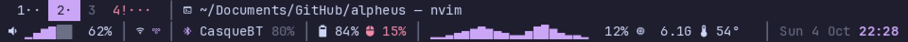
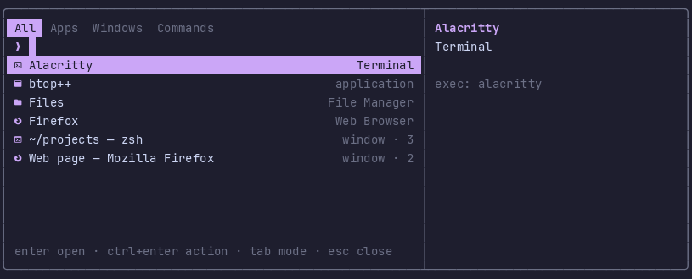
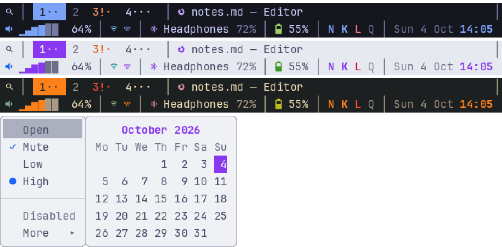

# alpheus

> *Alpheus*: the pistol shrimp, tiny and the fastest in the ocean.

A **lightweight, terminal-spirited** Wayland desktop shell, written in
Rust: what DankMaterialShell or Noctalia bring (bar, centralized settings,
notifications, OSD), **without their weight**. Aimed at modest hardware
with modern features.

## Memory

How much RAM a desktop shell keeps resident, measured as PSS
(`/proc/<pid>/smaps_rollup`) on the author's laptop (Hyprland, three
outputs). alpheus figures are release builds. Updated with every delivery.

### Compared with other shells

| Shell | Toolkit | Resident memory | What it covers |
|---|---|---:|---|
| **alpheus** (today, hybrid mode) | Rust, no toolkit | **≈ 71 MB** | bar ≈ 14 MB + mako, swayosd, swaybg still borrowed ≈ 57 MB |
| **alpheus** (target, everything replaced) | Rust, no toolkit | **≤ 120 MB budget** | bar, launcher, notifications, OSD, wallpaper |
| waybar + mako + swayosd + swaybg | GTK / C | ≈ 120 MB | bar, notifications, OSD, wallpaper |
| HyprPanel | GJS | ≈ 151 MB | bar, notifications, OSD (Hyprland only) |
| Wayle | Rust, GTK4 | ≈ 168 MB | bar, panels |
| ashell + swaync | Rust, iced | ≈ 194 MB | bar, notifications |
| Noctalia 4.7 | Quickshell (QML) | ≈ 517 MB | full shell (v5, a native C++ rewrite released in September 2026, not measured yet) |
| DankMaterialShell (trimmed) | Quickshell (QML) | ≈ 512 MB | full shell, sound/visualizer/weather/temperatures off |
| DankMaterialShell | Quickshell (QML) | ≈ 537 MB | full shell |
| Caelestia | Quickshell (QML) | ≈ 730 MB | full shell |

### alpheus, component by component

| Component | Memory | Notes |
|---|---:|---|
| Bar daemon, all modules + launcher, 3 outputs — at start | ≈ 8.1 MB | headless sway test, `tests/memory.rs`, recorded D-Bus services on a private bus; libdbus shared with the session; tray unused (≈ 8.8–8.9 MB with the tray and 10 fake items, but that test runs without the launcher module) |
| Bar daemon — after 8,300 events and 5 plug cycles | ≈ 8.9–9.2 MB | stable, 0 wake-ups at rest, the theme watch adds no wake-up, 6 threads (D-Bus through dbus-rs/libdbus: one thread; the launcher and the tray add none) |
| Tray, module present, no item | ≈ 0.4 MB | watcher + session connection only, no thread (376–392 KB) |
| Tray, 10 fake items (5 KDE-, 2 Qt-, 2 Chromium-style, 1 Steam-like) | ≈ 0.5 MB | 488–496 KB, ≤ 2 MB budget, `ten_fake_items_cost_at_most_2_mb`; menu and calendar popups freed on close (20 cycles: +32 KB in each of 3 runs) |
| Tray, linked in but unused (no `tray` in `modules`, no session bus) | +0.4–0.7 MB vs. the delivery before this one | one-time cost of a bigger binary (stripped 4.49 → 5.36 MB, +864 KB: libdbus linkage, menus, popups, calendar); measured back to back in release, a real cost, like the launcher's |
| Themes, linked in (9 presets, resolver, inotify watch, portal following) | +144–224 KB vs. the delivery before this one | one-time cost; binary 5.11 → 5.18 MiB (+76 KiB stripped); measured `c85c0df` vs this delivery, release, back to back, 2 runs each; an unused preset is rodata only |
| Themes, 50 reloads (3 outputs repainted each time) | +0–444 KB | `theme_reloads_no_growth`: 0 KB in four of five runs, 444 KB in the first run after a build; 0 loop wake-ups at rest after a reload |
| Bar daemon, live on the author's laptop (3 outputs) | ≈ 11.3 MB | real session, all modules — predates this merge, see note below |
| `pw-dump` child (sound source) | ≈ 2.5 MB | silent at rest |
| **alpheus resident total, live** | **≈ 14 MB** | bar + sound source — predates this merge, see note below |
| Launcher feature, linked in but never opened (no `launcher` in `modules` even) | +0.3–0.7 MB vs. the delivery before this one | one-time cost of a bigger binary (`nucleo-matcher`, `xkeysym`, `xkbcommon`'s Rust bindings) plus `libxkbcommon.so` itself (≈ 60 KB of it, `/proc/<pid>/smaps`); measured `c256d33` vs the launcher delivery, release, back to back — a real cost, not "noise" |
| Launcher, closed (socket only, nothing else resident) on top of that | +0 MB | no thread, timer or keyboard exists while closed |
| Launcher, open (typed query, keyboard bound) | ≈ +2.0–2.1 MB over closed | headless sway, 300 synthetic apps, `tests/memory.rs`, with dbus-rs |
| Launcher, open latency | ≈ 0.8–1.3 ms median (max 1.7–2.9 ms) | request accepted → first frame committed, 20 opens, with dbus-rs |
| Launcher, 50 open/close cycles | ≈ +0.1–0.2 MB vs. the post-warm-up baseline | 17 of them closed by a typed Escape, the rest by toggle, with dbus-rs |
| Launcher, 100,000-line dmenu | ≈ +6.6–6.8 MB open, back to +0.5 MB 1 s after cancel | worst-case dmenu size; memory released promptly on cancel; with dbus-rs |
| Control center (TUI) while open | ≈ 2 MB + its terminal | 0 at rest (not resident); the terminal dominates: alacritty ≈ 93 MB |
| Borrowed for now: mako / swaybg / swayosd | 6.6 / 1.4 / 49.5 MB | to be replaced by alpheus toasts and OSD |

> **Memory note:** absolute PSS shifts with machine state, by about ±0.5 MB
> between boots, because shared libraries are counted proportionally; the
> per-component deltas are the stable figures. Ranges are over 2–3 release runs
> (KB/1024, one decimal; 2 runs for the themes rows). The launcher rows come
> from the tray-delivery measurement (three runs); the themes rows from two
> alternated runs against the delivery before.
>
> **Note:** the "live" row above (≈ 11.3 MB), the resident total it feeds
> into (≈ 14 MB) and the hybrid-mode comparison in the shells table
> (≈ 71 MB) predate the move from zbus to dbus-rs, the launcher merge and
> the tray: they were measured before any of them. The headless sway rows
> above are measured with all of them; the live rows will be re-measured
> at the real-world trial of the tray (tray plan 2, task 21).

The control center (`alpheus`, TUI) is not resident: it opens on demand
and exits.

Hyprland and niri. Mouse and keyboard everywhere.

Sleep and screen power-off remain the job of dedicated tools (hypridle,
swayidle…): alpheus never touches them. On some outputs (DisplayLink in
particular), a misplaced power-off can freeze the machine.

> **Status**: ongoing personal project, used daily by its author on NixOS.
> It still depends on a few scripts from her configuration (`wm-set`,
> `shell-ctl`…); making them optional, with a neutral fallback, is the next
> step before use elsewhere.

## Features compared

The roadmap's yardstick: what DankMaterialShell and Noctalia offer, within a
fraction of their memory. ✅ done · 🚧 planned (delivery) · 💭 to decide ·
❌ out of scope by design · ➖ partial or through another tool.

| Feature | **alpheus** | DMS | Noctalia | ashell | waybar stack¹ |
|---|---|---|---|---|---|
| **Resident memory** | **≈ 14 MB** today, ≤ 120 MB target | ≈ 537 MB | — | ≈ 194 MB² | ≈ 120 MB |
| **Bar** | | | | | |
| Workspaces, active window | ✅ | ✅ | ✅ | ➖ | ✅ |
| Clock | ✅ | ✅ | ✅ | ✅ | ✅ |
| Calendar popup | ✅ month grid, locale first day, ISO weeks | ✅ | ➖ | ✅ | ✅ |
| Volume, network, Bluetooth, battery | ✅ | ✅ | ✅ | ✅ | ✅ |
| CPU, memory, temperature | ✅ | ✅ | ➖ | ✅ | ✅ |
| System tray (icons and menus) | ✅ Nerd Font glyphs, no images | ✅ | ✅ | ✅ | ✅ |
| Media (MPRIS) | 🚧 bar 5 | ✅ | ✅ | ✅ | ✅ |
| Notification counter, do-not-disturb | 🚧 bar 5 | ✅ | ✅ | ➖ | ➖ |
| Keyboard layout | 💭 | ✅ | ➖ | ✅ | ✅ |
| Privacy indicators (mic, camera, screen share) | 💭 | ✅ | ➖ | ✅ | ✅ |
| Weather | 💭 | ✅ | ✅ | ✅ | ➖ |
| **Panels** | | | | | |
| Control center (quick settings) | ✅ TUI (≈ 2 MB + terminal, only while open) | ✅ | ✅ | ➖ | ❌ |
| Power menu | ✅ TUI | ✅ | ✅ | ✅ | ❌ |
| Display settings | ✅ TUI (Hyprland) | ✅ | ➖ | ➖ | ❌ |
| Network, Bluetooth, per-app audio | ➖ TUI + nmtui, bluetui, wiremix | ✅ | ➖ | ✅ | ❌ |
| Notification center, history | 🚧 with the toasts | ✅ | ✅ | ➖ | ➖ |
| USB devices (debugging) | 🚧 TUI tab | ❌ | ❌ | ❌ | ❌ |
| **Launcher** | | | | | |
| Apps, run command, window switcher | ✅ | ✅ | ➖ | ❌ | ➖ |
| Script/dmenu mode | ✅ (fuzzel's exit codes) | ➖ | ➖ | ❌ | ✅ |
| Calculator, units, currencies, dates | 🚧 launcher 2 | ✅ | ➖ | ❌ | ❌ |
| System actions, Bluetooth/sound, SSH, web search | 🚧 launcher 3 | ➖ | ➖ | ❌ | ❌ |
| Emoji, files, clipboard history | 🚧 launcher 4 | ✅ | ➖ | ❌ | ➖ |
| **Other** | | | | | |
| Notification toasts | 🚧 (mako ≈ 6.6 MB until then) | ✅ | ✅ | ✅ | ✅ |
| OSD (volume, brightness) | 🚧 (swayosd ≈ 49.5 MB until then) | ✅ | ✅ | ✅ | ✅ |
| Colours from the wallpaper (matugen) | ✅ dark and light files, live | ✅ | ✅ | ❌ | ❌ |
| Colour themes, light/dark following the desktop | ✅ 9 presets, 7 hues per theme, per-module colours, auto light/dark, live reload | ✅ | ✅ | ➖ | ➖ |
| Bar styles (islands, powerline, floating…) | 🚧 themes 2 | ✅ | ✅ | ➖ | ➖ |
| Appearance settings | 🚧 TUI tab, themes 3 | ✅ | ✅ | ❌ | ❌ |
| Wallpaper management | 💭 | ✅ | ✅ | ❌ | ❌ |
| Lock screen | 💭 | ✅ | ✅ | ❌ | ❌ |
| Settings GUI | ➖ TUI + TOML | ✅ | ✅ | ❌ | ❌ |
| Dock, desktop widgets | 💭 | ➖ | ✅ | ❌ | ❌ |
| Screenshots, recording | 💭 | ➖ | ➖ | ❌ | ❌ |
| Idle and power management | ❌ left to hypridle (DisplayLink safety) | ✅ | ✅ | ✅ | ➖ |
| Shows on (layer-shell compositors: Hyprland, niri, sway, river, labwc…) | ✅ | ✅ | ✅ | ✅ | ✅ |
| Workspaces and windows read from | Hyprland, niri | 7 compositors | 6 compositors | Hyprland, niri, sway | many (one module each) |
| Extensions | script mode, no plugin API | ✅ | ✅ ~100 | ❌ | ➖ |

¹ waybar + mako + swayosd + fuzzel. ² ashell + swaync. Other shells'
features from their documentation (October 2026); memory measured on the
author's laptop.

## What's in the repository

A Cargo workspace of three crates:

| Crate | Role |
|---|---|
| `alpheus` | **Control center** as a TUI (ratatui), opened on demand |
| `alpheus-demon` | **Resident daemon**: the bar, one per screen (layer-shell) |
| `alpheus-commun` | Shared foundation: command execution, configuration, theme, access to system tools |

The TUI doesn't embed Wayland, the daemon doesn't embed ratatui: a test
checks this.

### The control center (`alpheus`)

Seven tabs: **Home**, **Sound**, **Network**, **BT** (Bluetooth), **Power**,
**Displays** (enable, place, set resolution and scale, profiles, with
automatic rollback after 15 s if not confirmed), **Theme** (choose a
theme, the light/dark mode and the module colours, with a preview; `--tab theme`).

| Key | Action |
|---|---|
| `1`…`6`, `Tab` / `Shift+Tab` | switch tabs |
| `Ctrl+P` | command palette (fuzzy search) |
| `/`, `Ctrl+F` | search a list |
| `F1`, `?` | help |
| `Esc` | go back; `q` quits |

`alpheus --tab <name>` opens directly on a tab (`home`, `sound`, `network`,
`bluetooth`, `power`, `displays`).

### The bar (`alpheus-demon`)

A line of monospace characters on the theme's bar colour, modules separated by
`│`, the active workspace on the theme's accent (see [Themes](#themes)).




Shipped: **launcher** (an icon that opens it, first module by default),
**workspaces** (one dot per window, empty workspace dimmed, the active one
on `accent_container`, urgent in `urgent`, click to go there, wheel to move to the next one), **active
window** (app icon and title), **volume** (gauge, wheel ±5 %, right click
mutes), **network** (link icon, VPN count), **Bluetooth** (device and its
battery), **battery** (laptop and peripherals; `warn` below 20 %, `error` below 10 %), **resources** (CPU graph,
memory, temperature), **tray** (status icons of running apps as Nerd
Font glyphs — or a letter —, left click activates, right click opens the
app's menu in a popup, keyboard and mouse), **clock** (a click opens the
month's calendar). Clicking a module opens the matching tab
of the control center. One bar per screen, screens plugged and unplugged
are tracked live. On a narrow screen, secondary modules disappear;
workspaces and the clock remain.

Coming next: now-playing and notifications, the OSD, notification toasts.

At rest the bar never wakes up except for its timers (the clock, and the
resources every 2 s when shown): measured 0 wake-ups at rest, ≈ 8.1 MB
of memory at start (≈ 8.8–8.9 MB with a tray of 10 items, launcher module off) and ≈ 8.9–9.2 MB under load,
on three outputs. The
compositor is only **read** (Hyprland or niri event stream); switching
workspace goes through a configurable command. Sound comes from
`pw-dump`, network, battery and Bluetooth from D-Bus (read-only),
resources from `/proc`. The tray talks to the session bus
(StatusNotifierItem, dbusmenu): one connection on the bar's own loop, no
thread. On Hyprland (any version; hyprwm/Hyprland#15729, fixed upstream in 0.56.2), the bar's keyboard interactivity stays None while a menu or the calendar grabs — detected from its `hyprland_*` globals.

### The launcher

A centred box (apps, open windows, `$PATH` commands, a script/dmenu mode
for shell scripts), opened and closed by the daemon itself — nothing of
it stays resident while closed, not even a thread.



`Tab`/`Shift+Tab` switches modes (All, Apps, Windows, Commands); typing
ranks results with [nucleo](https://github.com/helix-editor/nucleo)
(Helix's fuzzy matcher) plus frecency (most-used first on an empty
query). `Enter` runs a command or typed shell text in a held terminal
(stays open to read the output); `Ctrl+Enter` runs it detached. `alpheus-launch`
bridges to it over an owner-only socket (`toggle`, `close`, `--dmenu`
with fuzzel's exit codes, plus exit code 3 — daemon unreachable — the
only case where a script falls back to another menu). Measured in
**release** (headless sway, 300 synthetic apps): opening costs ≈ 1.9–2.1 MB
of PSS over closed, median open latency ≈ 0.8–1.3 ms, 50 open/close cycles
grow PSS by well under the 1 MB budget (measured 148–220 KB across runs),
0 wake-ups in 5 s at rest after use (2 in one of three runs). A 100,000-line dmenu peaks at
+6.6–6.8 MB and drops back to +0.5 MB a second after it is cancelled.

### Themes

Colours come from a **theme**: one of nine compiled-in presets, or your
wallpaper through [matugen](https://github.com/InioX/matugen). Each has a dark
and a light variant. The mode follows the desktop (the portal's
`org.freedesktop.appearance` `color-scheme`, read by the bar, which passes it
on to the control center) or is fixed. The bar, its popups, the launcher and the
control center change together. The bar picks up a new
`theme.toml`, `colors.toml` or `colors-light.toml` by itself, without a
restart: one inotify watch, nothing wakes at rest. If `~/.config/alpheus` is
itself a symlink (home-manager), the watch follows it to its target, so
replacing the link is not seen until the bar restarts (the bar logs it once at start).



```toml
# ~/.config/alpheus/theme.toml — every key optional
theme = "catppuccin"   # a preset below, or "wallpaper"
mode  = "auto"         # "auto" (follow the desktop), "dark", "light"
module_colors = "icons" # "none", "icons" (default), "full": see Module colours below

[colors]               # override any role, whatever the theme and mode
# accent = "#ff9e64"
```

With no `theme.toml`, or no `theme` key in it, alpheus uses `wallpaper` when
`~/.config/alpheus/colors.toml` exists (what it did before themes existed),
and `catppuccin` otherwise. An unknown name falls back to `catppuccin`, with
one line in the log.

| `theme` | Dark | Light |
|---|---|---|
| `catppuccin` | Mocha | Latte |
| `gruvbox` | dark | light |
| `tokyo-night` | Night | Day |
| `rose-pine` | main | Dawn |
| `everforest` | dark medium | light medium |
| `kanagawa` | Wave | Lotus |
| `solarized` | dark | light |
| `nord` | Nord | dark only |
| `dracula` | Dracula | dark only |

A preset with no light variant stays dark in light mode. Every preset is
checked for legibility in both modes by a test using WCAG contrast:
- text reaches 4.5:1 on the bar and the popups;
- secondary text and the state colours reach 3:1 on the bar.

Where an official colour falls short in a light variant, alpheus uses a
darker shade of it. Nord's bar sits on `nord0` rather than `nord1`, so that
its red stays readable.

A theme is 16 colours, named by use:

| Role | Used for |
|---|---|
| `bar_bg` | the bar's background |
| `pill_bg` | raised cells of the bar (a visible workspace) |
| `popup_bg` | menus, calendar, tooltip, launcher |
| `raised` | hover (reserved: no surface uses it yet; delivery 2) |
| `selection` | the selected row |
| `fg`, `fg_dim` | text, secondary text (frames are `fg_dim` at 40 %) |
| `on_accent` | text on an accent |
| `accent`, `accent_container` | the clock, the active workspace |
| `accent2` | checks and radios in menus |
| `accent2_container` | reserved (no surface uses it yet; delivery 2) |
| `ok`, `warn`, `error`, `urgent` | states: low battery is `warn`, critical `error`, an urgent workspace `urgent` |

#### Module colours

A theme also carries **seven hues**: `red`, `orange`, `yellow`, `green`,
`cyan`, `blue` and `purple`. Each preset takes them from its own palette
(darker shades in the light variants where the official one is too pale to
read, 3:1 on the bar at least). `module_colors` in `theme.toml` decides how
much of each module wears its hue:

| `module_colors` | Look |
|---|---|
| `none` | no hue: the bar looks as before the hues existed |
| `icons` (default) | each module's icon takes its hue |
| `full` | the icon and the module's text |

The mapping is fixed:

| Module | Hue |
|---|---|
| window title (its icon) | purple |
| sound | blue |
| network | cyan |
| Bluetooth | purple |
| battery | green |
| CPU (its graph) | orange |
| RAM | yellow |
| temperature | red |

Workspaces, the clock, the tray icons, the launcher button and the
separators keep their colours. **States win over the hue**: a low (`warn`) or
critical (`error`) battery, a hot temperature, a network with limited
connectivity, a charging battery (accent), a muted volume, an offline or
down module, an urgent workspace and a tray item that needs attention keep
their state colours whatever `module_colors` says. The Theme tab of the
control center has a "Module colours" row (None, Icons, Full) with a preview.

A colour file may carry the seven hues as optional keys (`red = "#f38ba8"`,
and so on); a hue that is absent is derived from Catppuccin's (Mocha for dark,
Latte for light) mixed 30 % toward the accent, so it stays in tune with the
theme. `[colors]` in `theme.toml` can override a hue like any role.

#### Wallpaper colours (matugen)

`theme = "wallpaper"` reads `colors.toml` (dark) and `colors-light.toml`
(light). If only the dark file exists, light mode uses it too. A file gives
the 16 roles above. The 7 keys of earlier versions (`bg fg accent muted
surface error ok`) still work, and the other roles are derived from them.

A matugen template for the 16 roles, `~/.config/matugen/templates/alpheus.toml`:

```toml
bar_bg            = "{{colors.surface_container_lowest.default.hex}}"
pill_bg           = "{{colors.surface_container_high.default.hex}}"
popup_bg          = "{{colors.surface_container.default.hex}}"
raised            = "{{colors.surface_container_highest.default.hex}}"
selection         = "{{colors.secondary_container.default.hex}}"
fg                = "{{colors.on_surface.default.hex}}"
fg_dim            = "{{colors.on_surface_variant.default.hex}}"
on_accent         = "{{colors.on_primary.default.hex}}"
accent            = "{{colors.primary.default.hex}}"
accent_container  = "{{colors.primary_container.default.hex}}"
accent2           = "{{colors.tertiary.default.hex}}"
accent2_container = "{{colors.tertiary_container.default.hex}}"
ok                = "{{colors.tertiary.default.hex}}"
warn              = "{{colors.amber.default.hex}}"
error             = "{{colors.error.default.hex}}"
urgent            = "{{colors.error_container.default.hex}}"
```

`amber` is a custom colour, tinted toward the wallpaper. The seven hues are
custom colours too, harmonised with the wallpaper: add these lines to the
template, in the same way (the keys are optional; without them alpheus
derives the hues from the accent):

```toml
red    = "{{colors.red.default.hex}}"
orange = "{{colors.orange.default.hex}}"
yellow = "{{colors.yellow.default.hex}}"
green  = "{{colors.green.default.hex}}"
cyan   = "{{colors.cyan.default.hex}}"
blue   = "{{colors.blue.default.hex}}"
purple = "{{colors.purple.default.hex}}"
```

One matugen configuration per mode, each writing its own file.
`~/.config/matugen/alpheus-dark.toml`:

```toml
[config.custom_colors]
amber  = { color = "#f9a825", blend = true }
red    = { color = "#f38ba8", blend = true }
orange = { color = "#fab387", blend = true }
yellow = { color = "#f9e2af", blend = true }
green  = { color = "#a6e3a1", blend = true }
cyan   = { color = "#94e2d5", blend = true }
blue   = { color = "#89b4fa", blend = true }
purple = { color = "#cba6f7", blend = true }

[templates.alpheus]
input_path = "~/.config/matugen/templates/alpheus.toml"
output_path = "~/.config/alpheus/colors.toml"
```

`alpheus-light.toml` is the same with `output_path = "~/.config/alpheus/colors-light.toml"`.
Then, at each wallpaper change:

```sh
matugen -c ~/.config/matugen/alpheus-dark.toml  image "$WALLPAPER" -m dark  -t scheme-vibrant
matugen -c ~/.config/matugen/alpheus-light.toml image "$WALLPAPER" -m light -t scheme-vibrant
```

`-t scheme-vibrant` gives livelier colours than matugen's default
(`scheme-tonal-spot`). The bar follows the new files on its own. Run from a
script with no terminal (a wallpaper hook), matugen cannot ask which of a
picture's dominant colours to use: add `--source-color-index 0` to pick the
first.

## Build

With Nix:

```sh
nix build .#alpheus          # the TUI
nix build .#alpheus-demon    # the bar
nix develop                  # dev shell: cargo, fonts, sway for tests
```

Without Nix, `cargo build --release` is enough for the TUI. The bar looks
for its fonts in `$ALPHEUS_FONTS` (set at build time by the flake),
otherwise in the system's.

## Configure

Everything is optional, under `~/.config/alpheus/`. An invalid file falls
back to default values with a warning, never a crash.

- `theme.toml`: the theme (a preset or the wallpaper), light/dark mode and
  per-role overrides; `colors.toml` / `colors-light.toml`: the wallpaper's
  colours, written by matugen. See [Themes](#themes); the bar follows changes
  without a restart, the control center reads them when it opens.
- `config.toml`: the TUI (keys, tools opened for sound, network,
  Bluetooth).
- `displays.toml`: screen profiles, written by the Displays tab.
- `bar.toml`: the bar.
- `launcher.toml`: the launcher (terminal command, result rows, history
  size, mode prefixes, the focus command); read fresh at each open,
  nothing kept while it is closed.

```toml
# bar.toml — default values
modules = ["launcher", "workspaces", "window", "media", "volume", "network",
           "bluetooth", "battery", "resources", "tray", "notifications", "clock"]
height = 22

[font]
family = "JetBrainsMono Nerd Font Mono"
size = 14.0
fallback = ["DejaVu Sans Mono"]  # for symbols the font lacks (✳ ◐…); setting the key replaces this default, [] disables it

[clock]
format = "%H:%M"
date = "%a %e %b"   # empty = no date
calendar = true     # a left click on the clock opens the month
week_numbers = false  # ISO week numbers in the calendar

[tray]
passive = "dim"     # "dim" | "show" | "hide": items that say they are idle
tooltips = true     # the item's name after ½ s of hovering

[tray.icons]        # glyph overrides, keyed like the built-in table (id, icon name, title, process)
# keepassxc = "󰌋"

[workspaces]
command = ["wm-set", "workspace", "{workspace}", "{output}"]

[battery]
peripherals = "always"   # "always" | "low" | "never": peripherals with a real percentage
coarse = "low"           # "always" | "low" | "never": peripherals with only a coarse level
```

Modules not yet shipped are accepted and ignored: a `bar.toml` written
today will stay valid.

## Principles

- **Lightness first.** An unused option costs nothing; no heavy dependency
  "for config". Budgets are checked by tests (memory and idle wakeups of
  the bar, measured on a headless sway).
- **Never `dpms`** nor sleep handling: turning off a screen on a
  DisplayLink output can freeze the machine.
- **No direct writes to the compositor**: only configurable commands.
- **Tests without a graphical session**: every command goes through an
  injectable executor, no test acts on the session.

## Documentation

- [`docs/SCOPE.md`](docs/SCOPE.md): why, budget, guardrails, breakdown.
- [`docs/specs/`](docs/specs/): the specifications (TUI, Displays tab,
  bar, launcher, tray, themes).
- [`docs/plans/`](docs/plans/): the implementation plans.

## License

[MIT](LICENSE) © 2026 Mae PUGIN
