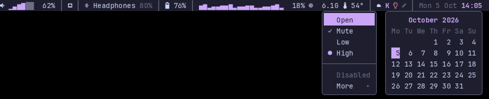

# alpheus

> *Alpheus*: the pistol shrimp, tiny and the fastest in the ocean.

A **lightweight, terminal-spirited** Wayland desktop shell, written in
Rust: what DankMaterialShell or Noctalia bring (bar, centralized settings,
notifications, OSD), **without their weight**. Aimed at modest hardware
with modern features.

## Memory

How much RAM a desktop shell keeps resident, measured as PSS
(`/proc/<pid>/smaps_rollup`) on the author's laptop (Hyprland, three
outputs). alpheus figures are release builds. Updated with every delivery.

### Compared with other shells

| Shell | Toolkit | Resident memory | What it covers |
|---|---|---:|---|
| **alpheus** (today, hybrid mode) | Rust, no toolkit | **≈ 15 MB** (to be re-measured) | bar ≈ 14 MB (live) + swaybg 1.4 MB (optional) borrowed (rows below); swayosd (7.6 MB) is no longer used since the OSD replaced it, and mako (6.7 MB) since the notifications did; the live bar figure predates several deliveries and is to be re-measured |
| **alpheus** (target, everything replaced) | Rust, no toolkit | **≤ 120 MB budget** | bar, launcher, notifications, OSD, wallpaper |
| waybar + mako + swayosd + swaybg | GTK / C | ≈ 55 MB (see the note below) | bar, notifications, OSD, wallpaper |
| HyprPanel | GJS | ≈ 151 MB | bar, notifications, OSD (Hyprland only) |
| Wayle | Rust, GTK4 | ≈ 168 MB | bar, panels |
| ashell + swaync | Rust, iced | ≈ 194 MB | bar, notifications |
| Noctalia 4.7 | Quickshell (QML) | ≈ 517 MB | full shell (v5, a native C++ rewrite released in September 2026, not measured yet) |
| DankMaterialShell (trimmed) | Quickshell (QML) | ≈ 512 MB | full shell, sound/visualizer/weather/temperatures off |
| DankMaterialShell | Quickshell (QML) | ≈ 537 MB | full shell |
| Caelestia | Quickshell (QML) | ≈ 730 MB | full shell |

### alpheus, component by component

| Component | Memory | Notes |
|---|---:|---|
| Bar daemon, all modules + launcher, 3 outputs — at start | ≈ 8.0 MB | headless sway test, `tests/memory.rs`, recorded D-Bus services on a private bus; libdbus shared with the session; tray unused: `startup_pss_per_source` ("everything", 3 runs: 8,144–8,246 KB); ≈ 8.4–8.5 MB with the tray and 10 fake items (`startup_pss_with_the_tray_under_15_mb`, 3 runs: 8,614–8,701 KB, without the launcher module) |
| Bar daemon — after 8,300 events and 5 plug cycles | ≈ 9.6–9.7 MB | stable, 0 wake-ups at rest, the theme watch adds no wake-up, 6 threads (D-Bus through dbus-rs/libdbus: one thread; the launcher and the tray add none) |
| Tray, module present, no item | ≈ 0.4 MB | watcher + session connection only, no thread (376–392 KB) |
| Tray, 10 fake items (5 KDE-, 2 Qt-, 2 Chromium-style, 1 Steam-like) | ≈ 0.5 MB | 488–496 KB, ≤ 2 MB budget, `ten_fake_items_cost_at_most_2_mb`; menu and calendar popups freed on close (20 cycles: +32 KB in each of 3 runs) |
| Tray, linked in but unused (no `tray` in `modules`, no session bus) | +0.4–0.7 MB vs. the delivery before this one | one-time cost of a bigger binary (stripped 4.49 → 5.36 MB, +864 KB: libdbus linkage, menus, popups, calendar); measured back to back in release, a real cost, like the launcher's |
| Themes, linked in (9 presets, resolver, inotify watch, portal following) | +144–224 KB vs. the delivery before this one | one-time cost; binary 5.11 → 5.18 MiB (+76 KiB stripped); measured `c85c0df` vs this delivery, release, back to back, 2 runs each; an unused preset is rodata only |
| Themes, 50 reloads (3 outputs repainted each time) | +0–444 KB | `theme_reloads_no_growth`: 0 KB in four of five runs, 444 KB in the first run after a build; 0 loop wake-ups at rest after a reload |
| Bar shapes, linked in (6 styles, corner masks, placement) | within noise (−48…+156 KB) vs. the delivery before this one | one-time cost; binary 5.20 → 5.24 MiB (+44 KiB stripped); measured `6a6df10` vs this delivery, release, back to back, 3 runs each, separate target directories; `flat` pays only the style match |
| Bar shapes, per style at start (all modules, 3 outputs) | flat ≈ 8.0 MB; others −76…+116 KB over flat | `startup_pss_per_style`, 3 runs (flat 8,142–8,224 KB: the same bar as the start row above); corner masks on first use −32…+88 KB (islands − flat), +36…+116 KB (floating − flat, its taller buffer included) (computed: 128 B for islands, 200 B for floating, at scale 1; one per radius and scale used) |
| Bar shapes, 48 style switches (3 outputs; floating reconfigures every bar) | +20 KB | `style_switches_no_growth`, +20 KB in each of 3 runs; 0 loop wake-ups at rest under each of the six styles (`at_rest_no_wakeups_under_each_style`) |
| Media, linked in but unused (no `media` in `modules`) | within noise (−52…+32 KB) vs. the delivery before this one | binary 5.24 → 5.33 MiB (+92 KiB stripped); measured `55ba754` vs this delivery, release, back to back, 3 runs each, separate target directories |
| Media module, no player (on the bar's own session connection, tray off) | 0–4 KB in mode `auto`; 286–395 KB in a fixed mode | `media_module_pss_without_and_with_players`, 3 runs (7.2–7.3 MB with it, 1 output): in mode `auto` that connection is the light/dark portal's, already open; in a fixed mode (`dark`) the module opens it, and the figure includes the connection itself; with the tray on it shares the tray's connection |
| Media, 3 fake players | 85–112 KB | same test, 3 runs; at most 16 players, strings capped at 256 characters, 8 artists |
| Media, 100 track changes | +0 KB | `track_changes_no_growth`, +0 KB in each of 3 runs (the titles reuse glyphs already drawn: the glyph cache's own bound is measured by the 8,300-events row); 0 loop wake-ups at rest with a player playing and the popup closed, tray on and off (`at_rest_no_wakeups_with_a_playing_player`); the popup's 1 s tick runs only while it is open and the track plays |
| Notifications, linked in but unused (no `notifications` in `modules`) | +122–248 KB vs. the delivery before this one | binary 5.34 → 5.47 MiB (+140 KiB stripped); measured `900a519` vs this delivery, release, back to back, 3 runs each, separate target directories |
| Notifications server and bell, serving with nothing (own session connection, tray off) | 0–4 KB | `notifications_pss_idle_history_and_bubbles`, 3 runs (10.9 MB with it, 1 output): in mode `auto` that connection is the light/dark portal's, already open, as for the media row; with the tray on, it shares the tray's connection |
| Notifications, 50-entry history | 192–198 KB | same test; capped: app 64 B, summary 256 B, body 1 KiB, 6 actions; history in memory only |
| Notifications, 4 bubbles shown | 326–774 KB, −84…+76 KB once closed | same test; their surface and pool exist only while a bubble shows; 0 loop wake-ups at rest with a sticky bubble shown and once every bubble went (`at_rest_no_wakeups_with_notifications`) |
| OSD, linked in but unused (no `osd` in `modules`) | within noise (−28…+172 KB) vs. the delivery before this one | binary 5.48 → 5.54 MiB (+56 KiB stripped); measured `1662cb4` vs this delivery, release, back to back, 3 runs each, separate target directories |
| OSD, module on, nothing shown | 0–96 KB | `osd_pss_idle_shown_and_gone`, 3 runs (10.9–11.0 MB with it, 1 output): the last sound state and three instants; no surface, no timer, no sysfs read until `alpheus-launch --osd brightness` |
| OSD, one pill shown | 4–30 KB, −38…−12 KB once gone | same test; its surface and pool exist only while it shows (1.3 s after the last change); a held key keeps one surface; 0 loop wake-ups at rest once it went (`at_rest_no_wakeups_after_the_osd`) |
| Quick settings, linked in but unused (no `quick` in `modules`) | +64…+196 KB vs. the delivery before this one | binary 5.59 → 5.70 MiB (+108 KiB stripped); measured `d483590` vs this delivery, release, back to back, 3 runs each, separate target directories, on the `everything` case of `startup_pss_per_source` (its `modules` list has no `quick`): the code linked in, unused |
| Quick settings, module on, panel closed | 96–108 KB | `quick_pss_idle_open_and_closed`, 3 runs (8.0 MB with it, 1 output): the power profile's state, read once from the system bus (no daemon: one GetNameOwner), and the sound tap; no surface, no timer, no sink list. With `quick` alone in `modules`, the D-Bus source thread may start for that profile (the default modules already run it) |
| Quick settings panel, open | 444–448 KB, +340–344 KB over idle once closed | same test; the closed figure is the first open's one-time warm-up, not a leak: `/proc/<pid>/smaps` shows the binary's code pages (≈ +320 KB) and the font file's (≈ +64 KB) now resident, the heap and the shm pool back to idle's; 20 more open/close cycles −18…+36 KB over closed; its surface and pool exist only while it shows; 0 loop wake-ups at rest once it closed (`at_rest_no_wakeups_after_the_quick_panel`) |
| Quick settings' Wi-Fi, linked in (delivery 2) | +176…+372 KB vs. delivery 1 | binary 5.70 → 5.83 MiB (+136 KiB stripped); measured `dbb90b8` vs this delivery, release, back to back, 3 runs each, separate target directories, on the `everything` case of `startup_pss_per_source` (no `quick` there), nine pairings: code linked in, unused. smaps at startup (one run each): the binary's resident code pages +244…+308 KB and its data +24 KB; heap, fonts and libraries unchanged within noise (the shm pools and anonymous memory move ±110 KB between runs) |
| Quick settings, Wi-Fi detail open (40 access points, 32 listed) | 1,018–1,034 KB over the panel's module at rest, +656…+672 KB of the daemon's own once closed (+84…+100 KB of it anonymous) | `quick_wifi_pss_detail_open_and_closed`, 3 runs (8.0–8.1 MB at rest, 1 output; re-measured with the VPN row in the panel, VPN delivery's final fix wave): the D-Bus thread reads the access points and saved profiles only while the detail is open (five match rules, removed with it; a socket pair wakes it, no thread, no timer). Once closed, smaps: the binary's code pages +192 KB and the font file's +384 KB touched by the first open (file-backed, clean, one-time; how many depends on page-cache fault-around and the tests run before), the main heap (most likely the painter's glyph caches, bounded), the shm pools −56 KB; the D-Bus thread's arena back to idle's. The test bounds anonymous memory only (heap, thread arenas, stacks, the binary's written data; pools apart): closed ≤ rest + 256 KB, 10 more cycles ≤ closed + 128 KB (measured +0…+40); total PSS and the file-backed share are printed, not asserted. 0 loop and 0 D-Bus-thread wake-ups at rest after (`at_rest_no_wakeups_after_the_wifi_detail`) |
| Quick settings' Bluetooth, linked in (delivery 3) | +12…+208 KB vs. delivery 2 | binary 6.07 → 6.24 MiB (+168 KiB stripped); measured `9401cec` vs this delivery, release, back to back, 3 runs each, separate target directories, on the `everything` case of `startup_pss_per_source` (no `quick` there), nine pairings: code linked in, unused |
| Quick settings, Bluetooth detail open (20 devices) | +1.1–1.8 MB over the panel's module at rest, +412…+516 KB once closed | `bluetooth_detail_pss_with_20_devices_and_after`, 8 runs (8.3–8.4 MB at rest, 1 output): the D-Bus thread reads the devices only while the detail is open (no rule added). Open, the daemon's own memory +436…+540 KB and the shm pools +774…+1,240 KB (4 runs), the moving part (most likely the detail growing one row per device found while it is open, its buffers re-made at each height), all gone with the popup; the closed figure is the daemon's own (the first open's code, font and glyph-cache pages, as for the Wi-Fi detail), the pools back to idle's. 10 more cycles +40…+64 KB; 0 loop, 0 D-Bus-thread and 0 whole-daemon wake-ups at rest after (`bluetooth_at_rest_no_wakeups_after_the_detail`, 5 runs) |
| Quick settings, Bluetooth acting connection | +54…+116 KB | `bluetooth_acting_connection_cost`, 5 runs (the detail with it against the rows without it): a second system-bus connection with the pairing agent, open only while the detail is open or a call is in flight; no thread (6 either way); 0 loop wake-ups in 5 s while it idles |
| Quick settings, Bluetooth headset row | +12…+20 KB | `bluetooth_headset_row_cost`, 5 runs (the rows on a Bluetooth headset against a wired sink): the bluez5 device and its profiles kept from `pw-dump` (≤ 8 devices × 32 profiles), one row more |
| Quick settings' VPN, linked in (delivery 4) | +5…+64 KB vs. the spec commit `12401fd` (one run read −438 KB: that run's whole new build read 0.2–0.6 MB low on every case, a boot shift) | binary 6.63 → 6.70 MiB (+68 KiB stripped); measured `12401fd` vs this delivery, release, back to back, 3 runs each, separate target directories, on the `everything` case of `startup_pss_per_source` (no `quick` there): code linked in, unused |
| Quick settings, VPN detail open (10 profiles) | 846–854 KB over the panel's module at rest, +696…+704 KB of the daemon's own once closed (+60…+68 KB of it anonymous) | `quick_vpn_pss_detail_open_with_10_profiles_and_after`, 3 runs (8.0–8.1 MB at rest, 1 output; final fix wave): the D-Bus thread lists the profiles and reads their settings (no secret) only while the panel is open. Closed, the figure is the first open's one-time warm-up (smaps: the binary's code pages +192, the font file's +384…+448, the main heap), not a leak: the test bounds anonymous memory only, closed ≤ rest + 256 KB and 10 more cycles ≤ closed + 128 KB (measured +4…+72), the pools back to idle's; 0 loop, 0 D-Bus-thread and 0 whole-daemon wake-ups at rest after (`at_rest_no_wakeups_after_the_vpn_detail`, which also checks that a VPN change after the close is read by the network domain alone) |
| UI refresh, linked in (lighter bar, quick switches, six presets in the daemon; rail, dashboard and shapes in the TUI) | within noise at start (`everything` +4…+32 KB in two pairings, −160 in the third; `plan 1` −64…−68, `+ privacy` −124…−80) vs. the delivery before this one | daemon binary 6,812,592 bytes both sides (6.50 MiB, same size, different bytes; the CPU history and the gauge are gone, the switches and labels are in), TUI binary 1.48 → 1.54 MiB (+60 KiB stripped); measured `d9b8965` vs this delivery, release, back to back, 3 runs each, separate target directories, on `startup_pss_per_source`. One `+ resources` pairing reads +272 KB because that base run read 8,271 KB against 8,607–8,611 in its two others (the same case on this delivery: 8,535–8,543); `+ sound` −156…+32 |
| UI refresh, quick panel | module at rest 0–104 KB (base 0–100); open 316–338 KB over rest (base 256–274); closed +208…+210 KB over rest (base +126…+148, the first open's one-time warm-up); 20 more cycles −28…−4 KB over closed (base −2…+44) | `quick_pss_idle_open_and_closed`, 3 runs each (the 0–100 KB "module at rest" is not a cost of the module: an anonymous-memory step of ~110 KB that flips on both trees, smaps-attributed by the final review of small features 2): the panel costs +60…+80 KB more open and after its first open than before (most likely the switch and labelled-button drawing's code and glyph pages, not attributed with smaps); within the test's bounds (closed ≤ idle + 512 KB, 20 cycles ≤ closed + 128 KB); 0 loop and 0 whole-daemon wake-ups at rest after (`at_rest_no_wakeups_after_the_quick_panel`) |
| Control center (TUI), first render of the dashboard | 0.43–0.75 ms | `first_render_of_the_dashboard_under_100_ms_even_with_slow_tools`, release, 3 runs (120×36, tools answering after 500 ms); budget 100 ms |
| Bar daemon, live on the author's laptop (3 outputs) | ≈ 11.3 MB | real session, all modules — predates this merge, see note below |
| `pw-dump` child (sound source) | ≈ 2.5 MB | silent at rest |
| **alpheus resident total, live** | **≈ 14 MB** | bar + sound source — predates this merge, see note below |
| Launcher feature, linked in but never opened (no `launcher` in `modules` even) | +0.3–0.7 MB vs. the delivery before this one | one-time cost of a bigger binary (`nucleo-matcher`, `xkeysym`, `xkbcommon`'s Rust bindings) plus `libxkbcommon.so` itself (≈ 60 KB of it, `/proc/<pid>/smaps`); measured `c256d33` vs the launcher delivery, release, back to back — a real cost, not "noise" |
| Launcher, closed (socket only, nothing else resident) on top of that | +0 MB | no thread, timer or keyboard exists while closed |
| Launcher, open (typed query, keyboard bound) | ≈ +2.0–2.1 MB over closed | headless sway, 300 synthetic apps, `tests/memory.rs`, with dbus-rs |
| Launcher, open latency | ≈ 0.8–1.3 ms median (max 1.7–2.9 ms) | request accepted → first frame committed, 20 opens, with dbus-rs |
| Launcher, 50 open/close cycles | ≈ +0.1–0.2 MB vs. the post-warm-up baseline | 17 of them closed by a typed Escape, the rest by toggle, with dbus-rs |
| Launcher, 100,000-line dmenu | ≈ +6.6–6.8 MB open, back to +0.5 MB 1 s after cancel | worst-case dmenu size; memory released promptly on cancel; with dbus-rs |
| Launcher 2 (prefixes `?` `:` `$`, window switcher, 1,906 emoji), linked in | −91…+106 KB at start (`everything` of `startup_pss_per_source`, 3 pairings, the harness drifts: trust the deltas) | binary 6.63 → 6.70 MiB stripped (+64 KiB: the emoji table's text is 43 KiB of read-only data, paged in only when `:` is used, the rest code); measured `95b4242` vs this delivery, release, back to back, 3 runs each, separate target directories |
| Launcher, open with `:face` typed | +1.2–1.3 MB over closed | `launcher_prefixes_pss_open_and_closed`, 3 runs (9.4–9.6 MB closed, 1 output, 300 synthetic apps); closed again +32…+49 KB; the first open warms code and font pages once (+0.53–0.58 MB), so closed is read after one warm-up cycle |
| Window switcher, open after 20 paced and 20 back-to-back steps (three windows) | +1.0–1.2 MB over closed: the daemon's own memory +144…+296 KB, the box's shm pool +878 KB (its two frames, mapped 1,756 KB, shared with the compositor) | `windows_switcher_pss_and_rest`, 3 runs under headless sway (8.1–9.2 MB closed); paced and back to back read the same (a draw with both buffers busy waits for a release instead of allocating; before the final review a burst grew the pool to ≈ +4 MB); closing frees it all (closed again +7…+21 KB) |
| Window switcher, after a cycle | 0 loop wake-ups in 5 s | same test, 3 runs: `--windows`, 20 steps, Escape |
| Launcher command sources, linked in but none configured | within noise of the delivery before this one (−4…+92 KB closed; +0.1–0.2 MB open) | one-time cost of a bigger binary (stripped 5.54 → 5.59 MiB); measured back to back in release, 3 runs each, separate target directories |
| Launcher, open with a 300-line command source | ≈ +2.4–2.5 MB over closed (≈ +1.9–2.4 MB with no source) | headless sway, 300 synthetic apps, `tests/memory.rs` `launcher_sources_pss_latency_and_rest`, 3 runs |
| Launcher, a 300-line source's entries | ≈ 15–17 ms after the request (median of 21 opens) | the box shows first: open latency ≈ 1.7–2.2 ms median against 1.6–1.9 ms with no source; 0 wake-ups at rest after; the harness drifts between runs: trust the deltas |
| Control center (TUI) while open | ≈ 2 MB + its terminal | 0 at rest (not resident); the terminal dominates: alacritty ≈ 93 MB |
| Sway and Mango backends, linked in | +132…+140 KB vs. the delivery before this one | binary 5.83 → 5.97 MiB (+140 KiB stripped); measured `2b137f0` vs this delivery, release, back to back, 3 runs each, separate target directories, on the `everything` case of `startup_pss_per_source` (the fake Hyprland on both sides): the code linked in, unused |
| Bar daemon under Sway and under Mango, all modules, 3 outputs — at start | Sway 8.9–9.0 MB, Mango 8.9 MB (the fake Hyprland 8.9–9.0 MB in the same runs; Sway −16…+68 KB, Mango −136…−44 KB against it) | `startup_pss_per_backend`, 3 runs: Sway is the headless sway itself, read through its i3 IPC (two connections on the existing compositor thread), Mango a fake socket serving the real 0.18 captures (two watch connections, one `poll`); 6 threads under each; 0 compositor-thread wake-ups at rest under both (`at_rest_no_wakeups_under_sway_and_mango`; 0 whole-daemon wake-ups in 5 runs of 6; 2 once under Mango, in run 1, the full memory suite, cause not investigated, the compositor thread at 0 throughout) |
| Power button, linked in but unused (no `power` in `modules`) | −8…+84 KB over six pairings; one run read +288…+336 KB on all three of its pairings (its resources step moved too; a boot shift believed, not proven) vs. the delivery before this one | binary 5.97 → 5.97 MiB (+8 KiB stripped); measured `242c686` vs this delivery, release, back to back, 3 runs each, separate target directories, on the `everything` case of `startup_pss_per_source` (no `power` there): the code linked in, unused |
| Power button, menu closed | 184–192 KB | `power_menu_pss_idle_open_and_closed`, 3 runs (7.4 MB with it, 1 output): a one-cell segment; no surface, no timer; of those, ≈ +128 KB are new pages of the same Nerd Font file already mapped (⏻ U+23FB is in it, no other face is loaded; the kernel's fault-around adds to it) and ≈ +64 KB the module's code pages: file-backed, clean, paid once |
| Power menu, open | 432 KB, +280 KB over idle once closed | same test; the closed figure is the first open's code and font pages; 20 more open/close cycles +12 KB over closed; its surface and pool exist only while it shows, its timer only while reboot or power off asks; 0 loop wake-ups at rest once it closed, a pending question included (`at_rest_no_wakeups_after_the_power_menu`) |
| Privacy indicators, linked in but off (no `privacy` in `modules`) | −80…+116 KB at start vs. the delivery before this one (the `everything` case, nine pairings; the `plan 1` case −160…+60 KB) | binary 5.97 → 6.05 MiB (+76 KiB stripped); measured `457cf5d` vs this delivery, release, back to back, separate target directories, 3 outputs, 3 runs each of `startup_pss_per_source` and of two variants dumping `/proc/<pid>/smaps` and `status` at the same 3 s point (8.78–8.87 MB before, 8.79–8.89 MB after). The smaps split (`everything`): the binary's code pages +68 KB and its read-only data −56 KB (RssFile +12 KB), heap −12…+36 KB, shm pools unchanged (660 KB in both trees), other anonymous memory one 112 KB step either way in both trees (startup timing): the code linked in, unused, and nothing allocated. A first measurement read +344…+440 KB; its base runs read ≈ 0.4 MB low against the same commit and binary, a harness shift not reproduced since |
| Privacy indicators, module on at start | −88…+120 KB over the same bar without it (8.79–8.90 MB) | same test, 6 runs; the fake `pw-dump` serves a full-size initial graph (the sound fixture's dump), so this is the "large graph" figure: the capture model keeps only the nodes and links that matter (≤ 1,024 nodes, 4,096 links) |
| Privacy indicators, a capture shown | −60…+26 KB, −50…−28 KB once it ended | `privacy_pss_with_a_capture_and_after`, 3 runs (8.0–8.1 MB idle, 1 output); no surface unless the popup opens; 20 more capture cycles +16…+30 KB; 0 loop wake-ups at rest after a capture and 0 for the whole daemon (`at_rest_no_wakeups_after_a_capture`): the 0.5 s off-delay timer is armed only while an indicator is going off |
| Privacy indicators, a camera opened directly | one-time cost −236…+100 KB (`everything`; one base run read 9.35 MB, a boot shift); module on at start +84…+192 KB (`+ privacy`) vs. `5d8fd55`, 3 runs each, retaken once the harness points every test daemon's `[privacy]` at empty directories (about 9.0–9.2 MB, 3 outputs); a holder shown −38…+70 KB over idle, 0…+4 KB once gone, +20 cycles +32…+64 KB (8.5–8.6 MB, 1 output) | binary 6.05 → 6.07 MiB (+24 KiB stripped); `privacy_camera_pss_and_rest`, 3 runs; 0 loop and 0 whole-daemon wake-ups in 5 s after the holder went (the 300 ms scan timer and the 0.5 s off-delay are armed only after a trigger); the scan stays on the event loop: median 4.0–4.1 ms on 120 processes × 30 descriptors (the daemon scans only its own user: 93 processes and 2,726 descriptors measured on the workstation), 14–15 ms on a synthetic 500 × 20 tree, the worst case seen |
| Displays (output protocol), linked in but off | one-time cost +4…+168 KB (`everything` of `startup_pss_per_source`, nine pairings; no `displays` in that case) | binary 6.25 → 6.49 MiB (+244 KiB stripped); measured `dc4793a` vs this delivery, release, back to back, 3 runs each, separate target directories. `+ sound`, `+ D-Bus` and `+ resources` read about +124…+504 KB higher on the new build with no code change on those paths and `displays` absent from those cases: base-side harness spread (the base's `+ resources` read below its `plan 1` in run 1), not a cost |
| Displays, module on at start | +56…+204 KB with 1 output, −36…+36 KB with 3 | `displays_pss_at_start`, 3 runs (8.8–9.0 MB with 1 output, 9.3 MB with 3): heads and modes read at bind; bound base + 512 KB; 0 loop and 0 whole-daemon wake-ups at rest |
| Displays, trials and hotplug | trial open −46…+8 KB over idle; 20 more trials +0 KB; 20 hotplug cycles +40…+44 KB, then **+8 KB** between cycles 21 and 41 and +0…+8 KB to 61 | `displays_pss_after_trials`, `displays_pss_after_hotplug_cycles`, 3 runs each, the daemon's own memory (PSS without the shm pools; checkpoint bound 32 KB). The pools are printed only: the bar's SCTK `RawPool` remaps on a resize (84…220 KB, also with the module off). 0 loop and 0 whole-daemon wake-ups after a trial (16 s) and after the cycles (10 s). A 64 KiB `displays.toml` raises the heap ≈ 2.8 MB once (the parse peaks ≈ 44× the file's size), re-parsed at each debounce end; a real file of a few profiles costs 20–60 KB |
| Small features 1 (battery alerts, rules, timed do-not-disturb, calculator), linked in | +24…+88 KB vs. the delivery before this one | binary 6.50 → 6.59 MiB (+98 KiB stripped); measured `697fea2` vs this delivery, release, back to back, 3 runs each, separate target directories, on the `everything` case of `startup_pss_per_source` (9,256–9,266 → 9,290–9,344 KB): code linked in |
| 32 notification rules, four battery thresholds and `dnd_while_sharing` configured | −420…+64 KB at start | `small_features_cost_nothing_at_start`, 3 runs, 3 outputs, both bars with `notifications`, `battery` and `privacy` (8.6–8.8 MB; one base run read 9.1 MB, a boot shift: trust the −56…+64 KB of the other two): bounded at 128 KB; the rules are 32 short strings and the thresholds four numbers |
| Timed do-not-disturb on | 0 loop wake-ups in 10 s | `at_rest_no_wakeups_with_a_timed_dnd`, 3 runs: one timer armed at the end, nothing before it (a 1 s timer reads 10 wake-ups in 10 s: the test bites) |
| Calculator, open with `6*7` typed | +778–790 KB over closed | `launcher_calc_pss_open_and_closed`, 3 runs (9.4–9.5 MB closed, 1 output, 300 synthetic apps); closed again 0…+16 KB; the first open of any launcher box also warms code and font pages once (+390…+422 KB, the same with a plain toggle), so closed is read after one warm-up cycle |
| Calculator, after a cycle | 0 loop wake-ups in 5 s | `at_rest_no_wakeups_after_a_calc_cycle`, 3 runs: open with `--calc`, `6*7` typed, Escape |
| Small features 2 (resources `net`, `disk`, `gpu`; do-not-disturb duration), linked in | −12…+112 KB vs. the delivery before this one (`everything`, 3 pairings; `+ resources` +332, −116, +332 KB: the base read 8,220, 8,656 and 8,220 against 8,540–8,552 on this side, harness spread, those cases leave the new items off) | binary 6.59 → 6.63 MiB (+40 KiB stripped); measured `1595029` vs this delivery, release, back to back, 3 runs each, separate target directories, on `startup_pss_per_source` (`everything` 9,199–9,311 → 9,275–9,311 KB): code linked in. The quick panel's figures did not move (module on 0–100 KB, open +338–342 KB over idle, closed +208–212 over idle against +268–272 on the base, 20 more cycles +36–40 KB); 0 wake-ups at rest with a timed do-not-disturb on both sides |
| Resources with every item (`cpu`, `memory`, `temperature`, `net`, `disk`, `gpu`) | +140…+248 KB over the default three | `resources_pss_default_and_every_item`, 3 runs, 1 output, interval 1 (8.1–8.2 MB with the default items, 8.34 MB with all six; smaps splits the one-time part into the binary's code pages +64 KB, the font file's pages +64 KB for the new glyphs and the heap +16…+20 KB; the test bounds it at +384 KB, and bounds what ~60 more passes keep at +64 KB of the daemon's own memory, pools left out); same tick: 14, 15 and 17 loop wake-ups in 5 s at interval = 1 (`resources_every_item_ticks_at_the_same_rate`, bound 4..=20; halving the period reads 24), no timer, thread or watch added |
| Event hooks, linked in (no `[hooks]` set) | −967…−188 KB vs. the delivery before this one (`everything`, 3 pairings: base 9,558, 8,759 and 8,827 against 8,591, 8,571 and 8,638 KB; the first base run read high, a boot shift, and the other machine sessions running tests at the same time widen the spread): nothing measurable | binary 6.71 → 6.77 MiB (+56 KiB stripped); measured `4bb311a` (the plan's commit, just before the code) vs this delivery, release, back to back, 3 runs each, separate target directories, on the `everything` case of `startup_pss_per_source` (no `[hooks]`, so the model is `None` and every feed point is one `Option` check): code linked in, unused |
| Every hook set (all eleven, one stub command) | +0…+64 KB of anonymous memory at start (PSS without the shm pools −15…+64 KB) | `hooks_pss_at_start_and_after_fires`, 3 runs (8.0–8.1 MB own memory, default modules, 1 output) against the same bar without `[hooks]` on the same build, one daemon at a time; the bound is on anonymous memory because the font file's and the binary's pages in the PSS moved ±200 KB between two identical daemons (a first run of the test on PSS read +289 KB after the burst, +163 KB of it the font file's) |
| Hooks, after a burst of 25 do-not-disturb changes | +20…+32 KB of anonymous memory over start (PSS +45…+96 KB, file pages) | same test: five paced runs, then twenty back to back (some run, the rest throttled, one `hook: dnd throttled` line); the test bites (a 16 KB leak per event reads +416 KB) |
| Hooks, at rest after a burst | 0 loop and 0 whole-daemon wake-ups in 5 s | `at_rest_no_wakeups_with_hooks`, 3 runs: no timer, watch or thread: the bucket and the quiet window are timestamps compared when an event comes, and a hook's process is the executor's detached child (a 1 s repeating timer in the event path reads 5 wake-ups: the test bites) |
| Resources popup, linked in (the history ring is always kept while the module is on) | one-time cost −1,041…+197 KB (`everything` of `startup_pss_per_source`, 3 pairings; `+ resources` −961…+338): within the harness spread of this run, which was shared with other sessions (the same base binary read 8.5–9.4 MB across runs) | binary 6.71 → 6.74 MiB (+24 KiB stripped); measured `f955878` vs this delivery, release, back to back, 3 runs each, separate target directories. The ring is about 3 KB (pinned by a test), so its cost at rest is below what PSS can show: `resources_history_full_keeps_nothing_more` bounds `Pss_Anon` (smaps_rollup: no file pages, no shm pools) at +64 KB between 30 s and 70 s at interval = 1 (ring full and wrapped; measured 0 KB in 3 runs, 1,388–1,396 KB; 4 KiB per push reads +160 KB) |
| Resources popup, open / closed / 20 more cycles | open +532…+544 KB over rest (bound 1,024); once closed `Pss_Anon` (smaps_rollup: heap and caches, no file pages, no shm pools) is +40…+44 KB over rest (1,380–1,396 KB at rest; bound 256), 20 more cycles +44…+60 KB (bound 128, each cycle open across two ticks; the mutation of 16 KiB per repaint reads +732…+744 KB, red in 5 of 5 runs); the shm pools closed −110 KB vs rest (bound +128) | `resources_popup_pss_idle_open_and_closed`, 3 runs, 1 output; 0 loop and 0 whole-daemon wake-ups in 10 s at rest after three cycles (`at_rest_no_wakeups_after_the_resources_popup`, interval = 60); the module's tick unchanged: 12–15 loop wake-ups in 5 s at interval = 1 (`resources_tick_at_the_configured_interval`, base 12–15) |
| Focus timer, linked in with the idle chip | −269…+222 KB at start vs. `f955878` (`everything`, which now includes the chip: 8,934 / 8,656 / 8,873 KB base against 8,665 / 8,878 / 8,797 on this side; harness spread, no cost seen) | binary 6.71 → 6.77 MiB (+60 KiB stripped; `alpheus-launch` +4 KiB); measured back to back, 3 runs each, separate target directories, on `startup_pss_per_source`; every other case within the same spread |
| Timer, idle chip | +24…+48 KB over the same bar without it | `timer_pss_idle_running_and_popup`, 3 runs (7.0–7.9 MB, 1 output; the shm pools 112 KB apart from the module): one glyph and a cell, nothing resident, no timer, no file read while idle |
| Timer running / popup open | running +0…+4 KB of the daemon's own memory over idle; popup closed +88…+92 KB over running (the first open's code and font pages), 20 more cycles +16…+27 KB (bound 64 KB) | same test; one run's reading dropped by ≈ 0.5 MB between the running and closed readings (a harness shift, printed, not counted). Wake-ups: 0 idle and paused (`at_rest_no_wakeups_with_the_timer_idle_or_paused`); 4 in 65 s with a countdown running (two repaints, the chip's and the clock's, each a tick and a buffer release) (`timer_running_wakes_about_once_a_minute`, a one-second tick reads 68); 10 in 5 s with the popup open (the one-second tick and the previous buffer's release: two per repaint, traced), 0 in 5 s right after it closed by a click, a barrier verb having waited for the close's replies (`timer_popup_ticks_each_second_only_while_open`; closed by the verb, 1 in two of three runs when the window opens before the flush: the close's own round trip, the buffer destroys and the keyboard release answered by `delete_id` and `leave`) |
| Quick notepad (`--notes`), linked in (the buffer, the file store, paste through the data device) | −361…−44 KB at start vs. the delivery before this one (`everything` of `startup_pss_per_source`, 3 pairings; every other case −833…−111 KB too, the third base run reading ≈ 0.6–0.8 MB high on all rows: harness spread, so a cost of the linked-in code is not visible) | binary 6.71 → 6.84 MiB (+128 KiB stripped); measured `f955878` vs this delivery, release, back to back, 3 runs each, separate target directories. The `wl_data_device_manager` is bound once at start (one protocol object): its share shows only in that `everything` row and is inside the noise; the data device itself exists only while the pad is open |
| Quick notepad, open with 2,000 characters typed | +794…+985 KB PSS over closed (3 runs) | `notes_pss_open_and_closed` (7.4–7.6 MB cold, 1 output; the pool, the text and the data device exist only while it shows); the first open also warms code and font pages once (+0.3–1.5 MB of file-backed PSS, the same as any box), so closed is read after one warm-up cycle |
| Quick notepad, closed again | +0…+92 KB of anonymous memory over the warmed closed figure (3 runs); anonymous memory 1.40–1.41 MB cold, 1.48–1.50 MB warmed | the same test; its bounds are on `Anonymous:` (smaps_rollup), because total PSS moves ±1 MB with what other processes share and with the page cache; total PSS and the file-backed share are printed |
| Quick notepad, at rest | 0 loop wake-ups in 5 s after a close, and 0 in 5 s with the pad open and saved | `at_rest_no_wakeups_after_notes`: the first window opens 1.1 s after the close (past SCTK's one key-repeat firing), the open-and-saved one is closed by the verb after it (never a scheduled key, which could land inside it); a save timer left re-arming every second makes the open-and-saved window read 5 |
| Clipboard history, linked in but off (no `[clipboard] enabled`) | −256…+80 KB at start (`everything` −140, −140, −52; `plan 1` +80, +78, −256, 3 pairings: the harness drifts, trust the deltas) | binary 7,390,128 → 7,533,488 bytes stripped (+140 KiB: code, no allocation); measured `1efa8dd` vs this delivery, release, back to back, 3 runs each, separate target directories; off, no protocol object is bound and nothing is allocated |
| Clipboard history, on, nothing copied (`+ clipboard`) | +160, +64, −24 KB over `everything` | `startup_pss_per_source`, 3 runs (bound 256 KB); the data-control manager and device, no timer, no thread |
| Clipboard history, full (50 × 4,000 bytes) | +164…+188 KB of anonymous memory over rest; 100 more copies +4 KB; cleared back to about rest | `clipboard_full_history`, 3 runs (bounds 384 / 64 KB on `Anonymous:`; PSS printed: +290…+430 KB); the history, its previews and the one read buffer, all wiped when removed |
| Clipboard history, launcher open on 50 entries | +1.0–1.14 MB PSS over closed; after 2 warm-up and 4 more cycles −112…+12 KB of anonymous memory | `clipboard_launcher_open_and_closed`, 3 runs (bound 128 KB); the first open warms code and font pages once |
| Clipboard history, at rest | 0 loop wake-ups in 5 s after copies and after a `--clipboard` cycle | `at_rest_no_wakeups_after_copies`, 3 runs; the 1 s read deadline is armed only while a read is pending |
| Shield mode, linked in (unconfigured: no `[shield]`) | −4…+214 KB at start (`everything` of `startup_pss_per_source`: 9,178 / 9,933 / 9,070 KB base against 9,174 / 9,181 / 9,284 on this side; `plan 1` −504…+437: the harness drifts, trust the deltas) | binary 7,541,680 → 7,590,864 bytes stripped (+48 KiB: code, no allocation); measured against `2a94055` (the merge of the clipboard into the Shield branch, so the figures are the Shield's alone), release, back to back, 3 runs each, separate target directories; unconfigured: no watch descriptor, no segment, no row, nothing allocated |
| Shield mode, configured, at rest | `Anonymous:` +0…+8 KB with the mode off, +28 KB with it on, over unconfigured (1,416 KB; bound 64); PSS −422…+72 KB off and +162…+732 KB on (file pages: the glyph's font and the code, file-backed) | `shield_pss_at_rest_unconfigured_and_configured`, 3 runs (7.5–8.9 MB, 1 output, the Shield row first): one inotify watch in the theme watch's instance, no thread, no timer |
| Shield detail open on 10 blocked devices | ≈ +0.6 MB PSS over rest (+551…+690 KB in 3 runs: spread, the page cache moves it); once closed `Anonymous:` +64…+68 KB over rest (1,440–1,444 KB; bound 256), the pools back below rest's; 10 more cycles +64…+68 KB (bound 128); in a 40-cycle run (release, once) `Anonymous:` read 1,448 KB at rest, 1,512 closed, then 1,564 / 1,588 / 1,584 / 1,588 after 10 / 20 / 30 / 40 cycles: it plateaus after about 20 cycles (+76 KB over closed), no creep | `shield_pss_detail_open_and_closed`, 3 runs; the first open's code and font file pages (file-backed, one-time) are in the PSS figures only; the bounds are on anonymous memory; a 16 KiB leak per listing reads +236 KB of `Anonymous:` and turns it red |
| Shield mode, at rest | 0 loop and 0 whole-daemon wake-ups in 5 s with the mode off, with it on, and after a detail cycle (the window starts within a second of the close); 6 threads before and after a switch and a listing | `at_rest_no_wakeups_with_shield` and `shield_threads_back_to_baseline`, 3 runs; the worker threads live only while a command or a read runs; a 1 s timer left armed reads 5 wake-ups and turns it red |
| Diagnostics (the Units domain, the user manager's count client, the `failed` module, the Diag tab's backend), linked in, `failed` not in `modules` | −392…+844 KB PSS at start vs. `b980b84` (`everything` of `startup_pss_per_source`, 3 pairings: 8,425 → 8,033, 8,770 → 9,614, 9,354 → 9,610 KB); the harness drifts by about 1 MB between boots (the base's own `plan 1` case read 7,466, 6,766 and 8,075 KB in the same three runs), so read the anonymous memory | the default bar's `Pss_Anon` (modules unset, `failed` in it on the new side, both managers served by a fake at count 0): 1,588 / 1,648 / 1,644 → 1,660 / 1,660 / 1,656 KB (+72, +12, +12), 6 threads either way, two more sockets (the units tap's pair); no session link and no thread added (the session link was already the portal's, mode `auto`). Binary, stripped, bytes: daemon 7,390,128 → 7,435,184 (+44 KiB), `alpheus-launch` unchanged, the control center 1,627,064 → 1,995,776 (+360 KiB: see the note below the table). Measured `b980b84` in a throwaway worktree with its own target directory, 3 runs each, back to back |
| The `failed` module on, at start (both managers at 0) | With the default `subscribe = false`: +28…+36 KB of anonymous memory over the same bar without it (1,440 → 1,476 / 1,468 / 1,472 KB; PSS +228, +220, +224); with `subscribe = true`: +12…+16 KB (1,452 / 1,452 / 1,456 KB; PSS +204…+208); bound 256 (3 runs, `subscribe` stated each way) | `failed_module_pss_at_start`, 3 runs (8.6–8.9 MB, 1 output): one more thread, the D-Bus thread, which every default bar has anyway (a bar with no D-Bus domain has none), and one read of the system manager's count at start (the user manager's `Get` is called twice: once after the owner is found, once after the system read); no `Subscribe` call by default (asserted), one on each manager with `true` (asserted). With no session bus: +8 KB (run 1). The `+ failed` case of `startup_pss_per_source`, which runs the default: over `everything` +36, −8, +96 KB (bound 256) |
| The `failed` module with two managers failing, then 20 more changes | `subscribe = true`: `Pss_Anon` +20 / +24 / +24 KB shown, +32 / +32 / +32 KB after 20 changes (bound 64); PSS +128…+132 KB shown, +140…+144 after (file pages the repaint touches, not growth) | `failed_module_shown_pss`, 3 runs; with `subscribe = false` (the default) and a refresh after each change: `Pss_Anon` +20 / +20 / 0 KB shown, +16 / +28 / 0 KB after, PSS +128 / +128 / 0 shown, +236 / +248 / +220 after. Prove-it-bites: a 16 KiB `black_box(Vec::leak(…))` per system read reads +360 KB and turns it red |
| The `failed` module, at rest | 0 loop, 0 D-Bus-thread and 0 whole-daemon wake-ups in 5 s, with `subscribe` true and false (3 runs each); 0 after a piggybacked read (3 runs: a real 61 s wait, one battery change, one read, then 5 s; `subscribe = false`, the default) | `at_rest_no_wakeups_with_failed_units`, `piggyback_costs_no_wakeup` (slow: run it with `--exact`); no timer, no polling: the count rides the D-Bus thread's own blocking wait and the session link's fd. A D-Bus thread whose poll times out each second reads `(5, 0, 5)` and turns the test red; a change inside the first minute reads nothing (asserted) |
| Diag tab, first render | 209–491 µs median over 20 renders (max 0.66–1.27 ms), 3 runs, 120×36, the tools made 500 ms slow: the tab renders its "reading" state at once | `first_render_medians_of_20_runs`; the Home tab's 218–300 µs on the same runs; budget 100 ms. Nothing is read while another tab shows |
| mako, replaced by the notifications above | 6.7 MB | measured on the author's session (2026-10-08, 19.5 MB RSS); alpheus takes `org.freedesktop.Notifications` as soon as mako lets it go, ≈ 6.7 MB (the module serving costs 0–4 KB here; a live figure against a headless one) won back |
| swayosd, replaced by the OSD above | 7.6 MB | PSS on the author's session (2026-10-09): GTK4, libpulse, zbus, async-std; ≈ 7.6 MB won back once `swayosd-server` is no longer started (the module at rest costs 0–96 KB here; a live figure against a headless one) |
| Borrowed for now: swaybg | 1.4 MB | optional |

> **Memory note:** absolute PSS shifts with machine state, by about ±0.5 MB
> between boots, because shared libraries are counted proportionally; the
> per-component deltas are the stable figures. Ranges are over 2–3 release runs
> (KB/1024, one decimal; 2 runs for the themes rows). The launcher rows come
> from the tray-delivery measurement (three runs); the themes rows from two
> alternated runs against the delivery before; the bar shapes rows likewise
> (three alternated runs, HEAD and base built in separate target directories); the media rows likewise; the notifications rows likewise; the OSD rows likewise; the quick settings rows likewise. The privacy rows: 6 runs for the module on at start, 9 pairings (three harness variants) for the linked-in cost.
>
> **The control center's binary** grew 1,627,064 → 1,995,776 bytes stripped (+360 KiB) with the
> Diag tab. Where it went, from the symbol sizes of two unstripped release builds of the same
> two commits (`nm --size-sort`, grouped by name; LTO inlines across crates, so the split is
> approximate and about 40 KiB of the growth belongs to no symbol): ≈ 180 KiB in the alpheus
> crates' own code (the tab, the journal and report views, the backend's parsers, the health
> checks, the redaction, the config), ≈ 30 KiB in `serde_json` (new to this binary: it joined
> `alpheus-commun` for `journalctl -o json` and `systemctl --output=json`), ≈ 70 KiB in generic
> std and dependency code instantiated for the new types, ≈ 15 KiB in `toml` and `serde` derive
> code. It is code, not a new connection or a new library: the TUI still links no D-Bus. The spec
> estimated 0.3–0.5 MiB for linking D-Bus into the TUI and chose to spawn the tools instead; the
> binary grew by +0.35 MiB all the same, and the control center is not resident.
>
> **Note:** the "live" row above (≈ 11.3 MB) and the resident total it
> feeds into (≈ 14 MB) predate the move from zbus to dbus-rs, the launcher
> merge and the tray: they were measured before any of them. The headless
> sway rows above are measured with all of them; the live rows will be
> re-measured at the real-world trial of the tray (tray plan 2, task 21).
> The hybrid-mode figures in the shells table add that live total to the
> borrowed tools' rows above: swayosd 7.6 MB (2026-10-09), swaybg 1.4 MB
> (2026-10-05), and mako 6.7 MB (2026-10-08) for the figure before the
> notifications delivery. All are PSS on the author's session.
>
> **The waybar stack's row** (≈ 55 MB) adds PSS figures from different
> days: waybar 39 MB (the nixos-config DMS trial spec, 2026-09-30), mako
> 6.7 MB, swayosd 7.6 MB, swaybg 1.4 MB (the rows above). The ≈ 120 MB first
> recorded for this stack on 2026-09-30 (waybar 39, swayosd 48, swaybg 31,
> hypridle 2 MB, also given as PSS) is not borne out by the later swayosd
> and swaybg measurements, and why they differ is not known; waybar's own
> 39 MB has not been measured again. The stack is to be measured again side
> by side.

The control center (`alpheus`, TUI) is not resident: it opens on demand
and exits.

Hyprland, Sway, Mango and niri. Mouse and keyboard everywhere.

Sleep and screen power-off remain the job of dedicated tools (hypridle,
swayidle…): alpheus never touches them. On some outputs (DisplayLink in
particular), a misplaced power-off can freeze the machine.

> **Status**: ongoing personal project, used daily by its author on NixOS.
> It still depends on a few scripts from her configuration (`wm-set`,
> `shell-ctl`…); making them optional, with a neutral fallback, is the next
> step before use elsewhere.

## Features compared

The roadmap's yardstick: what DankMaterialShell and Noctalia offer, within a
fraction of their memory. ✅ done · 🚧 planned (delivery) · 💭 to decide ·
❌ out of scope by design · ➖ partial or through another tool.

| Feature | **alpheus** | DMS | Noctalia | ashell | waybar stack¹ |
|---|---|---|---|---|---|
| **Resident memory** | **≈ 14 MB** today, ≤ 120 MB target | ≈ 537 MB | — | ≈ 194 MB² | ≈ 55 MB³ |
| **Bar** | | | | | |
| Workspaces, active window | ✅ | ✅ | ✅ | ➖ | ✅ |
| Clock | ✅ | ✅ | ✅ | ✅ | ✅ |
| Calendar popup | ✅ month grid, locale first day, ISO weeks | ✅ | ➖ | ✅ | ✅ |
| Volume, network, Bluetooth, battery | ✅ | ✅ | ✅ | ✅ | ✅ |
| CPU, memory, temperature | ✅ and, opt-in through `[resources] show`, network rates, the disk's use and the GPU's temperature; a popup with a 60-sample graph per item (left click), the monitor on the right click | ✅ | ➖ | ✅ | ✅ |
| System tray (icons and menus) | ✅ Nerd Font glyphs, no images | ✅ | ✅ | ✅ | ✅ |
| Media (MPRIS) | ✅ `▶ Title` in the bar, middle click play/pause, wheel next/previous; a popup with time, progress, ⏮ ⏯ ⏭ and the player choice | ✅ | ✅ | ✅ | ✅ |
| Notification counter, do-not-disturb | ✅ a neutral bell with the unread count, crossed under do-not-disturb (middle click, or `alpheus-launch --dnd on\|off\|toggle`) | ✅ | ✅ | ➖ | ➖ |
| Timed do-not-disturb, and while sharing the screen | ✅ `alpheus-launch --dnd on --for 30m` or `--until 22:30`, or the quick panel's Do not disturb detail, kept across a restart; `[notifications] dnd_while_sharing` | ➖ | ✅ | ❌ | ❌ |
| Per-app notification rules | ✅ `[[notifications.rules]]`: mute (kept in the history), drop, or change the urgency | ➖ | ✅ | ❌ | ➖ |
| Low battery alerts | ✅ a notification at 20, 10 and 5 % while discharging (`[battery] warn`), the lowest one critical | ➖ | ✅ | ❌ | ➖ |
| Event hooks | ✅ `[hooks]` in `bar.toml`: a command (an argv, run as given) per event — started, theme mode, do-not-disturb, battery charge and level, power profile, network, VPN, Bluetooth, privacy, displays — with the data in `ALPHEUS_*` variables, run in its own systemd scope, rate-limited, never logged | ➖ | ✅ | ❌ | ➖ |
| Shield mode (public-network security: state, toggle, blocked USB devices) | ✅ `[shield]` in `bar.toml`: a green glyph while the mode is on, a quick-panel row and a blocked-USB detail, `alpheus-launch --shield on\|off\|toggle\|status\|allow`, notices, a hook; the root work stays in your system configuration (alpheus runs the argv you give it, nothing else); nothing exists unconfigured | ❌ | ❌ | ❌ | ❌ |
| Focus timer (countdown, Pomodoro, stopwatch) | ✅ a chip in the bar (`󰔛` idle, `󰔛 25m` running, `󰔟`/`󰅶` work and break, `󱎫` stopwatch, `󰏤` paused, `󰂞 done`), a popup under it, `alpheus-launch --timer start 25m\|pomodoro\|stopwatch\|pause\|resume\|toggle\|stop\|skip\|popup`; the end through the notification server and an optional sound; kept across a restart; no seconds on the chip, so one wake-up a minute | ❌ | ➖ a countdown plugin | ❌ | ❌ |
| Keyboard layout | 💭 | ✅ | ➖ | ✅ | ✅ |
| Privacy indicators (mic, camera, screen share) | ✅ glyphs in the bar for the microphone, a camera (through PipeWire, or opened directly as `/dev/video*`, found by an inotify watch and one `/proc` scan, no polling) or screen share seen through PipeWire, and a screen cast announced by niri or Hyprland; a click lists the apps; wf-recorder under Sway and Mango is still invisible | ✅ | ➖ | ✅ | ✅ |
| Failed units (systemd) | ✅ `󰀦 N` in the bar, only above 0: `NFailedUnits` of the system and the user manager, read on triggers (start, resume, a refresh, a piggyback) or, with `[failed] subscribe = true` (off by default: systemd then signals every client), pushed at once, a left click opens the Diag tab; a `failed_units` hook; an optional notification (`[failed] notify`) | — | — | — | ➖ a custom module of your own |
| Weather | 💭 | ✅ | ✅ | ✅ | ➖ |
| **Panels** | | | | | |
| Control center (quick settings) | ✅ a panel under the volume, network and Bluetooth modules (`alpheus-launch --quick [sound\|wifi\|bluetooth\|vpn]`): volume and output, brightness, Wi-Fi (networks, saved, open and WPA-personal with a password field), Bluetooth (power, paired and nearby devices, connect, pair with codes, forget), VPN (the NetworkManager profiles, up and down), a Bluetooth headset's Hi-Fi/Mic mode, microphone, do-not-disturb (with a duration), power profile, keep-awake, night light (switches on the toggle rows), labelled session buttons; the TUI (≈ 2 MB + terminal, only while open) for the rest: a left rail, a Home dashboard, shapes that follow the bar's style | ✅ | ✅ | ➖ | ❌ |
| Power menu | ✅ a ⏻ button at the bar's end: Lock, Log out, Reboot, Power off with the quick panel's commands (reboot and power off ask first; a double click never confirms); the panel's session buttons and the TUI too | ✅ | ✅ | ✅ | ❌ |
| Display settings | ✅ TUI (enable, place, resolution, scale, profiles, 15 s rollback held by the daemon) through `zwlr_output_manager_v1`, no external script; profiles applied on hotplug (at most 3 a minute per set of screens, a held-back one applied when the minute ends); a trial restored when the daemon stops (lost if it crashes); DisplayLink kept at 120 Hz or below | ✅ | ➖ | ➖ | ❌ |
| Network, Bluetooth, per-app audio | ✅ Wi-Fi, Bluetooth and VPN in the quick panel (Bluetooth: connect, pair with codes, forget, headset mode; VPN: a row and a detail of the saved profiles, up and down (a failing `nmcli` shows `…` until NetworkManager answers or 20 s pass; a profile needing a secret no agent provides fails; `More…` (nmtui-edit) is where to store the secret); `More…` opens nmtui, and nmtui-edit for the VPN profiles, for enterprise, hidden networks, hotspot); per-app audio in the TUI (wiremix) and a `Mixer…` row in the quick panel that opens it | ✅ | ➖ | ✅ | ❌ |
| Notification center, history | ✅ a panel under the bell: the player, the last 50 notifications (in memory), do-not-disturb, Clear all | ✅ | ✅ | ➖ | ➖ |
| Session health, journal viewer, boot report, crash list, bug report | ✅ the control center's Diag tab: the compositor, `WAYLAND_DISPLAY` and the systemd user environment checked (your own checks in `config.toml`), failed units and units restarting in a loop with restart and reset-failed (system units: systemd's own password prompt in the tab's window), eight journal presets, filters by unit, priority and text, follow, the boot's `systemd-analyze`, recent crashes, and a redacted bug report shown in full before it is copied | — | — | — | ➖ |
| USB devices (debugging) | 🚧 TUI tab | ❌ | ❌ | ❌ | ❌ |
| **Launcher** | | | | | |
| Apps, run command, window switcher | ✅ | ✅ | ➖ | ❌ | ➖ |
| Script/dmenu mode | ✅ (fuzzel's exit codes) | ➖ | ➖ | ❌ | ✅ |
| Menu scripts' entries in the search (`[[sources]]`: a `list` command per open, `run` with the chosen line) | ✅ the entry, then its path dimmed; nothing resident, nothing per keystroke | ➖ | ✅ | ❌ | ❌ |
| Calculator and unit conversion | ✅ type `6*7`, `2^10`, `0xff + 1` or `5 km to mi` in Mod+Space, or `alpheus-launch --calc` (a bind of your own, Super+C) to open it directly; Enter copies the answer through `wl-copy` | ✅ | ➖ | ❌ | ❌ |
| Quick notepad | ✅ one pad of plain text on `alpheus-launch --notes` (a bind of your own): autosaved 2 s after an edit and on every close to `$XDG_STATE_HOME/alpheus/notes.txt`, Ctrl+C/X/V through `wl-copy` and the Wayland clipboard; nothing resident while closed | ➖ | ➖ | ❌ | ❌ |
| Web search | ✅ `? rust ratatui` in Mod+Space, Enter opens `search` through `open` (`xdg-open`) | ➖ | ➖ | ❌ | ❌ |
| Emoji picker | ✅ `:heart`, Enter copies it through `wl-copy`; 1,906 emoji compiled in, no resident cost | ✅ | ➖ | ❌ | ➖ |
| Shell command line | ✅ `$ …` runs `sh -c`, detached or in the held terminal | ➖ | ➖ | ❌ | ➖ |
| Window switcher (Alt+Tab) | ✅ `alpheus-launch --windows` from a compositor bind: the previous window first, the bind again steps | ➖ | ➖ | ❌ | ❌ |
| Currencies, dates | 🚧 later | ✅ | ➖ | ❌ | ❌ |
| System actions, Bluetooth/sound, SSH | 🚧 launcher 3 | ➖ | ➖ | ❌ | ❌ |
| Clipboard history | ✅ off unless `[clipboard] enabled = true`: text only, 50 entries of 4 KiB in memory (nothing on disk), pins, `alpheus-launch --clipboard` (a bind of your own) and the `"` prefix in Mod+Space; a copy with a password-manager hint is never stored (see [Clipboard history](#clipboard-history)) | ✅ | ➖ | ❌ | ➖ |
| Files | 🚧 launcher 4 | ✅ | ➖ | ❌ | ➖ |
| **Other** | | | | | |
| Notification toasts | ✅ bubbles top centre on the focused output; a click runs the app's action, critical ones stay; replaces mako (≈ 6.7 MB) | ✅ | ✅ | ✅ | ✅ |
| OSD (volume, brightness) | ✅ volume and mute, and the microphone's mute (never its level: call apps move it), from PipeWire's own state (any app, any key, a Bluetooth headset), laptop brightness on `alpheus-launch --osd brightness`; bottom centre on the focused output, never takes a click; replaces swayosd (≈ 7.6 MB) | ✅ | ✅ | ✅ | ✅ |
| Colours from the wallpaper (matugen) | ✅ dark and light files, live | ✅ | ✅ | ❌ | ❌ |
| Colour themes, light/dark following the desktop | ✅ 15 presets, 7 hues per theme, per-module colours, auto light/dark, live reload | ✅ | ✅ | ➖ | ➖ |
| Bar styles (islands, powerline, floating…) | ✅ 6 styles (flat, islands, powerline, floating, underline, translucent), pills, chosen in the Theme tab, live reload | ✅ | ✅ | ➖ | ➖ |
| Appearance settings | ✅ the TUI's Theme tab: theme, light/dark mode, module colours, bar style, with a preview | ✅ | ✅ | ❌ | ❌ |
| Wallpaper management | 💭 | ✅ | ✅ | ❌ | ❌ |
| Lock screen | 💭 | ✅ | ✅ | ❌ | ❌ |
| Settings GUI | ➖ TUI + TOML | ✅ | ✅ | ❌ | ❌ |
| Dock, desktop widgets | 💭 | ➖ | ✅ | ❌ | ❌ |
| Screenshots, recording | 💭 | ➖ | ➖ | ❌ | ❌ |
| Idle and power management | ❌ left to hypridle (DisplayLink safety) | ✅ | ✅ | ✅ | ➖ |
| Shows on (layer-shell compositors: Hyprland, niri, sway, river, labwc…) | ✅ | ✅ | ✅ | ✅ | ✅ |
| Workspaces and windows read from | Hyprland, Sway, Mango, niri | 7 compositors | 6 compositors | Hyprland, niri, sway, Mango | many (one module each) |
| Sway: workspaces, title, the launcher's windows | ✅ the i3 IPC on `$SWAYSOCK`, read only (GET_WORKSPACES, GET_TREE, SUBSCRIBE to workspace and window events), one re-read per burst | ✅ | ✅ | ✅ | ✅ |
| Mango: tags, title, the launcher's windows | ✅ Mango's own socket, read only (two `watch` lines), one `poll`: tags per output (active, urgent, occupied; empty ones hidden), the overview, a focus history for the launcher | ✅ | ❌⁴ | ✅ | ✅ |
| Extensions | script mode, no plugin API | ✅ | ✅ ~100 | ❌ | ➖ |

¹ waybar + mako + swayosd + fuzzel. ² ashell + swaync. ³ waybar + mako +
swayosd + swaybg, from PSS figures of different days (see the memory note
above). Other shells' features from their documentation or source (October 2026);
memory measured on the author's laptop. ⁴ No Mango backend found in Noctalia
(October 2026, unverified). — : not found in that shell's documentation (not verified).

## What's in the repository

A Cargo workspace of four crates:

| Crate | Role |
|---|---|
| `alpheus` | **Control center** as a TUI (ratatui), opened on demand |
| `alpheus-demon` | **Resident daemon**: the bar, one per screen (layer-shell) |
| `alpheus-launch` | **Scripting bridge** to the daemon's launcher, notifications, OSD and quick panel (`--toggle`, `--dmenu`, `--dnd`, `--quick`…) |
| `alpheus-commun` | Shared foundation: command execution, configuration, theme, access to system tools |

The TUI doesn't embed Wayland, the daemon doesn't embed ratatui: a test
checks this.

### The control center (`alpheus`)

Eight tabs: **Home**, **Sound**, **Network**, **BT** (Bluetooth), **Power**,
**Displays** (enable, place, set resolution and scale, profiles, with
automatic rollback after 15 s if not confirmed; the daemon speaks the output
protocol and holds that countdown, so it works under every compositor that
implements `zwlr_output_manager_v1`, and a profile matching the connected
screens is applied on hotplug), **Theme** (choose a
theme, the light/dark mode, the module colours and the bar style, with a preview; `--tab theme`) and **Diag**
(session health, failed units, the journal, a boot report, a bug report: see below; `--tab diagnostics`).

**The rail.** In a terminal of at least 84 columns and 26 rows (Mae's
Super+A window is 87×26) the tabs become a left rail: the brand, then icon,
name and number per tab, the active one filled with the theme's accent
container, and the status line at its foot. Each tab has its own hue (Home the
accent, Sound blue, Network cyan, BT purple, Power red, Displays green, Theme
orange, Diag yellow) for its header, headings, gauges and switches; a hue is only ever the
ink of a glyph or a heading, never of text on a fill (labels on a button, a
chip or a tag are `fg`). Its controls are drawn in the
theme: selection bands, knob gauges for volume and brightness, switches,
glyph buttons. Below that size the classic top tab bar and rows are drawn, as
before except for three changes: the keycaps' order, the Displays row dropping
its scale column at 80 columns, and the Theme tab's caption hiding when the
rows need its room.

**The Home dashboard.** When the Home body is at least 64 columns by 20 rows
(87×26 with the rail leaves a 67×20 body), Home is a dashboard: a block-digit
clock with the date, a greeting and a one-line summary, a card per setting
(volume, brightness, energy profile) with large digits and a gauge, four tiles
(Wi-Fi, Bluetooth, Do not disturb, Keep awake) filled with their hue when on,
the connections and the devices. It shows only what the control center already reads, the
same keys and clicks reach the same items as in the classic rows, and it
opens in well under 100 ms.

**Shapes.** The theme's `style` (see [Bar styles](#bar-styles)) shapes the
control center too: `islands` cuts round caps and rounded frames, `powerline`
arrow tips, `underline` drops the fills for coloured, underlined text,
`floating` draws double frames with drop shadows, and `flat` and
`translucent` stay square. `islands` and `powerline` use Nerd Font glyphs
(U+E0B0, U+E0B4, U+E0B6), like the bar: in a terminal without a Nerd Font they
show as boxes; `flat` needs none.


| Key | Action |
|---|---|
| `1`…`8`, `Tab` / `Shift+Tab` | switch tabs |
| `Ctrl+P` | command palette (fuzzy search) |
| `/`, `Ctrl+F` | search a list |
| `F1`, `?` | help |
| `Esc` | go back; `q` quits |

`alpheus --tab <name>` opens directly on a tab (`home`, `sound`, `network`,
`bluetooth`, `power`, `displays`, `appearance`, `diagnostics`; `theme` is accepted for
`appearance`, `diag` for `diagnostics`).

**The Diag tab.** Nothing is read until it is shown, and leaving it stops the reads not yet sent (one already running finishes).
One list, in sections: the **session health** (the compositor's socket answers, `WAYLAND_DISPLAY`
is reachable, the systemd user environment names this session's display and compositor, no failed
user unit, the alpheus daemon answers, plus `[[diagnostics.checks]]` of your own; a failing one
shows its fix as text, never runs it), the **failed units** of both managers, the units
**restarting in a loop**, the **crashes** of the last seven days (`coredumpctl`) and the **boot**
time. On a failed or looping unit `Enter` opens its journal, `r` restarts it (asked first) and `c`
clears its failed state (also asked first on a system unit); a user unit runs through the tab's worker, a system one in the tab's own
window so that systemd's password prompt appears there (alpheus never runs `sudo` or `pkexec`;
`[diagnostics] system_actions = false` hides both keys on system units). The **journal view** has
eight presets (errors this boot, USB, suspend and resume, out of memory, thermal and throttling,
NetworkManager, live journal, the logs of a service), `u` filters by unit, `p` cycles the priority,
`/` filters the text, `f` follows (one bounded read a second while the view is open, no resident
`journalctl`; pressed again after a failed read, it reads again), `PgUp`/`PgDn`/`Home`/`End` and
the wheel scroll, `Esc` clears a filter first and then goes back (in the unit picker it closes the
picker, and back to the overview when no unit was chosen yet; `Backspace` on an empty picker clears
the unit). `/`, `u`, `p` and `f` are the view's own letters: a key you bound to another action wins. The **boot report** shows `systemd-analyze`'s time, blame and
critical chain. The **bug report** (versions, failed units, loops, crashes, this boot's errors) is
shown in full, redacted, and copied through `[diagnostics] copy` (`wl-copy` by default; the text
goes on its standard input) only when you press Enter in the report or click Copy. Redaction is a safety net: it
replaces your user name, home, host name and machine id, MAC and IP addresses, UUIDs and anything
shaped like an e-mail address; **Wi-Fi network names and USB serial numbers are not touched**. Read
it before copying. Reading the system journal needs the `wheel`, `adm` or `systemd-journal` group
(the header says "your own messages only" otherwise). Every string from systemd or the journal is
cleaned of control characters before it reaches a cell. `F5` (the `refresh` binding; not in the journal view, which reads for itself) reads everything again.

### The bar (`alpheus-demon`)

In the default `flat` style, a line of monospace characters on the theme's bar colour, modules separated by
a dim dot (`  ·  `), the active workspace on the theme's accent (see [Themes](#themes) and [Bar styles](#bar-styles)).





Shipped: **launcher** (an icon that opens it, first module by default),
**workspaces** (one dot per window, empty workspace dimmed, the active one
on `accent_container`, urgent in `urgent`, click to go there, wheel to move to the next one), **active
window** (app icon and title), **media** (`▶ Title` while a player plays, `⏸ Title` paused, hidden when nothing plays; middle click play/pause, wheel next/previous; a left click opens a popup with the artist, the elapsed time and a progress bar, ⏮ ⏯ ⏭, and the players to choose from),
**privacy** (nothing while nothing is captured; then one glyph per capture in an own block: `󰍬` microphone in orange, `󰄀` camera in green, `󰍹` screen in red, whatever `module_colors` says; the microphone glyph is dim while the default source is muted. Read from PipeWire's graph by the `pw-dump` child the sound module already runs, so a meter (pavucontrol, cava), a filter chain or a loopback never lights it, and an app muting itself in its own call still does; a screen cast announced by niri or Hyprland lights the screen too. A glyph goes 0.5 s after its capture ends, never blinking on a renegotiation. A left click opens a popup listing the apps by name (`(unnamed)` when only the compositor knows); a middle click mutes or unmutes the default microphone. A camera opened directly (`/dev/video*` outside PipeWire) lights it too: the daemon watches the device nodes with inotify (`[privacy] dev_dir`, `proc_dir`: where video devices and processes are listed) and, 300 ms after an open or close, scans its own user's `/proc/<pid>/fd` for a link to a `video*` node (never opening one; PipeWire, WirePlumber and the daemon itself excluded). **Not seen:** wf-recorder under Sway and Mango, which announce nothing, a camera held by another user's process, and a same-user process named `pipewire` or `wireplumber`; under Hyprland, a cast running before the daemon started shows only through PipeWire (niri reports it at connection). **Known:** on boards whose hardware codec nodes are named `video*` (some ARM boards), a codec in use also lights the camera; the nodes are never opened to tell them apart),
**shield** (nothing unless `[shield]` is set in `bar.toml` and the mode is on; then `󰒘`, always green, in an own block right after the privacy indicators, removed on a narrow bar just before them. Its state is a file: the mode is on while `flag` exists, watched through the theme watch's one inotify instance, so a change made in a terminal shows at once. A left click opens the quick panel on the Shield row (with the `quick` module): Space switches it with the `on` or `off` command, which asks for authorisation itself (`pkexec` shows polkit's dialog), `…` until the flag follows, `failed` for 4 s on a refusal; Enter opens the detail, the USB devices blocked since the mode went on (read once each time it opens), Enter on one runs `allow` with its id. `alpheus-launch --shield` does the same from a script, and the notices come from alpheus's own server; see [Shield mode](#shield-mode)), **volume** (an icon and the percentage, wheel ±5 %; with the quick panel, a left click opens it and a right click the TUI's sound tab, else a right click
mutes), **network** (link icon, VPN count), **Bluetooth** (device and its
battery), **battery** (laptop and peripherals; `warn` below 20 %, `error` below 10 %), **resources** (CPU, memory, temperature: each an icon and a figure; a left click opens a popup with each item's figure and a graph of its last 60 samples, drawn in pixels (`last N min`: 60 × `interval` seconds), and a `Monitor…` row; the right click runs `[actions] resources`; the 60 samples are kept in a fixed ring of about 3 KB, fed by the tick that already runs, so nothing more wakes; `[resources] show` adds `net` (the default route's interface, receive and send rates; IPv4 only), `disk` ($HOME's filesystem, percent used, rounded up like `df`) and `gpu` (the GPU's temperature, from its hwmon); all read at the same tick, nothing more is read for an item left out. `disk` calls `statvfs` on `$HOME` at each pass, on the event loop: a hung network `$HOME` would block the bar. Reading a discrete GPU's hwmon can wake it on a hybrid laptop: set `gpu_sensor` to the integrated GPU's driver (`i915`, `xe`, `amdgpu`) to read that one instead), **tray** (status icons of running apps as Nerd
Font glyphs — or a letter —, left click activates, right click opens the
app's menu in a popup, keyboard and mouse),
**notifications** (a bell with the unread count, crossed under do-not-disturb, dim while another
server holds the name; a left click opens the panel — the player, the last 50 notifications, Do not
disturb, Clear all — a middle click toggles do-not-disturb; bubbles top centre on the focused output:
a left click runs the app's default action, a right click dismisses, critical ones stay until
clicked), **OSD** (a pill bottom centre on the focused output for the volume and mute, read from PipeWire's own state — any app, any key, a headset's buttons — with the new sink's name when the default sink switches; for the microphone only when its mute flips, never for a change of its level, which call apps (WebRTC) adjust on their own; and for the laptop's brightness on `alpheus-launch --osd brightness`, read once from sysfs, never written; it goes 1.3 s after the last change and never takes a click), **quick settings** (a panel under the volume, network or Bluetooth module, or `alpheus-launch --quick [sound|wifi|bluetooth]`: the volume with its output devices and, for a Bluetooth headset, its Hi-Fi/Mic mode (a switch of its PipeWire profile with `wpctl set-profile`), the backlight, the Wi-Fi (the radio, and a detail of the visible networks: saved ones connect by their profile, open ones by name, a new WPA-personal one with a password typed in the panel and handed to `nmcli` on its standard input; a failed new network's profile is removed; `More…` opens nmtui), the Bluetooth (power, and a detail of the paired devices and of the nearby ones found while it is open: connect or disconnect, pair a new one — a keyboard's code to type or a code to confirm shown in the panel by alpheus's own pairing agent, then trusted and connected —, and forget one after `Forget? ⏎`; the Bluetooth module's left click opens it), the microphone and a `Mixer…` row that opens wiremix in a terminal (`[quick] mixer`; `[]` hides it), do-not-disturb (Space toggles; Enter or → opens a detail: Off, 30 minutes, 1 hour, 2 hours, Until `[quick] dnd_until`, Until I turn it off; a timed one reads `until HH:MM` on the row), the power profile from power-profiles-daemon, keep-awake and night light as commands of your own, and lock, log out, reboot and power off — reboot and power off ask once more; every change is a command such as `wpctl`, `brightnessctl` or `powerprofilesctl`, never a write of the bar's own; a row whose tool, device or command is missing does not show (except the default `Mixer…`, not checked: without wiremix its terminal closes at once)), **displays** (nothing drawn: the daemon reads the screens through `zwlr_output_manager_v1` for the Displays tab, holds the tab's 15 s trial and applies the matching `displays.toml` profile on hotplug, 500 ms after the screens settle, at most 3 times a minute per set of screens (one held back is applied when the minute ends); a trial still open when the daemon stops is rolled back, one lost to a crash is not, and a try still waiting for the compositor at shutdown may keep its layout; `[displays] auto = false` keeps the tab and drops the hotplug behaviour), **clock** (a click opens the
month's calendar), **timer** (a dim `󰔛` while idle, in its own yellow block just before the clock; `[timer] idle = "hidden"` draws nothing then. Running: the minutes left, rounded up (`󰔛 25m`, `󰔛 1h05`); a Pomodoro shows `󰔟` while working and `󰅶` on a break; the stopwatch `󱎫 12m`; paused `󰏤 24m`, dim; ended `󰂞 done` in the warn colour. The chip changes once a minute, never each second. A left click opens a popup (Timer ‹ 10 min › with ← → and the wheel, Pomodoro, Stopwatch; while one runs Pause or Resume, Add 1 min or Skip, Stop; the time ticks each second only while it is open), a middle click pauses or resumes. The end is a notification from alpheus's own server (kept in the history only under do-not-disturb, which also mutes the sound) and `[timer] sound`, an argv run at each end; the state survives a restart in `$XDG_STATE_HOME/alpheus/timer`), **failed** (`󰀦 N` in the error colour, drawn only above 0: systemd's `NFailedUnits` for the system manager plus the user manager, each read through one `Get` of that property on the D-Bus connections the bar already has, never the Manager's other properties; a left click opens the Diag tab. By default (`[failed] subscribe = false`) the count is read at start, on resume, on `alpheus-launch --failed-refresh` and the Diag tab's refresh, and piggybacked on another domain's wake-up at most once a minute, never with a timer of its own; with `true` alpheus calls `Subscribe()` once on each manager so that systemd sends the change at once (the icon is instant, and systemd and dbus-daemon then serialize their signals for every client on that bus; the piggyback is skipped). If the session link closes, the user count stays as last known (the link is never reconnected). A systemd1 that fails to answer leaves the count unknown for that read (one rate-limited log line, the session and the other modules unaffected). A count going unknown keeps its last value. `[failed] user_units = false` leaves the session bus alone; `notify = true` sends one notification when the total rises), **power** (⏻ at the bar's end: a menu with Lock, Log out, Reboot and Power off, run with the quick panel's `[quick]` commands; reboot and power off ask once more, and a double click never confirms; an entry with no command does not show, nor the button without any). Clicking a module opens the matching tab
clicked), **OSD** (a pill bottom centre on the focused output for the volume and mute, read from PipeWire's own state — any app, any key, a headset's buttons — with the new sink's name when the default sink switches; for the microphone only when its mute flips, never for a change of its level, which call apps (WebRTC) adjust on their own; and for the laptop's brightness on `alpheus-launch --osd brightness`, read once from sysfs, never written; it goes 1.3 s after the last change and never takes a click), **quick settings** (a panel under the volume, network or Bluetooth module, or `alpheus-launch --quick [sound|wifi|bluetooth|vpn]`: the volume with its output devices and, for a Bluetooth headset, its Hi-Fi/Mic mode (a switch of its PipeWire profile with `wpctl set-profile`), the backlight, the Wi-Fi (the radio, and a detail of the visible networks: saved ones connect by their profile, open ones by name, a new WPA-personal one with a password typed in the panel and handed to `nmcli` on its standard input; a failed new network's profile is removed; `More…` opens nmtui), the Bluetooth (power, and a detail of the paired devices and of the nearby ones found while it is open: connect or disconnect, pair a new one — a keyboard's code to type or a code to confirm shown in the panel by alpheus's own pairing agent, then trusted and connected —, and forget one after `Forget? ⏎`; the Bluetooth module's left click opens it), the VPN (a row under Bluetooth with the active profile, else `off`; Space brings the last used one up or down, and a detail lists the NetworkManager VPN profiles, OpenVPN-style and WireGuard alike, to bring one up or down with `nmcli connection up|down uuid`, no secret ever read or typed in the panel; `More…` opens nmtui-edit; a failing `nmcli` itself is not seen: the profile shows `…` until NetworkManager says otherwise or 20 s pass (60 s while it reports the connection activating), then `failed`, on the row too; a profile that needs a secret no agent provides (a password asked each time, with no secret agent running) fails, and `More…` (nmtui-edit) is where to store the secret), the microphone and a `Mixer…` row that opens wiremix in a terminal (`[quick] mixer`; `[]` hides it), do-not-disturb (Space toggles; Enter or → opens a detail: Off, 30 minutes, 1 hour, 2 hours, Until `[quick] dnd_until`, Until I turn it off; a timed one reads `until HH:MM` on the row), the power profile from power-profiles-daemon, keep-awake and night light as commands of your own, and lock, log out, reboot and power off — reboot and power off ask once more; every change is a command such as `wpctl`, `brightnessctl` or `powerprofilesctl`, never a write of the bar's own; a row whose tool, device or command is missing does not show (except the default `Mixer…`, not checked: without wiremix its terminal closes at once)), **displays** (nothing drawn: the daemon reads the screens through `zwlr_output_manager_v1` for the Displays tab, holds the tab's 15 s trial and applies the matching `displays.toml` profile on hotplug, 500 ms after the screens settle, at most 3 times a minute per set of screens (one held back is applied when the minute ends); a trial still open when the daemon stops is rolled back, one lost to a crash is not, and a try still waiting for the compositor at shutdown may keep its layout; `[displays] auto = false` keeps the tab and drops the hotplug behaviour), **clock** (a click opens the
month's calendar), **power** (⏻ at the bar's end: a menu with Lock, Log out, Reboot and Power off, run with the quick panel's `[quick]` commands; reboot and power off ask once more, and a double click never confirms; an entry with no command does not show, nor the button without any). Clicking a module opens the matching tab
of the control center (with the quick panel: the right click on volume, network and Bluetooth). One bar per screen, screens plugged and unplugged
are tracked live. On a narrow screen, secondary modules disappear;
workspaces and the clock remain.

The lock screen is paused (the wallpaper, swaybg, is optional): the focus is
polishing the bar, the launcher, the notifications and the control center.

At rest the bar never wakes up except for its timers (the clock, and the
resources every 2 s when shown): measured 0 wake-ups at rest, ≈ 8.0 MB
of memory at start (≈ 8.4–8.5 MB with a tray of 10 items, launcher module off) and ≈ 9.6–9.7 MB under load,
on three outputs. The
compositor is only **read** (Hyprland's or niri's event stream, Sway's i3 IPC, Mango's watch sockets); switching
workspace goes through a configurable command. Sound comes from
`pw-dump`, network, battery and Bluetooth from D-Bus (read-only, and no service is ever D-Bus-activated, with one exception: when the battery is wanted and UPower has no owner — it is activated only on demand on some systems, NixOS among them — the daemon asks the bus for UPower once per session start, so the battery shows without another client starting it first; the quick panel's Bluetooth acts through a second system-bus connection (BlueZ's own calls and its pairing agent), open only while its detail is open or a call is in flight),
resources from `/proc`. The tray talks to the session bus
(StatusNotifierItem, dbusmenu): one connection on the bar's own loop, no
thread. The media module speaks MPRIS on that same connection (or on one of its own when the tray is off,
shared with the light/dark portal): players found at start and on arrival, their changes read from
signals, never polled; while its popup is open the time ticks once a second, and only then.
The notifications module is the `org.freedesktop.Notifications` server on that same connection. It
waits in the D-Bus queue while another server (mako) holds the name, and takes over as soon as it is
released; a mako started after it is refused and exits. Text is capped and cleaned: markup is
stripped, never rendered, and images are skipped unread. A noisy app is rate-limited, and the bubbles
exist only while one shows. One timer is armed for the earliest expiry, and none at rest. **Rules** (`[[notifications.rules]]`, at most 32, the first match wins) are applied to each notification before anything else: `action = "mute"` shows no bubble but keeps it in the history and counts it unread, `action = "drop"` ignores it entirely (the sender is answered as usual, nothing is stored), `urgency = "low"|"normal"|"critical"` replaces the app's own; the app name is compared whole, in any case, and never logged. **Battery alerts** (`[battery] warn = [20, 10, 5]`, with `battery` and `notifications` in `modules`) are notifications from `alpheus` itself when the battery, discharging, crosses a threshold from UPower's state the bar already reads (no new timer, thread or match rule); one per threshold, all armed again once it charges, the lowest one critical; given only while the server holds the name, and offered again when it starts. With `[notifications] dnd_while_sharing = true` (and `privacy` and `notifications` in `modules`), do-not-disturb turns on while a screen capture runs and off when it ends, unless you set it yourself meanwhile (your choice wins). A timed do-not-disturb whose end falls during a share hands over to sharing instead of turning off: it stays on, and the capture's end turns it off. Scripts drive it through `alpheus-launch`: `--dnd on|off|toggle` sets
do-not-disturb (kept across restarts, in `$XDG_STATE_HOME/alpheus/dnd`; `--dnd on --for 30m` (`2h`, `1h30m`; 1 minute to 24 hours) or `--dnd on --until 22:30` (local time, tomorrow if already past) ends it by itself: one timer, armed only while it runs, and a restarted daemon keeps the end or turns it off if it passed; `off` and `toggle` cancel it, an older daemon exits 3); an alpheus older than this feature reads any state file as plain on, so a rollback keeps do-not-disturb on (untimed) until you toggle it, `--clear-notifications`
empties the history; exit code 2 when the notifications module is not in `bar.toml`, 3 when the bar
is not running. `--osd brightness` shows the backlight's level (exit 0 also when there is none to
show, or the `osd` module is off; 3 when the bar is not running). `--calc` opens the launcher in calculator mode (closed: it opens; open, whatever its mode, apps box or script menu: it closes, as `--toggle` does, and a `--calc` less than 250 ms after the one that opened it is ignored; exit 3 when the bar is not running or older than `--calc`). `--windows` opens the window switcher (see [The launcher](#the-launcher)); a second `--windows` while it is open steps to the next window, and it replaces any other open launcher, cancelling a waiting `--dmenu` (a password prompt included); exit 3 when the bar is not running or older than `--windows`. `--quick [sound|wifi|bluetooth]` opens or closes the quick panel on the focused output (`wifi`, `bluetooth`: on that detail; exit 0 also without the `quick` module; 3 when the bar is not running or older than `--quick` (or than its `wifi` or `bluetooth` word)); a `--quick` arriving less than 250 ms after the one that opened the panel is ignored, so a compositor that re-fires a press bind does not close it at once. `--timer start <duration>` (`90s`, `25m`, `1h30m`, or a bare number of minutes: 1 second to 24 hours), `--timer pomodoro`, `--timer stopwatch`, `--timer pause|resume|toggle|stop|skip` (on whatever runs; nothing to act on is no error) and `--timer popup` (opens or closes the popup under the chip, the keyboard taken without a grab; a second within 250 ms of its own open is ignored) drive the focus timer (exit 2 without the `timer` module, 3 when the bar is not running or older than `--timer`). A known
show, or the `osd` module is off; 3 when the bar is not running). `--calc` opens the launcher in calculator mode (closed: it opens; open, whatever its mode, apps box or script menu: it closes, as `--toggle` does, and a `--calc` less than 250 ms after the one that opened it is ignored; exit 3 when the bar is not running or older than `--calc`). `--windows` opens the window switcher (see [The launcher](#the-launcher)); a second `--windows` while it is open steps to the next window, and it replaces any other open launcher, cancelling a waiting `--dmenu` (a password prompt included); exit 3 when the bar is not running or older than `--windows`. `--notes` opens or closes the quick notepad (see [The quick notepad](#the-quick-notepad); a `--notes` less than 250 ms after the one that opened it is ignored; exit 3 when the bar is not running or older than `--notes`). `--quick [sound|wifi|bluetooth]` opens or closes the quick panel on the focused output (`wifi`, `bluetooth`: on that detail; exit 0 also without the `quick` module; 3 when the bar is not running or older than `--quick` (or than its `wifi` or `bluetooth` word)); a `--quick` arriving less than 250 ms after the one that opened the panel is ignored, so a compositor that re-fires a press bind does not close it at once. A known
show, or the `osd` module is off; 3 when the bar is not running). `--calc` opens the launcher in calculator mode (closed: it opens; open, whatever its mode, apps box or script menu: it closes, as `--toggle` does, and a `--calc` less than 250 ms after the one that opened it is ignored; exit 3 when the bar is not running or older than `--calc`). `--quick [sound|wifi|bluetooth|vpn]` opens or closes the quick panel on the focused output (`wifi`, `bluetooth`, `vpn`: on that detail; exit 0 also without the `quick` module; 3 when the bar is not running or older than `--quick` (or than its `wifi`, `bluetooth` or `vpn` word)); a `--quick` arriving less than 250 ms after the one that opened the panel is ignored, so a compositor that re-fires a press bind does not close it at once. `--shield on|off|toggle|status|allow` drives Shield mode (see [Shield mode](#shield-mode); exit 2 when `[shield]` is not set, the state cannot be read, a command is already running, or `allow` is asked with the mode off or nothing to run; 3 when the bar is not running or older than `--shield`), `--clipboard` opens or closes the clipboard history in the launcher's box (any other open launcher is replaced; a `--clipboard` less than 250 ms after the one that opened it is ignored) and `--clipboard-clear` forgets every unpinned entry without touching the current clipboard (exit 2 when `[clipboard] enabled` is not set or the compositor offers no data-control protocol, 3 when the bar is not running or older than the verb). A known
limitation: right-to-left titles (Arabic, Hebrew) are drawn in logical order, not reordered. On Hyprland (any version; hyprwm/Hyprland#15729, fixed upstream in 0.56.2), the bar's keyboard interactivity stays None while a menu or the calendar grabs — detected from its `hyprland_*` globals.

### Event hooks

`[hooks]` in `bar.toml` runs a command when something changes. Each key is an argv, run as given
(no `~` or `$VAR` expansion: a hook that wants a shell says `["sh", "-c", "…"]`); absent or `[]`
means no hook. Every hook gets `ALPHEUS_EVENT=<key>`, plus:

| Key | Fires when | Variables | Needs in `modules` |
|---|---|---|---|
| `started` | once, when the daemon has started its sources | none | always |
| `theme_mode` | the mode in effect changes (the portal's word in `auto`, or a `theme.toml` change) | `ALPHEUS_MODE` = `dark` \| `light` | always |
| `dnd` | do-not-disturb turns on or off, by any path | `ALPHEUS_DND` = `on` \| `off` | `notifications` |
| `battery_charge` | the laptop battery's charge state changes | `ALPHEUS_CHARGE` = `charging` \| `discharging` \| `full` \| `pending`, `ALPHEUS_PERCENT` | `battery` |
| `battery_level` | the battery's whole percentage changes | the same (`ALPHEUS_CHARGE` may also read `unknown`) | `battery` |
| `power_profile` | the power profile changes | `ALPHEUS_POWER_PROFILE` = `power-saver` \| `balanced` \| `performance` | `quick` |
| `network` | the primary connection goes online or offline, or changes kind | `ALPHEUS_NETWORK` = `online` \| `offline`, `ALPHEUS_LINK` = `wifi` \| `ethernet` \| `vpn` \| `other` \| `none` | `network` or `quick` |
| `vpn` | a VPN becomes active, or the last one goes | `ALPHEUS_VPN` = `on` \| `off` | `network` or `quick` |
| `bluetooth` | the adapter powers on or off, or a device connects or disconnects | `ALPHEUS_BLUETOOTH` = `on` \| `off` \| `connected` \| `disconnected`, `ALPHEUS_DEVICE` (the device's name, the last two only; unset for a name that is a Bluetooth address) | `bluetooth` or `quick` |
| `privacy` | the microphone, camera or screen indicator turns on or off | `ALPHEUS_CAPTURE` = `microphone` \| `camera` \| `screen`, `ALPHEUS_STATE` = `on` \| `off` | `privacy` |
| `shield` | Shield mode turns on or off, by any path | `ALPHEUS_SHIELD` = `on` \| `off` | `[shield]` set in `bar.toml` |
| `failed_units` | the total of failed units (system plus user manager) changes | `ALPHEUS_FAILED` (the total), `ALPHEUS_FAILED_SYSTEM`, `ALPHEUS_FAILED_USER` (each unset until that manager has answered once; afterwards its last known value) | `failed` |
| `displays` | a `displays.toml` profile was applied on hotplug | `ALPHEUS_DISPLAY_PROFILE` (the profile's name) | `displays` |

```toml
[hooks]
started = ["notify-send", "alpheus is up"]
dnd = ["sh", "-c", "echo \"$ALPHEUS_DND\" > ~/.cache/dnd-led"]
theme_mode = ["sh", "-c", "gsettings set org.gnome.desktop.interface color-scheme \"prefer-$ALPHEUS_MODE\""]
```

- **Edges only.** A hook fires on a change, never for the start-up state: each event's first value
  is only a seed, and for the first 3 s after the daemon starts an edge only moves its seed (the
  portal's first answer, the first `pw-dump` graph). `started` is the one exception.
  `failed_units` seeds each manager apart: a user count that answers after the first 3 s is a seed
  too, not a change.
- **A hook never adds a source.** Events come from what the configured `modules` already read; one
  whose module is off never fires, and the daemon says so once at start
  (`hooks: power_profile never fires (needs quick)`). A source that is down is not a state: nothing
  fires for it.
- **Rate limit.** Per event, five runs at once, then one every 3 s; a run with no token is dropped,
  with one log line per episode. A hook that re-triggers its own event settles at one run per 3 s.
- **Finding the program.** The first word is an absolute path or a bare name looked up on the
  daemon's own `$PATH` (not your shell's); relative paths (`./x`) and `~` are not expanded or found.
  Quote variables in `sh -c` (`"$ALPHEUS_DEVICE"`): a name may hold spaces.
- **A scope.** The command runs detached in its own `systemd-run --user --scope` when a user manager
  runs (as the launcher's apps), so it never dies with the bar, and bare otherwise. The event's data
  reaches it only through the environment, never as an argument; device and profile names are
  cleaned and cut to 255 bytes. A hook variable the event does not set is removed from the
  environment, so an inherited one never passes for the event's. A Bluetooth device whose name
  is only its address gets no `ALPHEUS_DEVICE`; one that is renamed from an address-like alias to
  its real name fires a disconnect and a connect (rename churn).
- **Nothing logged but the event.** `hook: <key>`, `hook: <key> failed (program not found)`,
  `throttled`; never the command, an argument or a value.
- **A change takes effect after `shell-ctl reload-bar`** (bar.toml is read at start).

### The launcher

A centred box (apps, open windows, `$PATH` commands, a script/dmenu mode
for shell scripts), opened and closed by the daemon itself — nothing of
it stays resident while closed, not even a thread.


`Tab`/`Shift+Tab` switches modes (All, Apps, Windows, Commands); typing
ranks results with [nucleo](https://github.com/helix-editor/nucleo)
(Helix's fuzzy matcher) plus frecency (most-used first on an empty
query). `Enter` runs a command or typed shell text in a held terminal
(stays open to read the output); `Ctrl+Enter` runs it detached. `alpheus-launch`
bridges to it over an owner-only socket (`toggle`, `close`, `--dmenu`
with fuzzel's exit codes, plus exit code 3 — daemon unreachable — the
only case where a script falls back to another menu). Measured in
**release** (headless sway, 300 synthetic apps): opening costs ≈ 1.9–2.1 MB
of PSS over closed, median open latency ≈ 0.8–1.3 ms, 50 open/close cycles
grow PSS by well under the 1 MB budget (measured 148–220 KB across runs),
0 wake-ups in 5 s at rest after use (2 in one of three runs). A 100,000-line dmenu peaks at
+6.6–6.8 MB and drops back to +0.5 MB a second after it is cancelled.

**Calculator.** A query that looks like arithmetic shows one row above the other results (or alone with `alpheus-launch --calc`). `+ - * / % ^`, parentheses, `x` as a multiplication, `0x`/`0b`/`0o` and `_` in numbers, `pi` and `e`, and `sqrt`, `cbrt`, `abs`, `ln`, `log`, `log2`, `exp`, `sin`, `cos`, `tan`, `asin`, `acos`, `atan`, `round`, `floor`, `ceil`, `min`, `max`. Integers are exact (128 bits) and fall back to floating point on overflow; results keep 12 significant digits. `%` is the truncated remainder, as in C and Rust: `-7 % 3` is `-1`. A result computed from hexadecimal, binary or octal input also shows `0x…` and `0b…`. Units convert with `<value> <unit> to <unit>` (or `in`): length (`mm cm m km inch ft yd mi`), mass (`mg g kg t oz lb`), temperature (`c f k`), data (`b kb mb gb tb pb`, `kib … pib`) and time (`ms s min h d`). Inches are typed `inch` (or `inches`): `in` is the keyword, so `12 in to cm` gives no row. A word such as `e`, `pi`, `2048`, `7zip` or `1password` never shows the row. `Enter` copies the answer (`3.10685596119 mi`), `Ctrl+Enter` copies `5 km to mi = 3.10685596119 mi`, through `copy = ["wl-copy"]` in `launcher.toml` (`[]` hides the action); the copy is not recorded in the history. Nothing resident, nothing per keystroke beyond the parse.

**Prefixes.** A query that starts with `?`, `:` or `$` in the All mode lists only that prefix's rows (never under `--password`, in the Apps, Windows and Commands modes, or in script and dmenu menus, where they are plain text). A prefix alone shows a hint line, not a row.

- `? rust ratatui` shows `Search the web: rust ratatui`; Enter opens `search` (default `https://duckduckgo.com/?q={query}`, the text percent-encoded as one parameter) through `open` (default `["xdg-open"]`, the URL as the last argument), in a systemd scope like an app, so the browser never dies with the bar. `search = ""` or `open = []` turns the prefix off, and a `?` query is then searched as text. Never recorded in the history.
- `:heart` lists the emoji whose name matches (Unicode 16.0, the 1,906 fully-qualified ones without skin tones, a table in the binary's read-only data, paged in only when used; the launcher's fuzzy matcher over the name, at most `rows`). Enter copies the emoji through `copy` (`wl-copy`), `Ctrl+Enter` copies its name. Sequences (a family, a flag, a keycap) show as their pieces but are copied whole. Colour needs an emoji font in `[font] fallback` of `bar.toml` (for example `["DejaVu Sans Mono", "Noto Color Emoji"]`, the key replacing the default): the default monospace font has few. `:!x` is the matcher's negation, and an accented needle matches literally.
- `"` lists the clipboard history (see [Clipboard history](#clipboard-history)); only while `[clipboard] enabled = true`, otherwise plain text.
- `$ sleep 5 && notify-send hi` shows `Run in a shell: …`; Enter runs `sh -c -- <text>` detached in a scope, `Ctrl+Enter` in `terminal_hold`. The text is never recorded or logged.

`:` and `$` are always claimed as prefixes: a query that starts with one never ranks apps (set `[prefixes]` to something else if you search names that start with them, a configured mode prefix is taken first). The attribution of the emoji names is in `NOTICE`.

**Window switcher.** `alpheus-launch --windows` (bind it to Alt+Tab in your compositor: `bind=ALT,Tab,spawn,alpheus-launch --windows` in Mango, `bindsym Mod1+Tab exec alpheus-launch --windows` in Sway) opens the windows with the previous one selected, so Enter goes back to the last window. A second `--windows` while it is open, and `Tab`, step down (`Shift+Tab` up), wrapping, so holding the modifier and pressing the key again walks the list; only a `--windows` within 250 ms of the switcher's own open is ignored (Hyprland re-fires a press bind on release). Esc closes. No modes row, no thumbnails, no scan of apps or `$PATH`, nothing resident.

**Command sources.** A menu script's lines can be searched next to the apps.
A `[[sources]]` table in `launcher.toml` names a `list` command and a `run` command. `list` runs once per open, on the thread that already scans the applications, after them: 1 s at most, 2,000 lines, 256 KiB. `run` receives the chosen line as one argument, never through a shell; it is the cleaned line (controls and invisible formatting characters removed, U+2028 and U+2029 turned into a space), not the script's raw bytes.

A line `Captures · Screenshot zone` shows as **Screenshot zone**, then `Captures` dimmed. It is found by typing either part. It is never listed on an empty query, in another mode or behind a prefix. Its use is remembered for the ranking like an app's.

```toml
[[sources]]
name = "Tools"                     # 1 to 32 characters, unique, no control character (logs, history)
list = ["my-menu", "--list"]       # argv, no shell
run  = ["my-menu", "{line}"]       # "{line}": the chosen line, as one argument
```

A source that fails, hangs or floods is cut off and logged once. The launcher opens as usual.
Whatever the list command started is killed with it when the read ends. If the daemon itself is
killed mid-read, the list command dies too, but processes it left in the background do not; a
systemd unit with `KillMode=control-group` (the default) cleans them up.

While the launcher is open, each kept line costs about three times its text (the line, its entry
and its path): ≈ 6–8 MB at the bounds (8 sources × 256 KiB) plus the ranker, released on close. A
300-line source costs ≈ 0.5 MB (table above).

`alpheus-launch --dmenu` takes fuzzel's dmenu options that scripts use:

| Option | What it does |
|---|---|
| `-p`, `--prompt TEXT` | text shown before the input |
| `--index` | print the chosen line's 0-based position on standard input instead of its text, empty lines counted as fuzzel does (`-1`, exit 0, for typed text that matches no line, as fuzzel) |
| `--password` | draw one `•` per typed character, show no list (standard input is read and ignored), print the text as typed; never logged nor kept in the history, wiped from memory on close; not with `--index` |
| `--visible N` | with an empty query, list only the first N non-empty lines; typing searches every line (a script's home menu: its categories first, every entry by typing); not with `--password` |
| `--placeholder TEXT`, `--width N`, `--lines N` | accepted and ignored (the box keeps its own size) |

A running `alpheus-demon` older than `--index`/`--password`/`--visible` (upgraded but not restarted) refuses
them: `alpheus-launch` then exits 3, like an unreachable daemon, so a script falls back to another
menu with the same options.

### The quick notepad

`alpheus-launch --notes` toggles one pad of plain text, drawn as the launcher's box (60 columns, 14 text rows) on the focused output. Bind it yourself, for example Mango `bind=SUPER,n,spawn,alpheus-launch --notes` or Sway `bindsym $mod+n exec alpheus-launch --notes`. It closes on Esc, on the verb again, on a click outside and when the keyboard focus leaves; every close saves. Keys: characters, Enter, Tab (four spaces), Backspace, Delete, Ctrl+Backspace/Delete (a word), arrows, Ctrl+arrows (words), Home/End, Ctrl+Home/End, Page Up/Down, Shift to select, Ctrl+A, Ctrl+C and Ctrl+X (through `copy` of `launcher.toml`, default `wl-copy`), Ctrl+V (the Wayland clipboard). The text is in `$XDG_STATE_HOME/alpheus/notes.txt` (owner only, written atomically), read at each open and dropped at each close; 64 KiB at most. Nothing is resident while it is closed: no surface, no keyboard, no timer, no text.

Known limits: one pad (no several notes, colours or pinning); no undo; no mouse selection (a click places the caret, the wheel scrolls); copy and cut are capped at 4 KiB, and a cut whose copy program fails after it started loses the text (the program is only known to have started); a save that fails at close keeps the text in memory for the next open, which shows it `not saved` as long as the file is as the pad last read or saved it (device, inode, modification time and size); if the file changed meanwhile (written elsewhere, replaced, removed, now refused), the file wins: it opens as usual, the kept text is dropped unwritten and the help row says `earlier unsaved text not written: the file changed` (the log says `notes: not saved (<kind>)`); that text, up to 64 KiB, is the one thing of the pad resident while it is closed, and only after such a failure; but a save that fails while the bar stops loses it; paste works with every `wl_data_device` version, but a compositor offering only version 1 cannot release the device, so one protocol object per open stays on the server until the bar exits (wlroots compositors, Sway and Mango among them, offer version 3; verified headless on Sway only); no `fsync` (the rename is atomic); something else writing the file while the pad is open is overwritten by the pad's next save.

A file the pad cannot safely take over opens it read only (moves, selection and copy work; edits and paste are refused, the reason on the help row) and is never overwritten: over 64 KiB or not UTF-8 shows its first 64 KiB (invalid bytes as �); a file with tabs, carriage returns or control characters (edited elsewhere) shows them cleaned; a file that is not ours (a symlink, another owner, a directory open to others) or cannot be read shows nothing. A panic in the pad saves its text and closes it; the log names the place, never the text (the bar's panic hook never prints a panic's message, and neither the pad's nor the launcher's guard logs it: `notes error in <what>`, `launcher error in <what>`).

### Clipboard history

Off by default. `[clipboard] enabled = true` in `bar.toml` (read at start: `shell-ctl reload-bar` or a restart after changing it) makes the daemon follow the Wayland clipboard through `ext-data-control-v1` (or `zwlr_data_control_manager_v1` v1 where that is all the compositor has). **Text only**: every copy is read once, at most 4,096 bytes (a longer text is skipped, never cut), valid UTF-8, not only whitespace; the last 50 are kept in memory, newest first, a repeat moves to the top. **Nothing is written to disk**: the history is lost when the daemon stops. The primary selection (mouse selection) is never read, and images are never read.

Open it with `alpheus-launch --clipboard` (bind it yourself: Mango `bind=SUPER,v,spawn,alpheus-launch --clipboard`, Sway `bindsym $mod+v exec alpheus-launch --clipboard`) or type `"` in Mod+Space. Enter copies the entry back and closes; Ctrl+Enter or a right click pins or unpins it (10 pins at most, kept first and never evicted); Delete forgets it; the last row, `Clear history`, asks (`Clear? ⏎`; a second Enter confirms, but only from 0.4 s after the question, and a held Enter never confirms; any other key or a click cancels it) and keeps the pins; `alpheus-launch --clipboard-clear` does the same from a script. Both verbs exit 2 when the history is off and when the compositor offers no data-control protocol (3 when the bar is not running). After Enter the daemon itself owns the clipboard (so it empties if the daemon stops), with no `wl-copy` left running.

**What is never stored.** A copy whose offer carries the password-manager hint (`x-kde-passwordManagerHint`, or macOS's and Windows' concealed types) is skipped without its text ever being received: KeePassXC, `wl-copy --sensitive` (so `pass`) and, per a user report, the Bitwarden desktop app set it. Anything copied while an alpheus `--dmenu --password` prompt is open, or in the 5 s after it closes, is skipped too (a tool that prompts for a password and copies it without the hint more than 5 s after the prompt closed, such as a slow gpg or pinentry decrypt, is not covered). **What is stored.** A copy **without** a hint **is stored**, in memory, with its text: a password manager that sets none puts its passwords in the history. Not verified: 1Password for Linux, the Bitwarden browser extension (browsers refuse custom types), Firefox's and Chromium's own password-field copies, gopass. Delete or `--clipboard-clear` forgets such an entry; log lines and the debug output never carry any clipboard text. **Device lifetime.** When the compositor finishes the data device the history attaches to a new one once; if the seat is removed it attaches to another seat.

### Shield mode

A security mode for public networks, with the work split in two. **Your system configuration does the root work** (a firewall chain, stopping sshd and Avahi, USBGuard's policy) behind one privileged command you already have; **alpheus does everything visible**: it shows the state, switches it, lists the USB devices USBGuard blocks, allows one, tells you and fires a hook. Nothing in alpheus is distribution-specific: the state is "a file exists", the actions are argv arrays, and the device list is USBGuard's `list-devices` text, which alpheus parses itself. It never runs anything but the argv you configured (no sudo, no polkit API, no firewall or USBGuard call of its own) and never watches USB plugs in the background. With no `[shield]` table nothing exists: no watch, no glyph, no row, and every verb answers `shield is not configured in bar.toml` (exit 2). **Configured** means `flag`, `on` and `off` are all set; the keys are in the [`bar.toml` reference](#configure). `on_text` and `off_text` are the notices' bodies.

- **State.** `flag` existing is on, absent is off, anything else unreadable (shown `·`, nothing runs). Its directory is watched in the theme watch's inotify instance (no new descriptor, thread or polling; a directory that other programs keep busy, such as `/tmp`, wakes the loop for each change in it, so give the flag a directory of its own); when that is impossible one log line says so and the flag is read at each panel open and after each command alpheus runs. The first reading is a seed: no notice and no hook for it.
- **The bar and the panel.** The `shield` module is drawn only while on. In the quick panel the Shield row sits under the VPN row: Space runs `off` or `on` (`…` until the flag follows; `failed` for 4 s when the command exits non-zero, is killed or the flag does not follow, with one log line of fixed words, never a device name or a command); Enter or → opens the blocked devices (`Reading…`, `No blocked device`, `Cannot list the devices`, or `Shield is off`), at most 32 rows with the `vid:pid` muted; Enter on one runs `allow` with its USBGuard id, then reads the list again. The configured command (for example `pkexec`) may show polkit's own dialog: a command may take 60 s (typing a password) and it survives the panel closing; its output goes to `/dev/null`, so a privileged helper is never cut half way by a closed pipe.
- **Verbs.** `alpheus-launch --shield on|off|toggle` answer once the command has started (the outcome reaches you through the switch, the notice and the log, never the exit code; already in the asked state: nothing runs); `status` prints `Shield: on|off` then the blocked devices as `<vid:pid>  ·  <name>` (exit 0 either way, `Shield: unknown` exits 2); `allow` opens the blocked devices as a picker in the launcher's box (`<vid:pid>  ·  <name>`, the checked ids first) and runs `allow` for the chosen one (Escape exits 1; nothing blocked gives the `No blocked USB device` notice, exit 0). A daemon older than the verb exits 3, the one code a caller falls back on.
- **Notices.** `Shield on` / `Shield off` (your `on_text` / `off_text`, at any change, whoever made it), `Shield unchanged` (a failed switch), `USB device allowed` (naming the device), `USB device not allowed`, `No blocked USB device`: through alpheus's own notification server, one log line `shield: no notification (not serving)` when it is not serving.
- **Hook.** `[hooks] shield` runs on each change with `ALPHEUS_SHIELD=on|off`, under the hooks' rules.
- **Costs.** Commands and reads run on a short-lived thread (`alpheus-shield`, alive only while one runs: one command and one read at a time, a read bounded to 2 s, 64 KiB and 1,024 lines); one timer, armed only while a switch waits for its flag (5 s after a clean exit, 60 s while the command still runs). Figures in the memory table above.

### Themes

Colours come from a **theme**: one of fifteen compiled-in presets, or your
wallpaper through [matugen](https://github.com/InioX/matugen). Each has a dark
and a light variant. The mode follows the desktop (the portal's
`org.freedesktop.appearance` `color-scheme`, read by the bar, which passes it
on to the control center) or is fixed. The bar, its popups, the launcher and the
control center change together. The bar picks up a new
`theme.toml`, `colors.toml` or `colors-light.toml` by itself, without a
restart: one inotify watch, nothing wakes at rest. If `~/.config/alpheus` is
itself a symlink (home-manager), the watch follows it to its target, so
replacing the link is not seen until the bar restarts (the bar logs it once at start).


```toml
# ~/.config/alpheus/theme.toml — every key optional
theme = "catppuccin"   # a preset below, or "wallpaper"
mode  = "auto"         # "auto" (follow the desktop), "dark", "light"
module_colors = "icons" # "none", "icons" (default), "full", "pills": see Module colours below
style   = "flat"        # "islands", "powerline", "floating", "underline", "translucent": see Bar styles below
opacity = 0.8           # translucent only

[colors]               # override any role, whatever the theme and mode
# accent = "#ff9e64"
```

With no `theme.toml`, or no `theme` key in it, alpheus uses `wallpaper` when
`~/.config/alpheus/colors.toml` exists (what it did before themes existed),
and `catppuccin` otherwise. An unknown name falls back to `catppuccin`, with
one line in the log.

| `theme` | Dark | Light |
|---|---|---|
| `catppuccin` | Mocha | Latte |
| `gruvbox` | dark | light |
| `tokyo-night` | Night | Day |
| `rose-pine` | main | Dawn |
| `everforest` | dark medium | light medium |
| `kanagawa` | Wave | Lotus |
| `solarized` | dark | light |
| `nord` | Nord | dark only |
| `dracula` | Dracula | dark only |
| `ember` | Ember | Ember |
| `glacier` | Glacier | Glacier |
| `ink` | Ink | Ink |
| `hicon` | High contrast | High contrast |
| `sorbet` | Sorbet | Sorbet |
| `phosphor` | Phosphor | dark only |

A preset with no light variant stays dark in light mode. Every preset is
checked for legibility in both modes by a test using WCAG contrast:
- text reaches 4.5:1 on the bar and the popups;
- secondary text and the state colours reach 3:1 on the bar;
- `fg` reaches 3.5:1 on the `raised` and `pill` fills, and the six presets added in the UI refresh keep secondary text and the module hues at 3:1 on `pill` (secondary text also on `raised`); where a hue or secondary text falls short on a fill, the control center draws that glyph or word in `fg` instead (a test checks every pair the rail and its tabs draw, in every preset and mode).

Where an official colour falls short in a light variant, alpheus uses a
darker shade of it. Nord's bar sits on `nord0` rather than `nord1`, so that
its red stays readable.

A theme is 16 colours, named by use:

| Role | Used for |
|---|---|
| `bar_bg` | the bar's background |
| `pill_bg` | raised cells of the bar (a visible workspace); the blocks of the block styles |
| `popup_bg` | menus, calendar, tooltip, launcher |
| `raised` | reserved for hover; powerline's alternate blocks; a visible workspace inside a block |
| `selection` | the selected row |
| `fg`, `fg_dim` | text, secondary text (frames are `fg_dim` at 40 %) |
| `on_accent` | text on an accent |
| `accent`, `accent_container` | the clock, the active workspace |
| `accent2` | checks and radios in menus |
| `accent2_container` | reserved (no surface uses it yet; delivery 2) |
| `ok`, `warn`, `error`, `urgent` | states: low battery is `warn`, critical `error`, an urgent workspace `urgent` |

#### Module colours

A theme also carries **seven hues**: `red`, `orange`, `yellow`, `green`,
`cyan`, `blue` and `purple`. Each preset takes them from its own palette
(darker shades in the light variants where the official one is too pale to
read, 3:1 on the bar at least). `module_colors` in `theme.toml` decides how
much of each module wears its hue:

| `module_colors` | Look |
|---|---|
| `none` | no hue: the bar looks as before the hues existed |
| `icons` (default) | each module's icon takes its hue |
| `full` | the icon and the module's text |
| `pills` | each block filled with its hue (block styles, see Bar styles below) |

The mapping is fixed:

| Module | Hue |
|---|---|
| window title (its icon) | purple |
| media | purple |
| sound | blue |
| network | cyan |
| Bluetooth | purple |
| battery | green |
| CPU (its icon and figure) | orange |
| RAM | yellow |
| temperature | red |

Workspaces, the clock, the tray icons, the notification bell
(its count in the accent), the launcher button and the separators keep their colours. **States win over the hue**: a low (`warn`) or
critical (`error`) battery, a hot temperature, a network with limited
connectivity, a muted volume, an offline or
down module, an urgent workspace and a tray item that needs attention keep
their state colours whatever `module_colors` says. A charging battery is
green at any level (its glyph shows it charges, so it never warns); under `none` it
keeps the accent. The Theme tab of the
control center has a "Module colours" row (None, Icons, Full, Pills) with a preview.

A colour file may carry the seven hues as optional keys (`red = "#f38ba8"`,
and so on); a hue that is absent is derived from Catppuccin's (Mocha for dark,
Latte for light) mixed 30 % toward the accent, so it stays in tune with the
theme. `[colors]` in `theme.toml` can override a hue like any role.

#### Bar styles

The bar has six shapes. `flat`, the default, is the bar as it always was.

```toml
# ~/.config/alpheus/theme.toml
style   = "islands"  # "flat" (default), "islands", "powerline", "floating", "underline", "translucent"
opacity = 0.8        # translucent only: 0.3 to 1.0 (clamped, with one line in the log)
```

Only `translucent` uses `opacity`; a value out of range still logs its warning under any other style.

| `style` | Look |
|---|---|
| `flat` | one line on the bar colour, modules separated by a dim dot |
| `islands` | each group of modules in its own rounded block; the bar between them is transparent |
| `powerline` | full-height blocks joined by arrows, alternating two tones |
| `floating` | one rounded bar, 6 px from the top and sides of the screen, with a light shadow |
| `underline` | blocks one step lighter than the bar, a thin line under it, the active workspace in the accent, underlined |
| `translucent` | the bar at `opacity` over the wallpaper, solid blocks |


*The six styles on catppuccin (dark), over a fictional wallpaper (sample data, real font, zoomed ×2, each bar split in two halves).*

The groups are the workspaces, the window title, the status modules (sound, network, Bluetooth,
battery), the resources, the tray, the clock and the launcher button. A module that is absent
makes no block. The text inside each block is the same in every style; only the background
changes.

`module_colors = "pills"` fills each block with the hue of its first module. Its text and icons
take whichever of the bar colour or the text colour reads better on that hue, and states still win
(a low battery stays `warn`). Pills apply to `islands`, `powerline`, `floating` and `translucent`.
Under `flat` and `underline`, `pills` looks like `full`.


The Theme tab of the control center has a "Style" row with a preview of each style. The preview is
drawn in terminal cells, so it is an approximation, not the real pixels. `opacity` is set in the
file only. A change applies at once: `floating` moves the bar 6 px down and in from the sides, and
windows start right under it (6 px lower than under the other styles), then their usual gaps.

alpheus never asks for blur. On Hyprland, a layer rule on the bar's namespace blurs what is behind
the `translucent` bar, and behind the `islands` and `floating` blocks:

```
# hyprland.conf
layerrule = blur on, ignore_alpha 0, match:namespace alpheus-bar
```

Clicks in the transparent gaps between `islands` blocks still reach the bar. The shadow under
`floating` lets clicks through to the window below.

#### Wallpaper colours (matugen)

`theme = "wallpaper"` reads `colors.toml` (dark) and `colors-light.toml`
(light). If only the dark file exists, light mode uses it too. A file gives
the 16 roles above. The 7 keys of earlier versions (`bg fg accent muted
surface error ok`) still work, and the other roles are derived from them.

A matugen template for the 16 roles, `~/.config/matugen/templates/alpheus.toml`:

```toml
bar_bg            = "{{colors.surface_container_lowest.default.hex}}"
pill_bg           = "{{colors.surface_container_high.default.hex}}"
popup_bg          = "{{colors.surface_container.default.hex}}"
raised            = "{{colors.surface_container_highest.default.hex}}"
selection         = "{{colors.secondary_container.default.hex}}"
fg                = "{{colors.on_surface.default.hex}}"
fg_dim            = "{{colors.on_surface_variant.default.hex}}"
on_accent         = "{{colors.on_primary.default.hex}}"
accent            = "{{colors.primary.default.hex}}"
accent_container  = "{{colors.primary_container.default.hex}}"
accent2           = "{{colors.tertiary.default.hex}}"
accent2_container = "{{colors.tertiary_container.default.hex}}"
ok                = "{{colors.tertiary.default.hex}}"
warn              = "{{colors.amber.default.hex}}"
error             = "{{colors.error.default.hex}}"
urgent            = "{{colors.error_container.default.hex}}"
```

`amber` is a custom colour, tinted toward the wallpaper. The seven hues are
custom colours too, harmonised with the wallpaper: add these lines to the
template, in the same way (the keys are optional; without them alpheus
derives the hues from the accent):

```toml
red    = "{{colors.red.default.hex}}"
orange = "{{colors.orange.default.hex}}"
yellow = "{{colors.yellow.default.hex}}"
green  = "{{colors.green.default.hex}}"
cyan   = "{{colors.cyan.default.hex}}"
blue   = "{{colors.blue.default.hex}}"
purple = "{{colors.purple.default.hex}}"
```

One matugen configuration per mode, each writing its own file.
`~/.config/matugen/alpheus-dark.toml`:

```toml
[config.custom_colors]
amber  = { color = "#f9a825", blend = true }
red    = { color = "#f38ba8", blend = true }
orange = { color = "#fab387", blend = true }
yellow = { color = "#f9e2af", blend = true }
green  = { color = "#a6e3a1", blend = true }
cyan   = { color = "#94e2d5", blend = true }
blue   = { color = "#89b4fa", blend = true }
purple = { color = "#cba6f7", blend = true }

[templates.alpheus]
input_path = "~/.config/matugen/templates/alpheus.toml"
output_path = "~/.config/alpheus/colors.toml"
```

`alpheus-light.toml` is the same with `output_path = "~/.config/alpheus/colors-light.toml"`.
Then, at each wallpaper change:

```sh
matugen -c ~/.config/matugen/alpheus-dark.toml  image "$WALLPAPER" -m dark  -t scheme-vibrant
matugen -c ~/.config/matugen/alpheus-light.toml image "$WALLPAPER" -m light -t scheme-vibrant
```

`-t scheme-vibrant` gives livelier colours than matugen's default
(`scheme-tonal-spot`). The bar follows the new files on its own. Run from a
script with no terminal (a wallpaper hook), matugen cannot ask which of a
picture's dominant colours to use: add `--source-color-index 0` to pick the
first.

## Build

With Nix:

```sh
nix build .#alpheus          # the TUI
nix build .#alpheus-demon    # the bar
nix develop                  # dev shell: cargo, fonts, sway for tests
```

Without Nix, `cargo build --release` builds the three programs (the daemon needs
`pkg-config`, libdbus and libxkbcommon development files; see
[docs/install.md](docs/install.md)). The bar looks
for its fonts in `$ALPHEUS_POLICES` (set at build time by the flake),
otherwise in the system's.

## Configure

Everything is optional, under `~/.config/alpheus/`. An invalid file falls
back to default values with a warning, never a crash: `bar.toml`,
`launcher.toml`, `config.toml` and `displays.toml` reject unknown keys, so a
single typo (or an unknown module name) discards that whole file. `theme.toml`
is lenient: an unknown key or a bad value is ignored with a warning and the
rest applies; unknown keys in `colors*.toml` are ignored. The daemon logs to its standard error.

When the files are read: `bar.toml` **once, when the daemon starts** (restart
`alpheus-demon` after editing it); the theme files (`theme.toml`,
`colors.toml`, `colors-light.toml`) are **watched and reloaded live**;
`launcher.toml` is read **at each open** of the launcher; `config.toml` once, when the control
center starts (restart it to apply an edit); `displays.toml` when the control center starts, and by the daemon at the end of each hotplug debounce.

- `theme.toml`: the theme (a preset or the wallpaper), light/dark mode,
  per-role overrides, the bar style and its opacity; `colors.toml` / `colors-light.toml`: the wallpaper's
  colours, written by matugen. See [Themes](#themes); the bar follows changes
  without a restart, the control center reads them when it opens.
- `config.toml`: the TUI (keys, tools opened for sound, network,
  Bluetooth).
- `displays.toml`: screen profiles, written by the Displays tab and applied by the daemon on hotplug (exact match of the connected screens, by `make model serial`, else description).
- `bar.toml`: the bar.
- `launcher.toml`: the launcher (terminal command, result rows, history
  size, mode prefixes, the focus command, command sources); read fresh at each open,
  nothing kept while it is closed.

```toml
# bar.toml — default values
modules = ["launcher", "workspaces", "window", "media", "privacy", "shield", "failed", "volume", "network",
           "bluetooth", "battery", "resources", "tray", "notifications", "osd", "quick", "displays", "timer", "clock", "power"]
height = 22

[font]
family = "JetBrainsMono Nerd Font Mono"
size = 14.0
fallback = ["DejaVu Sans Mono"]  # for symbols the font lacks (✳ ◐…); setting the key replaces this default, [] disables it

[clock]
format = "%H:%M"
date = "%a %e %b"   # empty = no date
calendar = true     # a left click on the clock opens the month
week_numbers = false  # ISO week numbers in the calendar

[tray]
passive = "dim"     # "dim" | "show" | "hide": items that say they are idle
tooltips = true     # the item's name after ½ s of hovering

[tray.icons]        # glyph overrides, keyed like the built-in table (id, icon name, title, process)
# keepassxc = "󰌋"

[media]
title_max = 30            # cells of the title in the bar (8 to 80)
ignore = ["kdeconnect"]   # bus-name substrings never queried; playerctld is always ignored

[privacy]
ignore = []               # app names (whole name, any case) never shown; an indicator left with no name and nothing unnamed goes off
# dev_dir = "/dev"        # where video devices are listed (watched, never opened)
# proc_dir = "/proc"      # where processes are listed (the camera scan)

[clipboard]
enabled = false           # true: follow the clipboard and keep a text history in memory (50 x 4 KiB, never a copy with a password-manager hint); read at start

# [shield]                # Shield mode: none set, no Shield anywhere; read at start (shell-ctl reload-bar after a change)
# flag = "/var/lib/shield/on"      # absolute: the mode is on while this file exists (not in alpheus's config directory)
# on = ["pkexec", "/run/current-system/sw/bin/shield-root", "on"]     # argv, run as given; their program asks for authorisation itself
# off = ["pkexec", "/run/current-system/sw/bin/shield-root", "off"]
# allow = ["pkexec", "/run/current-system/sw/bin/shield-root", "allow", "{id}"]   # {id}: one whole element, once; absent: devices are listed only
# blocked = ["usbguard", "list-devices", "--blocked"]   # the default; []: no device list
# on_text = "Protections for public networks are on."     # the notices' bodies, one line, 256 bytes at most
# off_text = "Back to the usual settings."

[failed]                                     # the failed-units count (the `failed` module)
user_units = true    # also count the user manager's failed units (the session bus); false: that bus is never touched
subscribe = false    # true: call Subscribe() on each manager so a change arrives at once; false (default): read at start, on resume, on a refresh and piggybacked (at most once a minute)
notify = false       # one notification when the total rises (needs "notifications" in modules); re-armed at 0

[displays]
auto = true                          # apply the displays.toml profile that matches the connected screens, 500 ms after they change
# drm_dir = "/sys/class/drm"         # where connectors are listed: a card driven by evdi marks a DisplayLink screen (120 Hz cap)

[notifications]
timeout = 5          # seconds, when the app leaves it to the server
timeout_min = 2      # an app's own timeout is kept within these
timeout_max = 20
max_visible = 4      # bubbles shown at once; more wait
width = 40           # cells (24 to 80)
history = 50         # entries kept in memory (0 to 200)
dnd_while_sharing = false   # true: do not disturb while a screen is shared (needs "privacy" and "notifications" in modules)

# Per app, the first match wins, at most 32. The app name is the whole name, any case.
# [[notifications.rules]]
# app = "Chatty"
# action = "mute"      # "mute": no bubble, kept in the history and counted; "drop": ignored entirely
# urgency = "low"      # "low" | "normal" | "critical": replaces the app's own (not with "drop")

[osd]
timeout_ms = 1300    # how long the pill stays after the last change (600 to 5000)
width = 32           # cells of its row (24 to 60)
margin = 48          # px above the bottom edge (0 to 400)
backlight = ""       # a device in backlight_dir; "": the first one, in sorted order
backlight_dir = "/sys/class/backlight"   # read only: on `alpheus-launch --osd brightness` and when the quick panel opens

[quick]
step = 5                                   # % per ←/→ or wheel notch on a slider (1 to 25)
keep_awake = { toggle = [], state = "" }   # toggle: a command, run as given; [] hides the row
night_light = { toggle = [], state = "" }  # state: "", "file:<path>" (on while it exists) or "process:<name>" (on while it runs)
lock = ["loginctl", "lock-session"]        # session buttons and the ⏻ menu's entries, run as given; [] hides one
logout = []
reboot = ["systemctl", "reboot"]           # reboot and power off ask once more
poweroff = ["systemctl", "poweroff"]
wifi_more = ["foot", "-e", "nmtui"]        # More… in the Wi-Fi detail; absent: launcher.toml's terminal, then nmtui; [] hides it
vpn_more = ["foot", "-e", "nmtui-edit"]   # More… in the VPN detail; absent: launcher.toml's terminal, then nmtui-edit; [] hides it
mixer = ["foot", "-e", "wiremix"]          # Mixer… under the microphone; absent: launcher.toml's terminal, then wiremix; [] hides it
dnd_until = "08:00"                         # the do-not-disturb detail's "Until" entry, HH:MM (local time, tomorrow if past)

[hooks]            # a command per event, its data in ALPHEUS_* variables (see "Event hooks"); none set: nothing runs
# started = ["notify-send", "alpheus up"]   # an argv, run as given (no ~ or $VAR expansion); [] or absent: no hook
# theme_mode = []                           # also dnd, battery_charge, battery_level, power_profile, network, vpn, bluetooth, privacy, shield, failed_units, displays
[timer]
countdown = 10       # minutes, the popup's Timer row at start (1 to 180)
work = 25            # Pomodoro, minutes (1 to 180)
short_break = 5
long_break = 15
rounds = 4           # work sessions before the long break (1 to 12)
sound = []           # an argv run at each end (not under do-not-disturb), e.g. ["pw-play", "/path/bell.oga"]; [] none
idle = "glyph"       # "glyph" | "hidden": the chip when nothing runs

[actions]
open_tab = ["alpheus-toggle", "{tab}"]   # a click on volume, network, Bluetooth, battery or failed: {tab} becomes sound, network, bluetooth, home or diagnostics
resources = ["foot", "-e", "btop"]       # a right click on the resources module, and the popup's Monitor… row (a left click opens the popup)
# {tab} is "sound" for volume, "network" for network, "bluetooth" for Bluetooth, "home" for battery and "diagnostics" for failed; no other module runs open_tab.
# With the quick panel (`quick` in modules) a left click on volume, network or Bluetooth opens the panel instead, and open_tab runs on the right click.

[resources]
interval = 2         # seconds between two readings of /proc (1 to 60)
graph = 20           # no effect since the UI refresh; kept so existing files stay valid
sensor = ""          # an hwmon name or a thermal zone type; "": automatic
show = ["cpu", "memory", "temperature"]   # in this order; also "net", "disk" ($HOME's filesystem, statvfs on the event loop), "gpu"
gpu_sensor = ""      # a GPU hwmon name (amdgpu, nouveau, i915, xe, nvidia); "": automatic. A discrete GPU's hwmon can wake it on a hybrid laptop: name the iGPU's driver

[workspaces]
command = ["wm-set", "workspace", "{workspace}", "{output}"]

[battery]
peripherals = "always"   # "always" | "low" | "never": peripherals with a real percentage
coarse = "low"           # "always" | "low" | "never": peripherals with only a coarse level
warn = [20, 10, 5]       # a notification when the battery, discharging, crosses one (1 to 99); the lowest is critical; []: none
```

An unknown module name in `modules` is an error that makes the whole
`bar.toml` fall back to its defaults (one warning in the log), like any other
invalid key.

The launcher, in `launcher.toml` (defaults shown; `[[sources]]` are described
under [The launcher](#the-launcher)):

```toml
terminal = ["foot", "-e"]                        # Terminal=true apps, plain
terminal_hold = ["foot", "--hold", "-e"]         # a command or typed shell text on Enter: the terminal stays open
rows = 10                                        # result rows (3 to 30)
history = 200                                    # entries kept (0 to 1000; 0: no history file)
focus = ["wm-set", "focus-window", "{window}"]   # run to focus a window; {window} is required (address:0x… on Hyprland, id:N elsewhere)
copy = ["wl-copy"]                               # the calculator's Enter: the text on its standard input; [] hides the action
search = "https://duckduckgo.com/?q={query}"    # the ? prefix's URL; {query} is required, percent-encoded; "" turns ? off
open = ["xdg-open"]                              # opens that URL (appended as the last argument); [] turns ? off

[prefixes]
commands = ">"       # non-empty, no leading space, neither a prefix of the other
windows = "w "
```

`terminal`, `terminal_hold` and `focus` are separate argv lists (program then
arguments, no shell); switching terminal means setting both of the first two.

The control center, in `config.toml` (defaults shown):

```toml
[keys]
dvorak_nav = true    # d/h/t/n also move left/down/up/right, beside the arrow keys

[keys.bindings]      # optional: action = ["chord", …], replaces that action's keys
# palette = ["ctrl+k"]

[commands]           # opened in alpheus's own window (program, then arguments)
mixer = ["wiremix"]
network = ["nmtui"]
bluetooth = ["bluetui"]

[diagnostics]        # the Diag tab
copy = ["wl-copy"]           # the bug report's clipboard program, the text on its standard input; [] disables Copy
system_actions = true        # restart / reset-failed on system units, in the control center's own window (polkit asks there)
restart_loop = 3             # NRestarts at or above this is "restarting in a loop" (1 to 1000)
journal_lines = 500          # entries read when the journal view opens (1 to 5000)

# At most 8 checks of your own, run on showing the tab and on F5; exit 0 is fine, `fix` is shown, never run.
# [[diagnostics.checks]]
# name = "One hypridle"
# run = ["sh", "-c", "[ \"$(pgrep -cx hypridle)\" -le 1 ]"]
# fix = "pkill -x hypridle && systemctl --user restart hypridle"
```

Action names for `[keys.bindings]`: `quit`, `back`, `help`, `palette`,
`search`, `next_tab`, `prev_tab`, `tab_1`…`tab_8`, `unit_restart`, `unit_reset`, `refresh`, `left`, `right`, `up`,
`down`, `page_up`, `page_down`, `home`, `end`, `toggle`, `activate`,
`decrease`, `increase`. A chord is optional modifiers joined by `+` (`ctrl`,
`alt`, `shift`) then a key: a single character (`?`, `-`, `+`, `k`…), or
`esc`, `enter`, `space`, `tab`, `backspace`, `up`, `down`, `left`, `right`,
`pageup`, `pagedown`, `home`, `end`, `f1`…; case does not matter (`ctrl+p`,
`shift+tab`). A key given to one action is taken away from the others; an
unknown action, modifier or key resets all key bindings to their defaults (one
warning on the status line); the rest of the file still applies.

## Principles

- **Lightness first.** An unused option costs nothing; no heavy dependency
  "for config". Budgets are checked by tests (memory and idle wakeups of
  the bar, measured on a headless sway).
- **Never `dpms`** nor sleep handling: turning off a screen on a
  DisplayLink output can freeze the machine.
- **No direct writes to the compositor**: only configurable commands, with
  one exception: the daemon sets the screens' layout through
  `zwlr_output_configuration_v1` (`outputs/wlr.rs`); never output power
  management, never `dpms`.
- **Tests without a graphical session**: every command goes through an
  injectable executor, no test acts on the session.

## Documentation

- [`docs/install.md`](docs/install.md): build and runtime dependencies, a flake
  input, starting the daemon, key binds for Hyprland, Sway, niri and Mango.
- [`docs/compositors.md`](docs/compositors.md): what each compositor gives the
  bar, and the external commands (`wm-set` and others) alpheus expects.
- [`docs/cli.md`](docs/cli.md): the command lines of `alpheus`,
  `alpheus-demon` and `alpheus-launch`: verbs, options, exit codes.
- [`docs/ARCHITECTURE.md`](docs/ARCHITECTURE.md), [`CONTRIBUTING.md`](CONTRIBUTING.md) and
  [`SECURITY.md`](SECURITY.md): how it is built, how to contribute, what it can do to your session.
- [`docs/SCOPE.md`](docs/SCOPE.md): the original scope (historical): why, budget, guardrails.
- [`docs/specs/`](docs/specs/README.md): the specifications, with a status index (TUI, Displays tab,
  bar, launcher, tray, themes, media, notifications, OSD).
- [`docs/plans/`](docs/plans/): the implementation plans.

## License

[MIT](LICENSE) © 2026 Mae PUGIN. The launcher's emoji table is Unicode data under the
Unicode License v3: see [NOTICE](NOTICE).
