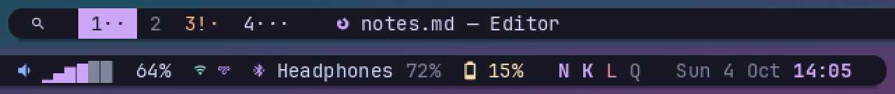

# alpheus

> *Alpheus*: the pistol shrimp, tiny and the fastest in the ocean.

A **lightweight, terminal-spirited** Wayland desktop shell, written in
Rust: what DankMaterialShell or Noctalia bring (bar, centralized settings,
notifications, OSD), **without their weight**. Aimed at modest hardware
with modern features.

## Memory

How much RAM a desktop shell keeps resident, measured as PSS
(`/proc/<pid>/smaps_rollup`) on the author's laptop (Hyprland, three
outputs). alpheus figures are release builds. Updated with every delivery.

### Compared with other shells

| Shell | Toolkit | Resident memory | What it covers |
|---|---|---:|---|
| **alpheus** (today, hybrid mode) | Rust, no toolkit | **≈ 23 MB** | bar ≈ 14 MB (live) + swayosd 7.6 MB + swaybg 1.4 MB still borrowed (rows below); ≈ 30 MB before the notifications replaced mako (6.7 MB) on 2026-10-09; ≈ 15 MB once the OSD replaces swayosd, only swaybg (optional) borrowed |
| **alpheus** (target, everything replaced) | Rust, no toolkit | **≤ 120 MB budget** | bar, launcher, notifications, OSD, wallpaper |
| waybar + mako + swayosd + swaybg | GTK / C | ≈ 55 MB (see the note below) | bar, notifications, OSD, wallpaper |
| HyprPanel | GJS | ≈ 151 MB | bar, notifications, OSD (Hyprland only) |
| Wayle | Rust, GTK4 | ≈ 168 MB | bar, panels |
| ashell + swaync | Rust, iced | ≈ 194 MB | bar, notifications |
| Noctalia 4.7 | Quickshell (QML) | ≈ 517 MB | full shell (v5, a native C++ rewrite released in September 2026, not measured yet) |
| DankMaterialShell (trimmed) | Quickshell (QML) | ≈ 512 MB | full shell, sound/visualizer/weather/temperatures off |
| DankMaterialShell | Quickshell (QML) | ≈ 537 MB | full shell |
| Caelestia | Quickshell (QML) | ≈ 730 MB | full shell |

### alpheus, component by component

| Component | Memory | Notes |
|---|---:|---|
| Bar daemon, all modules + launcher, 3 outputs — at start | ≈ 8.0 MB | headless sway test, `tests/memory.rs`, recorded D-Bus services on a private bus; libdbus shared with the session; tray unused: `startup_pss_per_source` ("everything", 3 runs: 8,144–8,246 KB); ≈ 8.4–8.5 MB with the tray and 10 fake items (`startup_pss_with_the_tray_under_15_mb`, 3 runs: 8,614–8,701 KB, without the launcher module) |
| Bar daemon — after 8,300 events and 5 plug cycles | ≈ 9.6–9.7 MB | stable, 0 wake-ups at rest, the theme watch adds no wake-up, 6 threads (D-Bus through dbus-rs/libdbus: one thread; the launcher and the tray add none) |
| Tray, module present, no item | ≈ 0.4 MB | watcher + session connection only, no thread (376–392 KB) |
| Tray, 10 fake items (5 KDE-, 2 Qt-, 2 Chromium-style, 1 Steam-like) | ≈ 0.5 MB | 488–496 KB, ≤ 2 MB budget, `ten_fake_items_cost_at_most_2_mb`; menu and calendar popups freed on close (20 cycles: +32 KB in each of 3 runs) |
| Tray, linked in but unused (no `tray` in `modules`, no session bus) | +0.4–0.7 MB vs. the delivery before this one | one-time cost of a bigger binary (stripped 4.49 → 5.36 MB, +864 KB: libdbus linkage, menus, popups, calendar); measured back to back in release, a real cost, like the launcher's |
| Themes, linked in (9 presets, resolver, inotify watch, portal following) | +144–224 KB vs. the delivery before this one | one-time cost; binary 5.11 → 5.18 MiB (+76 KiB stripped); measured `c85c0df` vs this delivery, release, back to back, 2 runs each; an unused preset is rodata only |
| Themes, 50 reloads (3 outputs repainted each time) | +0–444 KB | `theme_reloads_no_growth`: 0 KB in four of five runs, 444 KB in the first run after a build; 0 loop wake-ups at rest after a reload |
| Bar shapes, linked in (6 styles, corner masks, placement) | within noise (−48…+156 KB) vs. the delivery before this one | one-time cost; binary 5.20 → 5.24 MiB (+44 KiB stripped); measured `6a6df10` vs this delivery, release, back to back, 3 runs each, separate target directories; `flat` pays only the style match |
| Bar shapes, per style at start (all modules, 3 outputs) | flat ≈ 8.0 MB; others −76…+116 KB over flat | `startup_pss_per_style`, 3 runs (flat 8,142–8,224 KB: the same bar as the start row above); corner masks on first use −32…+88 KB (islands − flat), +36…+116 KB (floating − flat, its taller buffer included) (computed: 128 B for islands, 200 B for floating, at scale 1; one per radius and scale used) |
| Bar shapes, 48 style switches (3 outputs; floating reconfigures every bar) | +20 KB | `style_switches_no_growth`, +20 KB in each of 3 runs; 0 loop wake-ups at rest under each of the six styles (`at_rest_no_wakeups_under_each_style`) |
| Media, linked in but unused (no `media` in `modules`) | within noise (−52…+32 KB) vs. the delivery before this one | binary 5.24 → 5.33 MiB (+92 KiB stripped); measured `55ba754` vs this delivery, release, back to back, 3 runs each, separate target directories |
| Media module, no player (on the bar's own session connection, tray off) | 0–4 KB in mode `auto`; 286–395 KB in a fixed mode | `media_module_pss_without_and_with_players`, 3 runs (7.2–7.3 MB with it, 1 output): in mode `auto` that connection is the light/dark portal's, already open; in a fixed mode (`dark`) the module opens it, and the figure includes the connection itself; with the tray on it shares the tray's connection |
| Media, 3 fake players | 85–112 KB | same test, 3 runs; at most 16 players, strings capped at 256 characters, 8 artists |
| Media, 100 track changes | +0 KB | `track_changes_no_growth`, +0 KB in each of 3 runs (the titles reuse glyphs already drawn: the glyph cache's own bound is measured by the 8,300-events row); 0 loop wake-ups at rest with a player playing and the popup closed, tray on and off (`at_rest_no_wakeups_with_a_playing_player`); the popup's 1 s tick runs only while it is open and the track plays |
| Notifications, linked in but unused (no `notifications` in `modules`) | +122–248 KB vs. the delivery before this one | binary 5.34 → 5.47 MiB (+140 KiB stripped); measured `900a519` vs this delivery, release, back to back, 3 runs each, separate target directories |
| Notifications server and bell, serving with nothing (own session connection, tray off) | 0–4 KB | `notifications_pss_idle_history_and_bubbles`, 3 runs (10.9 MB with it, 1 output): in mode `auto` that connection is the light/dark portal's, already open, as for the media row; with the tray on, it shares the tray's connection |
| Notifications, 50-entry history | 192–198 KB | same test; capped: app 64 B, summary 256 B, body 1 KiB, 6 actions; history in memory only |
| Notifications, 4 bubbles shown | 326–774 KB, −84…+76 KB once closed | same test; their surface and pool exist only while a bubble shows; 0 loop wake-ups at rest with a sticky bubble shown and once every bubble went (`at_rest_no_wakeups_with_notifications`) |
| OSD, linked in but unused (no `osd` in `modules`) | within noise (−28…+172 KB) vs. the delivery before this one | binary 5.48 → 5.54 MiB (+56 KiB stripped); measured `1662cb4` vs this delivery, release, back to back, 3 runs each, separate target directories |
| OSD, module on, nothing shown | 0–96 KB | `osd_pss_idle_shown_and_gone`, 3 runs (10.9–11.0 MB with it, 1 output): the last sound state and three instants; no surface, no timer, no sysfs read until `alpheus-launch --osd brightness` |
| OSD, one pill shown | 4–30 KB, −38…−12 KB once gone | same test; its surface and pool exist only while it shows (1.3 s after the last change); a held key keeps one surface; 0 loop wake-ups at rest once it went (`at_rest_no_wakeups_after_the_osd`) |
| Bar daemon, live on the author's laptop (3 outputs) | ≈ 11.3 MB | real session, all modules — predates this merge, see note below |
| `pw-dump` child (sound source) | ≈ 2.5 MB | silent at rest |
| **alpheus resident total, live** | **≈ 14 MB** | bar + sound source — predates this merge, see note below |
| Launcher feature, linked in but never opened (no `launcher` in `modules` even) | +0.3–0.7 MB vs. the delivery before this one | one-time cost of a bigger binary (`nucleo-matcher`, `xkeysym`, `xkbcommon`'s Rust bindings) plus `libxkbcommon.so` itself (≈ 60 KB of it, `/proc/<pid>/smaps`); measured `c256d33` vs the launcher delivery, release, back to back — a real cost, not "noise" |
| Launcher, closed (socket only, nothing else resident) on top of that | +0 MB | no thread, timer or keyboard exists while closed |
| Launcher, open (typed query, keyboard bound) | ≈ +2.0–2.1 MB over closed | headless sway, 300 synthetic apps, `tests/memory.rs`, with dbus-rs |
| Launcher, open latency | ≈ 0.8–1.3 ms median (max 1.7–2.9 ms) | request accepted → first frame committed, 20 opens, with dbus-rs |
| Launcher, 50 open/close cycles | ≈ +0.1–0.2 MB vs. the post-warm-up baseline | 17 of them closed by a typed Escape, the rest by toggle, with dbus-rs |
| Launcher, 100,000-line dmenu | ≈ +6.6–6.8 MB open, back to +0.5 MB 1 s after cancel | worst-case dmenu size; memory released promptly on cancel; with dbus-rs |
| Control center (TUI) while open | ≈ 2 MB + its terminal | 0 at rest (not resident); the terminal dominates: alacritty ≈ 93 MB |
| mako, replaced by the notifications above | 6.7 MB | measured on the author's session (2026-10-08, 19.5 MB RSS); alpheus takes `org.freedesktop.Notifications` as soon as mako lets it go, ≈ 6.7 MB (the module serving costs 0–4 KB here; a live figure against a headless one) won back |
| swayosd, replaced by the OSD above | 7.6 MB | PSS on the author's session (2026-10-09): GTK4, libpulse, zbus, async-std; ≈ 7.6 MB won back once `swayosd-server` is no longer started (the module at rest costs 0–96 KB here; a live figure against a headless one) |
| Borrowed for now: swaybg | 1.4 MB | optional |

> **Memory note:** absolute PSS shifts with machine state, by about ±0.5 MB
> between boots, because shared libraries are counted proportionally; the
> per-component deltas are the stable figures. Ranges are over 2–3 release runs
> (KB/1024, one decimal; 2 runs for the themes rows). The launcher rows come
> from the tray-delivery measurement (three runs); the themes rows from two
> alternated runs against the delivery before; the bar shapes rows likewise
> (three alternated runs, HEAD and base built in separate target directories); the media rows likewise; the notifications rows likewise; the OSD rows likewise.
>
> **Note:** the "live" row above (≈ 11.3 MB) and the resident total it
> feeds into (≈ 14 MB) predate the move from zbus to dbus-rs, the launcher
> merge and the tray: they were measured before any of them. The headless
> sway rows above are measured with all of them; the live rows will be
> re-measured at the real-world trial of the tray (tray plan 2, task 21).
> The hybrid-mode figures in the shells table add that live total to the
> borrowed tools' rows above: swayosd 7.6 MB (2026-10-09), swaybg 1.4 MB
> (2026-10-05), and mako 6.7 MB (2026-10-08) for the figure before the
> notifications delivery. All are PSS on the author's session.
>
> **The waybar stack's row** (≈ 55 MB) adds PSS figures from different
> days: waybar 39 MB (the nixos-config DMS trial spec, 2026-09-30), mako
> 6.7 MB, swayosd 7.6 MB, swaybg 1.4 MB (the rows above). The ≈ 120 MB first
> recorded for this stack on 2026-09-30 (waybar 39, swayosd 48, swaybg 31,
> hypridle 2 MB, also given as PSS) is not borne out by the later swayosd
> and swaybg measurements, and why they differ is not known; waybar's own
> 39 MB has not been measured again. The stack is to be measured again side
> by side.

The control center (`alpheus`, TUI) is not resident: it opens on demand
and exits.

Hyprland and niri. Mouse and keyboard everywhere.

Sleep and screen power-off remain the job of dedicated tools (hypridle,
swayidle…): alpheus never touches them. On some outputs (DisplayLink in
particular), a misplaced power-off can freeze the machine.

> **Status**: ongoing personal project, used daily by its author on NixOS.
> It still depends on a few scripts from her configuration (`wm-set`,
> `shell-ctl`…); making them optional, with a neutral fallback, is the next
> step before use elsewhere.

## Features compared

The roadmap's yardstick: what DankMaterialShell and Noctalia offer, within a
fraction of their memory. ✅ done · 🚧 planned (delivery) · 💭 to decide ·
❌ out of scope by design · ➖ partial or through another tool.

| Feature | **alpheus** | DMS | Noctalia | ashell | waybar stack¹ |
|---|---|---|---|---|---|
| **Resident memory** | **≈ 14 MB** today, ≤ 120 MB target | ≈ 537 MB | — | ≈ 194 MB² | ≈ 55 MB³ |
| **Bar** | | | | | |
| Workspaces, active window | ✅ | ✅ | ✅ | ➖ | ✅ |
| Clock | ✅ | ✅ | ✅ | ✅ | ✅ |
| Calendar popup | ✅ month grid, locale first day, ISO weeks | ✅ | ➖ | ✅ | ✅ |
| Volume, network, Bluetooth, battery | ✅ | ✅ | ✅ | ✅ | ✅ |
| CPU, memory, temperature | ✅ | ✅ | ➖ | ✅ | ✅ |
| System tray (icons and menus) | ✅ Nerd Font glyphs, no images | ✅ | ✅ | ✅ | ✅ |
| Media (MPRIS) | ✅ `▶ Title` in the bar, middle click play/pause, wheel next/previous; a popup with time, progress, ⏮ ⏯ ⏭ and the player choice | ✅ | ✅ | ✅ | ✅ |
| Notification counter, do-not-disturb | ✅ a neutral bell with the unread count, crossed under do-not-disturb (middle click, or `alpheus-launch --dnd on\|off\|toggle`) | ✅ | ✅ | ➖ | ➖ |
| Keyboard layout | 💭 | ✅ | ➖ | ✅ | ✅ |
| Privacy indicators (mic, camera, screen share) | 💭 | ✅ | ➖ | ✅ | ✅ |
| Weather | 💭 | ✅ | ✅ | ✅ | ➖ |
| **Panels** | | | | | |
| Control center (quick settings) | ✅ TUI (≈ 2 MB + terminal, only while open) | ✅ | ✅ | ➖ | ❌ |
| Power menu | ✅ TUI | ✅ | ✅ | ✅ | ❌ |
| Display settings | ✅ TUI (Hyprland) | ✅ | ➖ | ➖ | ❌ |
| Network, Bluetooth, per-app audio | ➖ TUI + nmtui, bluetui, wiremix | ✅ | ➖ | ✅ | ❌ |
| Notification center, history | ✅ a panel under the bell: the player, the last 50 notifications (in memory), do-not-disturb, Clear all | ✅ | ✅ | ➖ | ➖ |
| USB devices (debugging) | 🚧 TUI tab | ❌ | ❌ | ❌ | ❌ |
| **Launcher** | | | | | |
| Apps, run command, window switcher | ✅ | ✅ | ➖ | ❌ | ➖ |
| Script/dmenu mode | ✅ (fuzzel's exit codes) | ➖ | ➖ | ❌ | ✅ |
| Calculator, units, currencies, dates | 🚧 launcher 2 | ✅ | ➖ | ❌ | ❌ |
| System actions, Bluetooth/sound, SSH, web search | 🚧 launcher 3 | ➖ | ➖ | ❌ | ❌ |
| Emoji, files, clipboard history | 🚧 launcher 4 | ✅ | ➖ | ❌ | ➖ |
| **Other** | | | | | |
| Notification toasts | ✅ bubbles top centre on the focused output; a click runs the app's action, critical ones stay; replaces mako (≈ 6.7 MB) | ✅ | ✅ | ✅ | ✅ |
| OSD (volume, brightness) | ✅ volume and mute, and the microphone's mute (never its level: call apps move it), from PipeWire's own state (any app, any key, a Bluetooth headset), laptop brightness on `alpheus-launch --osd brightness`; bottom centre on the focused output, never takes a click; replaces swayosd (≈ 7.6 MB) | ✅ | ✅ | ✅ | ✅ |
| Colours from the wallpaper (matugen) | ✅ dark and light files, live | ✅ | ✅ | ❌ | ❌ |
| Colour themes, light/dark following the desktop | ✅ 9 presets, 7 hues per theme, per-module colours, auto light/dark, live reload | ✅ | ✅ | ➖ | ➖ |
| Bar styles (islands, powerline, floating…) | ✅ 6 styles (flat, islands, powerline, floating, underline, translucent), pills, chosen in the Theme tab, live reload | ✅ | ✅ | ➖ | ➖ |
| Appearance settings | 🚧 TUI tab, themes 3 | ✅ | ✅ | ❌ | ❌ |
| Wallpaper management | 💭 | ✅ | ✅ | ❌ | ❌ |
| Lock screen | 💭 | ✅ | ✅ | ❌ | ❌ |
| Settings GUI | ➖ TUI + TOML | ✅ | ✅ | ❌ | ❌ |
| Dock, desktop widgets | 💭 | ➖ | ✅ | ❌ | ❌ |
| Screenshots, recording | 💭 | ➖ | ➖ | ❌ | ❌ |
| Idle and power management | ❌ left to hypridle (DisplayLink safety) | ✅ | ✅ | ✅ | ➖ |
| Shows on (layer-shell compositors: Hyprland, niri, sway, river, labwc…) | ✅ | ✅ | ✅ | ✅ | ✅ |
| Workspaces and windows read from | Hyprland, niri | 7 compositors | 6 compositors | Hyprland, niri, sway | many (one module each) |
| Extensions | script mode, no plugin API | ✅ | ✅ ~100 | ❌ | ➖ |

¹ waybar + mako + swayosd + fuzzel. ² ashell + swaync. ³ waybar + mako +
swayosd + swaybg, from PSS figures of different days (see the memory note
above). Other shells' features from their documentation (October 2026);
memory measured on the author's laptop.

## What's in the repository

A Cargo workspace of three crates:

| Crate | Role |
|---|---|
| `alpheus` | **Control center** as a TUI (ratatui), opened on demand |
| `alpheus-demon` | **Resident daemon**: the bar, one per screen (layer-shell) |
| `alpheus-commun` | Shared foundation: command execution, configuration, theme, access to system tools |

The TUI doesn't embed Wayland, the daemon doesn't embed ratatui: a test
checks this.

### The control center (`alpheus`)

Seven tabs: **Home**, **Sound**, **Network**, **BT** (Bluetooth), **Power**,
**Displays** (enable, place, set resolution and scale, profiles, with
automatic rollback after 15 s if not confirmed), **Theme** (choose a
theme, the light/dark mode, the module colours and the bar style, with a preview; `--tab theme`).

| Key | Action |
|---|---|
| `1`…`6`, `Tab` / `Shift+Tab` | switch tabs |
| `Ctrl+P` | command palette (fuzzy search) |
| `/`, `Ctrl+F` | search a list |
| `F1`, `?` | help |
| `Esc` | go back; `q` quits |

`alpheus --tab <name>` opens directly on a tab (`home`, `sound`, `network`,
`bluetooth`, `power`, `displays`).

### The bar (`alpheus-demon`)

In the default `flat` style, a line of monospace characters on the theme's bar colour, modules separated by
`│`, the active workspace on the theme's accent (see [Themes](#themes) and [Bar styles](#bar-styles)).


Shipped: **launcher** (an icon that opens it, first module by default),
**workspaces** (one dot per window, empty workspace dimmed, the active one
on `accent_container`, urgent in `urgent`, click to go there, wheel to move to the next one), **active
window** (app icon and title), **media** (`▶ Title` while a player plays, `⏸ Title` paused, hidden when nothing plays; middle click play/pause, wheel next/previous; a left click opens a popup with the artist, the elapsed time and a progress bar, ⏮ ⏯ ⏭, and the players to choose from),
**volume** (gauge, wheel ±5 %, right click
mutes), **network** (link icon, VPN count), **Bluetooth** (device and its
battery), **battery** (laptop and peripherals; `warn` below 20 %, `error` below 10 %), **resources** (CPU graph,
memory, temperature), **tray** (status icons of running apps as Nerd
Font glyphs — or a letter —, left click activates, right click opens the
app's menu in a popup, keyboard and mouse),
**notifications** (a bell with the unread count, crossed under do-not-disturb, dim while another
server holds the name; a left click opens the panel — the player, the last 50 notifications, Do not
disturb, Clear all — a middle click toggles do-not-disturb; bubbles top centre on the focused output:
a left click runs the app's default action, a right click dismisses, critical ones stay until
clicked), **OSD** (a pill bottom centre on the focused output for the volume and mute, read from PipeWire's own state — any app, any key, a headset's buttons — with the new sink's name when the default sink switches; for the microphone only when its mute flips, never for a change of its level, which call apps (WebRTC) adjust on their own; and for the laptop's brightness on `alpheus-launch --osd brightness`, read once from sysfs, never written; it goes 1.3 s after the last change and never takes a click), **clock** (a click opens the
month's calendar). Clicking a module opens the matching tab
of the control center. One bar per screen, screens plugged and unplugged
are tracked live. On a narrow screen, secondary modules disappear;
workspaces and the clock remain.

Coming next: the lock screen; the wallpaper (swaybg) is optional.

At rest the bar never wakes up except for its timers (the clock, and the
resources every 2 s when shown): measured 0 wake-ups at rest, ≈ 8.0 MB
of memory at start (≈ 8.4–8.5 MB with a tray of 10 items, launcher module off) and ≈ 9.6–9.7 MB under load,
on three outputs. The
compositor is only **read** (Hyprland or niri event stream); switching
workspace goes through a configurable command. Sound comes from
`pw-dump`, network, battery and Bluetooth from D-Bus (read-only),
resources from `/proc`. The tray talks to the session bus
(StatusNotifierItem, dbusmenu): one connection on the bar's own loop, no
thread. The media module speaks MPRIS on that same connection (or on one of its own when the tray is off,
shared with the light/dark portal): players found at start and on arrival, their changes read from
signals, never polled; while its popup is open the time ticks once a second, and only then.
The notifications module is the `org.freedesktop.Notifications` server on that same connection. It
waits in the D-Bus queue while another server (mako) holds the name, and takes over as soon as it is
released; a mako started after it is refused and exits. Text is capped and cleaned: markup is
stripped, never rendered, and images are skipped unread. A noisy app is rate-limited, and the bubbles
exist only while one shows. One timer is armed for the earliest expiry, and none at rest. Scripts drive it through `alpheus-launch`: `--dnd on|off|toggle` sets
do-not-disturb (kept across restarts, in `$XDG_STATE_HOME/alpheus/dnd`), `--clear-notifications`
empties the history; exit code 2 when the notifications module is not in `bar.toml`, 3 when the bar
is not running. `--osd brightness` shows the backlight's level (exit 0 also when there is none to
show, or the `osd` module is off; 3 when the bar is not running). A known
limitation: right-to-left titles (Arabic, Hebrew) are drawn in logical order, not reordered. On Hyprland (any version; hyprwm/Hyprland#15729, fixed upstream in 0.56.2), the bar's keyboard interactivity stays None while a menu or the calendar grabs — detected from its `hyprland_*` globals.

### The launcher

A centred box (apps, open windows, `$PATH` commands, a script/dmenu mode
for shell scripts), opened and closed by the daemon itself — nothing of
it stays resident while closed, not even a thread.


`Tab`/`Shift+Tab` switches modes (All, Apps, Windows, Commands); typing
ranks results with [nucleo](https://github.com/helix-editor/nucleo)
(Helix's fuzzy matcher) plus frecency (most-used first on an empty
query). `Enter` runs a command or typed shell text in a held terminal
(stays open to read the output); `Ctrl+Enter` runs it detached. `alpheus-launch`
bridges to it over an owner-only socket (`toggle`, `close`, `--dmenu`
with fuzzel's exit codes, plus exit code 3 — daemon unreachable — the
only case where a script falls back to another menu). Measured in
**release** (headless sway, 300 synthetic apps): opening costs ≈ 1.9–2.1 MB
of PSS over closed, median open latency ≈ 0.8–1.3 ms, 50 open/close cycles
grow PSS by well under the 1 MB budget (measured 148–220 KB across runs),
0 wake-ups in 5 s at rest after use (2 in one of three runs). A 100,000-line dmenu peaks at
+6.6–6.8 MB and drops back to +0.5 MB a second after it is cancelled.

### Themes

Colours come from a **theme**: one of nine compiled-in presets, or your
wallpaper through [matugen](https://github.com/InioX/matugen). Each has a dark
and a light variant. The mode follows the desktop (the portal's
`org.freedesktop.appearance` `color-scheme`, read by the bar, which passes it
on to the control center) or is fixed. The bar, its popups, the launcher and the
control center change together. The bar picks up a new
`theme.toml`, `colors.toml` or `colors-light.toml` by itself, without a
restart: one inotify watch, nothing wakes at rest. If `~/.config/alpheus` is
itself a symlink (home-manager), the watch follows it to its target, so
replacing the link is not seen until the bar restarts (the bar logs it once at start).


```toml
# ~/.config/alpheus/theme.toml — every key optional
theme = "catppuccin"   # a preset below, or "wallpaper"
mode  = "auto"         # "auto" (follow the desktop), "dark", "light"
module_colors = "icons" # "none", "icons" (default), "full", "pills": see Module colours below
style   = "flat"        # "islands", "powerline", "floating", "underline", "translucent": see Bar styles below
opacity = 0.8           # translucent only

[colors]               # override any role, whatever the theme and mode
# accent = "#ff9e64"
```

With no `theme.toml`, or no `theme` key in it, alpheus uses `wallpaper` when
`~/.config/alpheus/colors.toml` exists (what it did before themes existed),
and `catppuccin` otherwise. An unknown name falls back to `catppuccin`, with
one line in the log.

| `theme` | Dark | Light |
|---|---|---|
| `catppuccin` | Mocha | Latte |
| `gruvbox` | dark | light |
| `tokyo-night` | Night | Day |
| `rose-pine` | main | Dawn |
| `everforest` | dark medium | light medium |
| `kanagawa` | Wave | Lotus |
| `solarized` | dark | light |
| `nord` | Nord | dark only |
| `dracula` | Dracula | dark only |

A preset with no light variant stays dark in light mode. Every preset is
checked for legibility in both modes by a test using WCAG contrast:
- text reaches 4.5:1 on the bar and the popups;
- secondary text and the state colours reach 3:1 on the bar.

Where an official colour falls short in a light variant, alpheus uses a
darker shade of it. Nord's bar sits on `nord0` rather than `nord1`, so that
its red stays readable.

A theme is 16 colours, named by use:

| Role | Used for |
|---|---|
| `bar_bg` | the bar's background |
| `pill_bg` | raised cells of the bar (a visible workspace); the blocks of the block styles |
| `popup_bg` | menus, calendar, tooltip, launcher |
| `raised` | reserved for hover; powerline's alternate blocks; a visible workspace inside a block |
| `selection` | the selected row |
| `fg`, `fg_dim` | text, secondary text (frames are `fg_dim` at 40 %) |
| `on_accent` | text on an accent |
| `accent`, `accent_container` | the clock, the active workspace |
| `accent2` | checks and radios in menus |
| `accent2_container` | reserved (no surface uses it yet; delivery 2) |
| `ok`, `warn`, `error`, `urgent` | states: low battery is `warn`, critical `error`, an urgent workspace `urgent` |

#### Module colours

A theme also carries **seven hues**: `red`, `orange`, `yellow`, `green`,
`cyan`, `blue` and `purple`. Each preset takes them from its own palette
(darker shades in the light variants where the official one is too pale to
read, 3:1 on the bar at least). `module_colors` in `theme.toml` decides how
much of each module wears its hue:

| `module_colors` | Look |
|---|---|
| `none` | no hue: the bar looks as before the hues existed |
| `icons` (default) | each module's icon takes its hue |
| `full` | the icon and the module's text |
| `pills` | each block filled with its hue (block styles, see Bar styles below) |

The mapping is fixed:

| Module | Hue |
|---|---|
| window title (its icon) | purple |
| media | purple |
| sound | blue |
| network | cyan |
| Bluetooth | purple |
| battery | green |
| CPU (its graph) | orange |
| RAM | yellow |
| temperature | red |

With `graph = 0`, only `full` colours the CPU (its icon is the graph).

Workspaces, the clock, the tray icons, the notification bell
(its count in the accent), the launcher button and the separators keep their colours. **States win over the hue**: a low (`warn`) or
critical (`error`) battery, a hot temperature, a network with limited
connectivity, a muted volume, an offline or
down module, an urgent workspace and a tray item that needs attention keep
their state colours whatever `module_colors` says. A charging battery is
green at any level (its glyph shows it charges, so it never warns); under `none` it
keeps the accent. The Theme tab of the
control center has a "Module colours" row (None, Icons, Full, Pills) with a preview.

A colour file may carry the seven hues as optional keys (`red = "#f38ba8"`,
and so on); a hue that is absent is derived from Catppuccin's (Mocha for dark,
Latte for light) mixed 30 % toward the accent, so it stays in tune with the
theme. `[colors]` in `theme.toml` can override a hue like any role.

#### Bar styles

The bar has six shapes. `flat`, the default, is the bar as it always was.

```toml
# ~/.config/alpheus/theme.toml
style   = "islands"  # "flat" (default), "islands", "powerline", "floating", "underline", "translucent"
opacity = 0.8        # translucent only: 0.3 to 1.0 (clamped, with one line in the log)
```

Only `translucent` uses `opacity`; a value out of range still logs its warning under any other style.

| `style` | Look |
|---|---|
| `flat` | one line on the bar colour, modules separated by `│` |
| `islands` | each group of modules in its own rounded block; the bar between them is transparent |
| `powerline` | full-height blocks joined by arrows, alternating two tones |
| `floating` | one rounded bar, 6 px from the top and sides of the screen, with a light shadow |
| `underline` | blocks one step lighter than the bar, a thin line under it, the active workspace in the accent, underlined |
| `translucent` | the bar at `opacity` over the wallpaper, solid blocks |





*The six styles on catppuccin (dark), over a fictional wallpaper (sample data, real font, zoomed ×2, each bar split in two halves).*

The groups are the workspaces, the window title, the status modules (sound, network, Bluetooth,
battery), the resources, the tray, the clock and the launcher button. A module that is absent
makes no block. The text inside each block is the same in every style; only the background
changes.

`module_colors = "pills"` fills each block with the hue of its first module. Its text and icons
take whichever of the bar colour or the text colour reads better on that hue, and states still win
(a low battery stays `warn`). Pills apply to `islands`, `powerline`, `floating` and `translucent`.
Under `flat` and `underline`, `pills` looks like `full`.


The Theme tab of the control center has a "Style" row with a preview of each style. The preview is
drawn in terminal cells, so it is an approximation, not the real pixels. `opacity` is set in the
file only. A change applies at once: `floating` moves the bar 6 px down and in from the sides, and
windows start right under it (6 px lower than under the other styles), then their usual gaps.

alpheus never asks for blur. On Hyprland, a layer rule on the bar's namespace blurs what is behind
the `translucent` bar, and behind the `islands` and `floating` blocks:

```
# hyprland.conf
layerrule = blur on, ignore_alpha 0, match:namespace alpheus-bar
```

Clicks in the transparent gaps between `islands` blocks still reach the bar. The shadow under
`floating` lets clicks through to the window below.

#### Wallpaper colours (matugen)

`theme = "wallpaper"` reads `colors.toml` (dark) and `colors-light.toml`
(light). If only the dark file exists, light mode uses it too. A file gives
the 16 roles above. The 7 keys of earlier versions (`bg fg accent muted
surface error ok`) still work, and the other roles are derived from them.

A matugen template for the 16 roles, `~/.config/matugen/templates/alpheus.toml`:

```toml
bar_bg            = "{{colors.surface_container_lowest.default.hex}}"
pill_bg           = "{{colors.surface_container_high.default.hex}}"
popup_bg          = "{{colors.surface_container.default.hex}}"
raised            = "{{colors.surface_container_highest.default.hex}}"
selection         = "{{colors.secondary_container.default.hex}}"
fg                = "{{colors.on_surface.default.hex}}"
fg_dim            = "{{colors.on_surface_variant.default.hex}}"
on_accent         = "{{colors.on_primary.default.hex}}"
accent            = "{{colors.primary.default.hex}}"
accent_container  = "{{colors.primary_container.default.hex}}"
accent2           = "{{colors.tertiary.default.hex}}"
accent2_container = "{{colors.tertiary_container.default.hex}}"
ok                = "{{colors.tertiary.default.hex}}"
warn              = "{{colors.amber.default.hex}}"
error             = "{{colors.error.default.hex}}"
urgent            = "{{colors.error_container.default.hex}}"
```

`amber` is a custom colour, tinted toward the wallpaper. The seven hues are
custom colours too, harmonised with the wallpaper: add these lines to the
template, in the same way (the keys are optional; without them alpheus
derives the hues from the accent):

```toml
red    = "{{colors.red.default.hex}}"
orange = "{{colors.orange.default.hex}}"
yellow = "{{colors.yellow.default.hex}}"
green  = "{{colors.green.default.hex}}"
cyan   = "{{colors.cyan.default.hex}}"
blue   = "{{colors.blue.default.hex}}"
purple = "{{colors.purple.default.hex}}"
```

One matugen configuration per mode, each writing its own file.
`~/.config/matugen/alpheus-dark.toml`:

```toml
[config.custom_colors]
amber  = { color = "#f9a825", blend = true }
red    = { color = "#f38ba8", blend = true }
orange = { color = "#fab387", blend = true }
yellow = { color = "#f9e2af", blend = true }
green  = { color = "#a6e3a1", blend = true }
cyan   = { color = "#94e2d5", blend = true }
blue   = { color = "#89b4fa", blend = true }
purple = { color = "#cba6f7", blend = true }

[templates.alpheus]
input_path = "~/.config/matugen/templates/alpheus.toml"
output_path = "~/.config/alpheus/colors.toml"
```

`alpheus-light.toml` is the same with `output_path = "~/.config/alpheus/colors-light.toml"`.
Then, at each wallpaper change:

```sh
matugen -c ~/.config/matugen/alpheus-dark.toml  image "$WALLPAPER" -m dark  -t scheme-vibrant
matugen -c ~/.config/matugen/alpheus-light.toml image "$WALLPAPER" -m light -t scheme-vibrant
```

`-t scheme-vibrant` gives livelier colours than matugen's default
(`scheme-tonal-spot`). The bar follows the new files on its own. Run from a
script with no terminal (a wallpaper hook), matugen cannot ask which of a
picture's dominant colours to use: add `--source-color-index 0` to pick the
first.

## Build

With Nix:

```sh
nix build .#alpheus          # the TUI
nix build .#alpheus-demon    # the bar
nix develop                  # dev shell: cargo, fonts, sway for tests
```

Without Nix, `cargo build --release` is enough for the TUI. The bar looks
for its fonts in `$ALPHEUS_FONTS` (set at build time by the flake),
otherwise in the system's.

## Configure

Everything is optional, under `~/.config/alpheus/`. An invalid file falls
back to default values with a warning, never a crash.

- `theme.toml`: the theme (a preset or the wallpaper), light/dark mode,
  per-role overrides, the bar style and its opacity; `colors.toml` / `colors-light.toml`: the wallpaper's
  colours, written by matugen. See [Themes](#themes); the bar follows changes
  without a restart, the control center reads them when it opens.
- `config.toml`: the TUI (keys, tools opened for sound, network,
  Bluetooth).
- `displays.toml`: screen profiles, written by the Displays tab.
- `bar.toml`: the bar.
- `launcher.toml`: the launcher (terminal command, result rows, history
  size, mode prefixes, the focus command); read fresh at each open,
  nothing kept while it is closed.

```toml
# bar.toml — default values
modules = ["launcher", "workspaces", "window", "media", "volume", "network",
           "bluetooth", "battery", "resources", "tray", "notifications", "osd", "clock"]
height = 22

[font]
family = "JetBrainsMono Nerd Font Mono"
size = 14.0
fallback = ["DejaVu Sans Mono"]  # for symbols the font lacks (✳ ◐…); setting the key replaces this default, [] disables it

[clock]
format = "%H:%M"
date = "%a %e %b"   # empty = no date
calendar = true     # a left click on the clock opens the month
week_numbers = false  # ISO week numbers in the calendar

[tray]
passive = "dim"     # "dim" | "show" | "hide": items that say they are idle
tooltips = true     # the item's name after ½ s of hovering

[tray.icons]        # glyph overrides, keyed like the built-in table (id, icon name, title, process)
# keepassxc = "󰌋"

[media]
title_max = 30            # cells of the title in the bar (8 to 80)
ignore = ["kdeconnect"]   # bus-name substrings never queried; playerctld is always ignored

[notifications]
timeout = 5          # seconds, when the app leaves it to the server
timeout_min = 2      # an app's own timeout is kept within these
timeout_max = 20
max_visible = 4      # bubbles shown at once; more wait
width = 40           # cells (24 to 80)
history = 50         # entries kept in memory (0 to 200)

[osd]
timeout_ms = 1300    # how long the pill stays after the last change (600 to 5000)
width = 32           # cells of its row (24 to 60)
margin = 48          # px above the bottom edge (0 to 400)
backlight = ""       # a device in backlight_dir; "": the first one, in sorted order
backlight_dir = "/sys/class/backlight"   # read only, and only on `alpheus-launch --osd brightness`

[workspaces]
command = ["wm-set", "workspace", "{workspace}", "{output}"]

[battery]
peripherals = "always"   # "always" | "low" | "never": peripherals with a real percentage
coarse = "low"           # "always" | "low" | "never": peripherals with only a coarse level
```

Modules not yet shipped are accepted and ignored: a `bar.toml` written
today will stay valid.

## Principles

- **Lightness first.** An unused option costs nothing; no heavy dependency
  "for config". Budgets are checked by tests (memory and idle wakeups of
  the bar, measured on a headless sway).
- **Never `dpms`** nor sleep handling: turning off a screen on a
  DisplayLink output can freeze the machine.
- **No direct writes to the compositor**: only configurable commands.
- **Tests without a graphical session**: every command goes through an
  injectable executor, no test acts on the session.

## Documentation

- [`docs/SCOPE.md`](docs/SCOPE.md): why, budget, guardrails, breakdown.
- [`docs/specs/`](docs/specs/): the specifications (TUI, Displays tab,
  bar, launcher, tray, themes, media, notifications, OSD).
- [`docs/plans/`](docs/plans/): the implementation plans.

## License

[MIT](LICENSE) © 2026 Mae PUGIN
