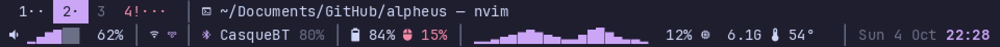
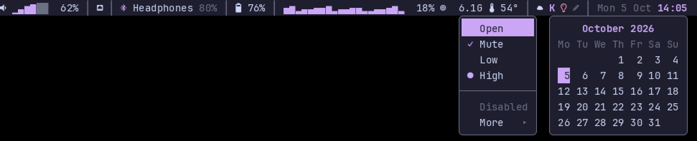
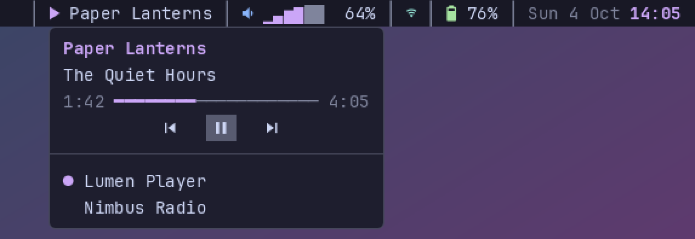
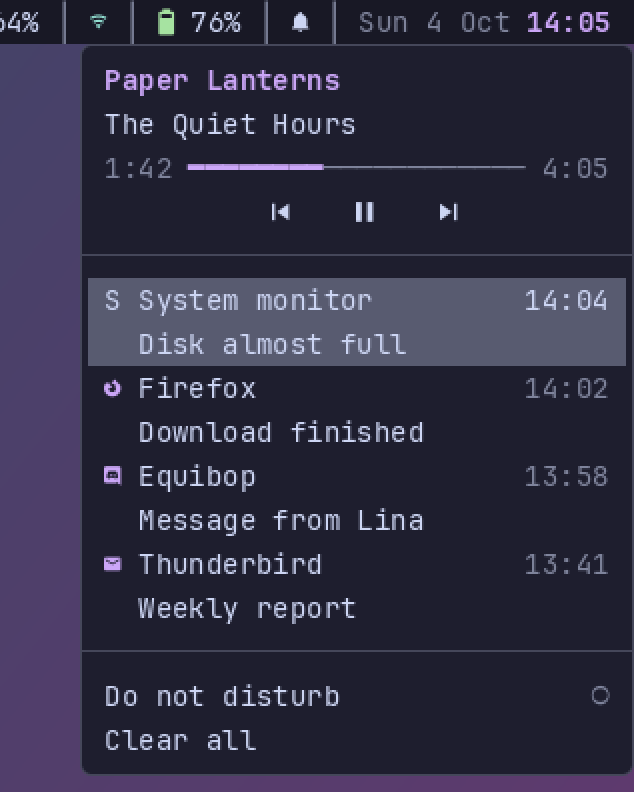
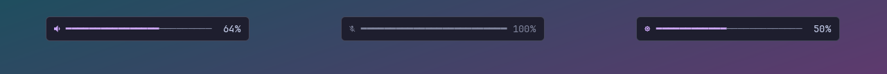
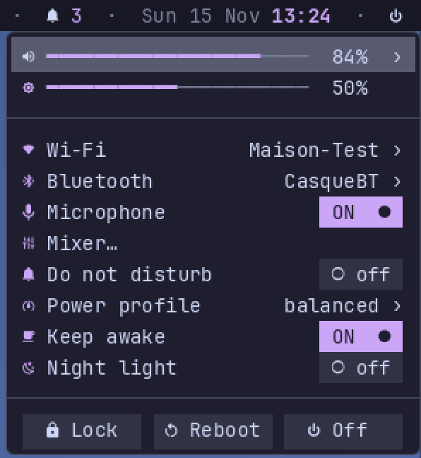

# The bar

In the default `flat` style, a line of monospace characters on the theme's bar colour, modules separated by
a dim dot (`  ·  `), the active workspace on the theme's accent (see [Themes](themes.md) and [Bar styles](themes.md#bar-styles)).

Shipped: **launcher** (an icon that opens it, first module by default),
**workspaces** (one dot per window, empty workspace dimmed, the active one
on `accent_container`, urgent in `urgent`, click to go there, wheel to move to the next one), **active
window** (app icon and title), **media** (`▶ Title` while a player plays, `⏸ Title` paused, hidden when nothing plays; middle click play/pause, wheel next/previous; a left click opens a popup with the artist, the elapsed time and a progress bar, ⏮ ⏯ ⏭, and the players to choose from),
**privacy** (nothing while nothing is captured; then one glyph per capture in an own block: `󰍬` microphone in orange, `󰄀` camera in green, `󰍹` screen in red, whatever `module_colors` says; the microphone glyph is dim while the default source is muted. Read from PipeWire's graph by the `pw-dump` child the sound module already runs, so a meter (pavucontrol, cava), a filter chain or a loopback never lights it, and an app muting itself in its own call still does; a screen cast announced by niri or Hyprland lights the screen too. A glyph goes 0.5 s after its capture ends, never blinking on a renegotiation. A left click opens a popup listing the apps by name (`(unnamed)` when only the compositor knows); a middle click mutes or unmutes the default microphone. A camera opened directly (`/dev/video*` outside PipeWire) lights it too: the daemon watches the device nodes with inotify (`[privacy] dev_dir`, `proc_dir`: where video devices and processes are listed) and, 300 ms after an open or close, scans its own user's `/proc/<pid>/fd` for a link to a `video*` node (never opening one; PipeWire, WirePlumber and the daemon itself excluded). **Not seen:** wf-recorder under Sway and Mango, which announce nothing, a camera held by another user's process, and a same-user process named `pipewire` or `wireplumber`; under Hyprland, a cast running before the daemon started shows only through PipeWire (niri reports it at connection). **Known:** on boards whose hardware codec nodes are named `video*` (some ARM boards), a codec in use also lights the camera; the nodes are never opened to tell them apart),
**shield** (nothing unless `[shield]` is set in `bar.toml` and the mode is on; then `󰒘`, always green, in an own block right after the privacy indicators, removed on a narrow bar just before them. Its state is a file: the mode is on while `flag` exists, watched through the theme watch's one inotify instance, so a change made in a terminal shows at once. A left click opens the quick panel on the Shield row (with the `quick` module): Space switches it with the `on` or `off` command, which asks for authorisation itself (`pkexec` shows polkit's dialog), `…` until the flag follows, `failed` for 4 s on a refusal; Enter opens the detail, the USB devices blocked since the mode went on (read once each time it opens), Enter on one runs `allow` with its id. `alpheus-launch --shield` does the same from a script, and the notices come from alpheus's own server; see [Shield mode](shield.md)), **volume** (an icon and the percentage, wheel ±5 %; with the quick panel, a left click opens it and a right click the TUI's sound tab, else a right click
mutes), **network** (link icon, VPN count), **Bluetooth** (device and its
battery), **battery** (laptop and peripherals; `warn` below 20 %, `error` below 10 %), **resources** (CPU, memory, temperature: each an icon and a figure; a left click opens a popup with each item's figure and a graph of its last 60 samples, drawn in pixels (`last N min`: 60 × `interval` seconds), and a `Monitor…` row; the right click runs `[actions] resources`; the 60 samples are kept in a fixed ring of about 3 KB, fed by the tick that already runs, so nothing more wakes; `[resources] show` adds `net` (the default route's interface, receive and send rates; IPv4 only), `disk` ($HOME's filesystem, percent used, rounded up like `df`) and `gpu` (the GPU's temperature, from its hwmon); all read at the same tick, nothing more is read for an item left out. `disk` calls `statvfs` on `$HOME` at each pass, on the event loop: a hung network `$HOME` would block the bar. Reading a discrete GPU's hwmon can wake it on a hybrid laptop: set `gpu_sensor` to the integrated GPU's driver (`i915`, `xe`, `amdgpu`) to read that one instead), **tray** (status icons of running apps as Nerd
Font glyphs — or a letter —, left click activates, right click opens the
app's menu in a popup, keyboard and mouse),
**notifications** (a bell with the unread count, crossed under do-not-disturb, dim while another
server holds the name; a left click opens the panel — the player, the last 50 notifications, Do not
disturb, Clear all — a middle click toggles do-not-disturb; bubbles top centre on the focused output:
a left click runs the app's default action, a right click dismisses, critical ones stay until
clicked), **OSD** (a pill bottom centre on the focused output for the volume and mute, read from PipeWire's own state — any app, any key, a headset's buttons — with the new sink's name when the default sink switches; for the microphone only when its mute flips, never for a change of its level, which call apps (WebRTC) adjust on their own; and for the laptop's brightness on `alpheus-launch --osd brightness`, read once from sysfs, never written; it goes 1.3 s after the last change and never takes a click), **quick settings** (a panel under the volume, network or Bluetooth module, or `alpheus-launch --quick [sound|wifi|bluetooth|vpn]`: the volume with its output devices and, for a Bluetooth headset, its Hi-Fi/Mic mode (a switch of its PipeWire profile with `wpctl set-profile`), the backlight, the Wi-Fi (the radio, and a detail of the visible networks: saved ones connect by their profile, open ones by name, a new WPA-personal one with a password typed in the panel and handed to `nmcli` on its standard input; a failed new network's profile is removed; `More…` opens nmtui), the Bluetooth (power, and a detail of the paired devices and of the nearby ones found while it is open: connect or disconnect, pair a new one — a keyboard's code to type or a code to confirm shown in the panel by alpheus's own pairing agent, then trusted and connected —, and forget one after `Forget? ⏎`; the Bluetooth module's left click opens it), the VPN (a row under Bluetooth with the active profile, else `off`; Space brings the last used one up or down, and a detail lists the NetworkManager VPN profiles, OpenVPN-style and WireGuard alike, to bring one up or down with `nmcli connection up|down uuid`, no secret ever read or typed in the panel; `More…` opens nmtui-edit; a failing `nmcli` itself is not seen: the profile shows `…` until NetworkManager says otherwise or 20 s pass (60 s while it reports the connection activating), then `failed`, on the row too; a profile that needs a secret no agent provides (a password asked each time, with no secret agent running) fails, and `More…` (nmtui-edit) is where to store the secret), the microphone and a `Mixer…` row that opens wiremix in a terminal (`[quick] mixer`; `[]` hides it), do-not-disturb (Space toggles; Enter or → opens a detail: Off, 30 minutes, 1 hour, 2 hours, Until `[quick] dnd_until`, Until I turn it off; a timed one reads `until HH:MM` on the row), the power profile from power-profiles-daemon, keep-awake and night light as commands of your own, and lock, log out, reboot and power off — reboot and power off ask once more; every change is a command such as `wpctl`, `brightnessctl` or `powerprofilesctl`, never a write of the bar's own; a row whose tool, device or command is missing does not show (except the default `Mixer…`, not checked: without wiremix its terminal closes at once)), **displays** (nothing drawn: the daemon reads the screens through `zwlr_output_manager_v1` for the Displays tab, holds the tab's 15 s trial and applies the matching `displays.toml` profile on hotplug, 500 ms after the screens settle, at most 3 times a minute per set of screens (one held back is applied when the minute ends); a trial still open when the daemon stops is rolled back, one lost to a crash is not, and a try still waiting for the compositor at shutdown may keep its layout; `[displays] auto = false` keeps the tab and drops the hotplug behaviour), **clock** (a click opens the
month's calendar), **timer** (a dim `󰔛` while idle, in its own yellow block just before the clock; `[timer] idle = "hidden"` draws nothing then. Running: the minutes left, rounded up (`󰔛 25m`, `󰔛 1h05`); a Pomodoro shows `󰔟` while working and `󰅶` on a break; the stopwatch `󱎫 12m`; paused `󰏤 24m`, dim; ended `󰂞 done` in the warn colour. The chip changes once a minute, never each second. A left click opens a popup (Timer ‹ 10 min › with ← → and the wheel, Pomodoro, Stopwatch; while one runs Pause or Resume, Add 1 min or Skip, Stop; the time ticks each second only while it is open), a middle click pauses or resumes. The end is a notification from alpheus's own server (kept in the history only under do-not-disturb, which also mutes the sound) and `[timer] sound`, an argv run at each end; the state survives a restart in `$XDG_STATE_HOME/alpheus/timer`), **failed** (`󰀦 N` in the error colour, drawn only above 0: systemd's `NFailedUnits` for the system manager plus the user manager, each read through one `Get` of that property on the D-Bus connections the bar already has, never the Manager's other properties; a left click opens the Diag tab. By default (`[failed] subscribe = false`) the count is read at start, on resume, on `alpheus-launch --failed-refresh` and the Diag tab's refresh, and piggybacked on another domain's wake-up at most once a minute, never with a timer of its own; with `true` alpheus calls `Subscribe()` once on each manager so that systemd sends the change at once (the icon is instant, and systemd and dbus-daemon then serialize their signals for every client on that bus; the piggyback is skipped). If the session link closes, the user count stays as last known (the link is never reconnected). A systemd1 that fails to answer leaves the count unknown for that read (one rate-limited log line, the session and the other modules unaffected). A count going unknown keeps its last value. `[failed] user_units = false` leaves the session bus alone; `notify = true` sends one notification when the total rises), **power** (⏻ at the bar's end: a menu with Lock, Log out, Reboot and Power off, run with the quick panel's `[quick]` commands; reboot and power off ask once more, and a double click never confirms; an entry with no command does not show, nor the button without any). Clicking a module opens the matching tab
of the control center (with the quick panel: the right click on volume, network and Bluetooth). One bar per screen, screens plugged and unplugged
are tracked live. On a narrow screen, secondary modules disappear;
workspaces and the clock remain.

The lock screen is paused (the wallpaper, swaybg, is optional): the focus is
polishing the bar, the launcher, the notifications and the control center.

At rest the bar never wakes up except for its timers (the clock, and the
resources every 2 s when shown): measured 0 wake-ups at rest, ≈ 8.0 MB
of memory at start (≈ 8.4–8.5 MB with a tray of 10 items, launcher module off) and ≈ 9.6–9.7 MB under load,
on three outputs. The
compositor is only **read** (Hyprland's or niri's event stream, Sway's i3 IPC, Mango's watch sockets); switching
workspace goes through a configurable command. Sound comes from
`pw-dump`, network, battery and Bluetooth from D-Bus (read-only, and no service is ever D-Bus-activated, with one exception: when the battery is wanted and UPower has no owner — it is activated only on demand on some systems, NixOS among them — the daemon asks the bus for UPower once per session start, so the battery shows without another client starting it first; the quick panel's Bluetooth acts through a second system-bus connection (BlueZ's own calls and its pairing agent), open only while its detail is open or a call is in flight),
resources from `/proc`. The tray talks to the session bus
(StatusNotifierItem, dbusmenu): one connection on the bar's own loop, no
thread. The media module speaks MPRIS on that same connection (or on one of its own when the tray is off,
shared with the light/dark portal): players found at start and on arrival, their changes read from
signals, never polled; while its popup is open the time ticks once a second, and only then.
The notifications module is the `org.freedesktop.Notifications` server on that same connection. It
waits in the D-Bus queue while another server (mako) holds the name, and takes over as soon as it is
released; a mako started after it is refused and exits. Text is capped and cleaned: markup is
stripped, never rendered, and images are skipped unread. A noisy app is rate-limited, and the bubbles
exist only while one shows. One timer is armed for the earliest expiry, and none at rest. **Rules** (`[[notifications.rules]]`, at most 32, the first match wins) are applied to each notification before anything else: `action = "mute"` shows no bubble but keeps it in the history and counts it unread, `action = "drop"` ignores it entirely (the sender is answered as usual, nothing is stored), `urgency = "low"|"normal"|"critical"` replaces the app's own; the app name is compared whole, in any case, and never logged. **Battery alerts** (`[battery] warn = [20, 10, 5]`, with `battery` and `notifications` in `modules`) are notifications from `alpheus` itself when the battery, discharging, crosses a threshold from UPower's state the bar already reads (no new timer, thread or match rule); one per threshold, all armed again once it charges, the lowest one critical; given only while the server holds the name, and offered again when it starts. With `[notifications] dnd_while_sharing = true` (and `privacy` and `notifications` in `modules`), do-not-disturb turns on while a screen capture runs and off when it ends, unless you set it yourself meanwhile (your choice wins). A timed do-not-disturb whose end falls during a share hands over to sharing instead of turning off: it stays on, and the capture's end turns it off. Scripts drive it through `alpheus-launch`: `--dnd on|off|toggle` sets
do-not-disturb (kept across restarts, in `$XDG_STATE_HOME/alpheus/dnd`; `--dnd on --for 30m` (`2h`, `1h30m`; 1 minute to 24 hours) or `--dnd on --until 22:30` (local time, tomorrow if already past) ends it by itself: one timer, armed only while it runs, and a restarted daemon keeps the end or turns it off if it passed; `off` and `toggle` cancel it, an older daemon exits 3); an alpheus older than this feature reads any state file as plain on, so a rollback keeps do-not-disturb on (untimed) until you toggle it, `--clear-notifications`
empties the history; exit code 2 when the notifications module is not in `bar.toml`, 3 when the bar
is not running. `--osd brightness` shows the backlight's level (exit 0 also when there is none to
show, or the `osd` module is off; 3 when the bar is not running). `--calc` opens the launcher in calculator mode (closed: it opens; open, whatever its mode, apps box or script menu: it closes, as `--toggle` does, and a `--calc` less than 250 ms after the one that opened it is ignored; exit 3 when the bar is not running or older than `--calc`). `--windows` opens the window switcher (see [The launcher](launcher.md)); a second `--windows` while it is open steps to the next window, and it replaces any other open launcher, cancelling a waiting `--dmenu` (a password prompt included); exit 3 when the bar is not running or older than `--windows`. `--notes` opens or closes the quick notepad (see [The quick notepad](notes.md); a `--notes` less than 250 ms after the one that opened it is ignored; exit 3 when the bar is not running or older than `--notes`). `--quick [sound|wifi|bluetooth]` opens or closes the quick panel on the focused output (`wifi`, `bluetooth`: on that detail; exit 0 also without the `quick` module; 3 when the bar is not running or older than `--quick [sound|wifi|bluetooth|vpn]` opens or closes the quick panel on the focused output (`wifi`, `bluetooth`, `vpn`: on that detail; exit 0 also without the `quick` module; 3 when the bar is not running or older than `--quick` (or than its `wifi`, `bluetooth` or `vpn` word)); a `--quick` arriving less than 250 ms after the one that opened the panel is ignored, so a compositor that re-fires a press bind does not close it at once. `--timer start <duration>` (`90s`, `25m`, `1h30m`, or a bare number of minutes: 1 second to 24 hours), `--timer pomodoro`, `--timer stopwatch`, `--timer pause|resume|toggle|stop|skip` (on whatever runs; nothing to act on is no error) and `--timer popup` (opens or closes the popup under the chip, the keyboard taken without a grab; a second within 250 ms of its own open is ignored) drive the focus timer (exit 2 without the `timer` module, 3 when the bar is not running or older than `--timer`). `--shield on|off|toggle|status|allow` drives Shield mode (see [Shield mode](shield.md); exit 2 when `[shield]` is not set, the state cannot be read, a command is already running, or `allow` is asked with the mode off or nothing to run; 3 when the bar is not running or older than `--shield`), `--clipboard` opens or closes the clipboard history in the launcher's box (any other open launcher is replaced; a `--clipboard` less than 250 ms after the one that opened it is ignored) and `--clipboard-clear` forgets every unpinned entry without touching the current clipboard (exit 2 when `[clipboard] enabled` is not set or the compositor offers no data-control protocol, 3 when the bar is not running or older than the verb). A known
limitation: right-to-left titles (Arabic, Hebrew) are drawn in logical order, not reordered. On Hyprland (any version; hyprwm/Hyprland#15729, fixed upstream in 0.56.2), the bar's keyboard interactivity stays None while a menu or the calendar grabs — detected from its `hyprland_*` globals.
