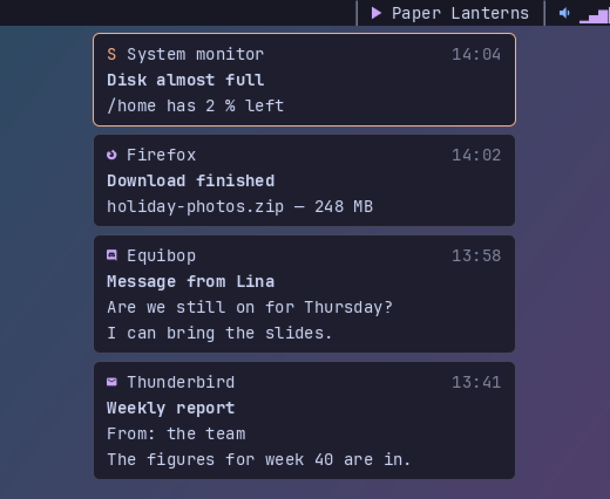

# The bar

One line per screen, with the modules you choose. This page says what it does, how to use it, how to
configure it, how it is built, which rules the tests enforce on it, and what it costs. It describes
the code as it is today. Most modules have a page of their own, linked below; the ones that do not
are described here.

## What it does

In the default `flat` style, the bar is a line of monospace characters on the theme's bar colour,
modules separated by a dim dot (`  ·  `), the active workspace on the theme's accent (see
[Themes](themes.md) and [Bar styles](themes.md#bar-styles)). There is one bar per screen, and screens
plugged and unplugged are tracked live. The bar, and the popups, panels and overlays that hang from
it:





### The modules

The table follows `ModuleId::ALL`'s order, which is the default `modules` list, left to right,
without the opt-in `keyboard`. A module that is not in `modules` runs
nothing: its source is never started. Its code is still linked in, a one-time cost of the binary
([measurements](../measurements.md)).

| Module | What it draws | Its page |
| --- | --- | --- |
| `launcher` | an icon that opens the launcher | [the launcher](launcher.md) |
| `workspaces` | one dot per window, the active workspace on `accent_container` | below |
| `window` | the active window's app icon and title | below |
| `keyboard` | `󰌌 us`, and the bind mode when not `default`; not in the default list | [the keyboard module](keyboard.md) |
| `media` | `▶ Title` while a player plays, `⏸ Title` paused, nothing when nothing plays | [media](media.md) |
| `privacy` | one glyph per capture: microphone, camera, screen | [privacy indicators](privacy.md) |
| `shield` | `󰒘`, green, only while Shield mode is on | [Shield mode](shield.md) |
| `failed` | `󰀦 N` when systemd has failed units, nothing at 0 | [failed units](failed.md) |
| `volume` | an icon and the percentage | below |
| `network` | the link icon and the VPN count | below |
| `bluetooth` | the connected device and its battery | below |
| `battery` | the laptop's battery and its peripherals' | below |
| `resources` | CPU, memory and temperature, each an icon and a figure | [the resources popup](resources.md) |
| `tray` | one glyph per application that registers a status icon | [the system tray](tray.md) |
| `notifications` | a bell with the unread count | [notifications](notifications.md) |
| `osd` | nothing in the bar: a pill at the bottom of the focused output | [the OSD](osd.md) |
| `quick` | nothing in the bar: the quick settings panel under a module | [quick settings](quick-settings.md) |
| `displays` | nothing in the bar: it reads the screens and applies the display profiles | [displays](displays.md) |
| `timer` | the focus timer's chip, a dim `󰔛` at rest | [the focus timer](timer.md) |
| `clock` | the date and the time | below, and [the calendar](calendar.md) |
| `power` | `⏻` at the bar's end, and its menu | [the power menu](power.md) |

### The modules described here

- **The launcher button.** An icon, the first module of the default list. A left click opens or
  closes the launcher inside the daemon, so nothing is run.
- **Workspaces.** One dot per window in each workspace, an empty workspace dimmed, the active one on
  `accent_container`, an urgent one in `urgent`. Beyond four windows the dots are summarised with a
  `+`, and a workspace name longer than 12 cells is cut. A left click goes to that workspace, and the wheel
  moves to the next or the previous one; both go through the `[workspaces] command`, never a write to
  the compositor.
- **The active window.** The application's icon and the window's title. The module is elastic: it
  takes the free space, so the modules on its right stay right-aligned. With no active window it
  draws nothing at all (no empty `· ·`), and the free space stays where the module sits in the
  configured order. The title is dropped when fewer than 8 cells are left for it.
- **Volume.** An icon by the level (low below 34 %, medium below 67 %, high above) and the
  percentage; muted, the off glyph and the word `muted`, both dim. The wheel changes the level by
  5 %, never above 100 %. With the `quick` module a left click opens the quick panel and a right
  click opens the control center's Sound tab; without it, a right click mutes.
- **Network.** The link icon (one Wi-Fi glyph, the wired one, or a VPN-only link's), a dim glyph when
  the link is offline, and `!` in the error colour when connectivity is limited. A VPN that is up
  adds its glyph, with the count from two VPNs on. A left click opens the quick panel, a right click
  (or the left one without `quick`) the control center's Network tab.
- **Bluetooth.** The connected device, cut to fit, with its battery when the device reports one and
  `+N` when more than one is connected; the plain glyph, dim, with nothing connected, and nothing at
  all with no adapter or the adapter powered off. A left click opens the quick panel, a right click
  (or the left one without `quick`) the control center's Bluetooth tab.
- **Battery.** The laptop's battery and the peripherals that report one: an icon and the percentage,
  in `warn` below 20 % and `error` below 10 %, both fixed; the separate `[battery] warn` list sends
  the low-battery notifications (see [notifications](notifications.md)). A left click opens the
  control center's Home tab.
- **The clock.** The date, muted, then the time in bold accent (`[clock] date` and `format`, both
  strftime). A left click opens the month's calendar under it.

A module that is waiting for its first reading draws nothing; a source that is down shows its icon
and then `–`.

### On a narrow screen

Modules disappear in a fixed order until the bar fits: the resources, the tray, media, the window
title, the keyboard layout, then Bluetooth, the network, the volume, the battery, the launcher button, the timer chip, the
failed-units count, the Shield glyph, the privacy indicators, and last the power button. The
workspaces, the clock and the notification bell always stay.

## Using it

**Clicks.** A left click opens the module's popup where it has one (media, privacy, the resources
figures, the timer chip, the bell, the clock, the power button, and the quick panel on volume,
network, Bluetooth and the Shield glyph); the other button — the right one, or the left one on a
module with no popup — opens the matching tab of the control center, through `[actions] open_tab`.
A middle click toggles do-not-disturb on the bell, pauses or resumes the timer on its chip, and
mutes the microphone on the privacy indicators. The wheel changes the volume on the volume module,
the track on media, and the workspace on the workspaces. Each module's page has its own table.

**Your own bindings.** `[bindings.<module>]` in `bar.toml` changes what one button of one module
does: `left`, `middle`, `right`, `wheel_up` and `wheel_down`, each either an argument list run as
written (`{tab}`, the module's control center tab, and `{output}`, the bar's connector, replaced in
it) or a verb: `none` (the button does nothing), `popup` (the module's own popup), `quick` (the
quick panel), `open_tab` (`[actions] open_tab` with the module's tab), `launcher`, `dnd` and `mute`
(the default output's mute). A button left out keeps the behaviour above. The window, and the clock
with `[clock] calendar = false`, have no click of their own: a binding gives them a zone that does
only what is bound. The workspaces and the tray take no binding. A wheel bound to `popup`, `quick`
or `launcher` toggles it once per notch: a second notch closes what the first opened. A bound
command runs as written: alpheus refuses only an argv naming `suspend`, `hibernate` or
`hybrid-sleep` (the machine is never put to sleep from the bar), and what any other command does is
the user's own choice.

**From a script or a key bind.** `alpheus-launch` drives the launcher, the notepad, the clipboard
history, the Tools menu, do-not-disturb, the notification history, the OSD, the quick panel, the
focus timer, Shield mode, the window switcher, the calculator, the power menu and the failed-units
refresh. Every verb, option and exit code is in [`docs/cli.md`](../cli.md). alpheus sets no key bind
itself.

**Known limits.**

- Right-to-left titles (Arabic, Hebrew) are drawn in logical order, not reordered.
- On Hyprland (any version; hyprwm/Hyprland#15729, fixed upstream in 0.56.2) the bar's keyboard
  interactivity stays `None` while a menu or the calendar holds a grab, which is detected from its
  `hyprland_*` globals. Everywhere else the bar goes `Exclusive` for the grab, because sway and niri
  give a grabbing popup no keyboard otherwise, while Hyprland hands it the keyboard itself and,
  before 0.56.2, an `Exclusive` layer surface swallowed its own popups' clicks, so each click inside
  a menu read as a click outside and closed it. The calendar, the power menu, the media popup and
  the resources popup point back here.

## Configuration

`bar.toml` in alpheus's configuration directory, read once at start, so a change takes effect when
`alpheus-demon` restarts. Every key is in [`docs/configuration.md`](../configuration.md), which
lists every key and its default from `config.rs`: `modules` decides which modules exist and in which
order, and each module has its own table there ([`[clock]`](../configuration.md#clock),
[`[workspaces]`](../configuration.md#workspaces), [`[battery]`](../configuration.md#battery),
[`[resources]`](../configuration.md#resources), and so on). An unknown module name, like any other
invalid key, makes the whole file fall back to its defaults with one warning in the log.

```toml
# ~/.config/alpheus/bar.toml
modules = ["launcher", "workspaces", "window", "volume", "clock"]

[bindings.volume]
right = ["pavucontrol"]          # run as written, never through a shell
wheel_up = "none"                # a verb: none, popup, quick, open_tab, launcher, dnd, mute

[bindings.clock]
middle = ["foot", "-e", "calcurse"]
```

A binding's errors (an empty list, a blank program, a sleep word, a verb whose popup, tab or module
is missing) name the key, never the command, and make the file fall back to its defaults like any other.

The colours and the bar's shape are in `theme.toml` ([Themes](themes.md)), and the launcher's own
settings in `launcher.toml` ([the launcher](launcher.md)).

## How it is built

The daemon is one event loop (calloop) on one thread. Sources on threads of their own feed one `Mail`
channel; the state is applied, then the grid is derived, then the painter draws. The map of the
modules and the walk through one event are in [`docs/ARCHITECTURE.md`](../ARCHITECTURE.md) and
[`docs/tour.md`](../tour.md); the files that carry the bar itself are:

- `wayland.rs`: one layer-shell surface per screen (the `Top` layer, anchored at the top, with an
  exclusive zone), tracked live, and a pointer for the clicks and the wheel. Nothing else is asked of
  the compositor, and a screen is redrawn only when its grid changes.
- `state.rs`: the bar's pure state — what the sources have said, and nothing else.
- `modules.rs`: every per-module fact, one row per module (its block, its hue, the control center tab
  of its click, its segment function, its popup, and the sources it needs).
- `segments.rs`: the segments of the system modules, each returning nothing when it has nothing to
  show. The whole segment is one click zone, except the tray's, which has one per icon.
- `layout.rs`: from the state to a screen's grid — the segments laid out left to right in the
  configured order, the elastic window module, the narrow-screen removal order, and the blocks of the
  block styles. A segment with no click zone of its own (the window, the clock without the calendar)
  gets a `Passive` one when a button of its module is bound (`wants_zone`).
- `actions.rs`: a click or a wheel turn turned into what it does. `bound` reads the button's
  binding first; `wayland.rs`'s `click` runs its argv through the executor, toggles its popup under
  the zone, toggles the launcher (the launcher button's press rule) or do-not-disturb, or does
  nothing, and only an unbound button goes on to the defaults (`command`, `ModulePopup::of`).
- `popup.rs`: the bar's popups, each an `xdg_popup` attached to the bar's own layer surface and placed
  under the cells it hangs from, drawn as rows of cells into a pool of its own. One at a time, and
  everything is dropped whole on close.
- `startup.rs`: assembling the daemon — the signals, the single-instance lock, the settings, the
  fonts, Wayland, the loop, and only the sources the modules need.

**What the bar reads, and what it writes.**

- **The compositor is only read**: Hyprland's and niri's event streams, Sway's i3 IPC, Mango's watch
  sockets. Switching workspace goes through the configurable command, and the only other writes are
  an output configuration ([displays](displays.md)) and the clipboard's own selection for a re-copy
  ([clipboard](clipboard.md)); alpheus never touches output power management.
- **Sound** comes from one `pw-dump` child, the only command the daemon keeps running.
- **Network, battery and Bluetooth** come from D-Bus, read-only, and no service is ever
  D-Bus-activated, with one exception: when the battery is wanted and UPower has no owner — it is
  activated on demand on some systems, NixOS among them — the daemon asks the bus for UPower once per
  session start, so the battery shows without another client starting it first. The quick panel's
  Bluetooth calls go through a second system-bus connection, open only while its detail is open or a
  call is in flight ([quick settings](quick-settings.md)).
- **The resources** come from `/proc` and `/sys`, at the tick of their own timer.
- **The tray** talks to the session bus (StatusNotifierItem, dbusmenu): one connection on the bar's
  own loop, with no thread. The media module speaks MPRIS on that same connection, or on one of its
  own when the tray is off, shared with the light/dark portal; the notification server and the
  failed-units user count ride it too. A closed session link is never reconnected.
- **The theme** is watched with one inotify instance ([Themes](themes.md)).

## Rules it keeps

These are enforced by tests, so a change that breaks one fails the build.

- `the_daemon_only_reads_from_the_compositor` (`tests/guardrails.rs`): the only writes to the
  compositor are the workspace command and the output configurations, built in `outputs/wlr.rs` and
  sent only from `outputs/app.rs`, plus the clipboard's own selection for a re-copy
  ([clipboard](clipboard.md)). `compositor_requests_are_read_only`,
  `mango_writes_only_its_request_lines`, `sway_writes_only_its_messages` and
  `compositor_sockets_opened_only_in_sources` pin each backend's requests, and
  `output_power_management_never_appears` keeps `dpms` and output power management out of alpheus
  altogether.
- `every_click_on_a_full_bar_stays_on_the_allowlist` and `every_click_only_runs_the_workspace_command`:
  every zone of a bar where every module is shown, every button, with the quick panel and without it,
  runs only a command of the allowlist, and each of those commands is reached by the test. They pin
  the defaults only: a user's binding runs what the user wrote.
- `every_user_binding_runs_as_written`: every button of every bindable module bound to an argv runs
  exactly that program and those arguments, `{tab}` and `{output}` replaced, through the executor:
  never `sh`, never `-c`, never `dpms`. `bindings_refuse_the_sleep_words` (`config/tests.rs`): an
  argv holding `suspend`, `hibernate` or `hybrid-sleep` as a whole word is an error naming only the
  key. `empty_bindings_change_no_click_byte_for_byte`: empty
  `[bindings.<module>]` tables change no zone, command or popup. The headless
  `a_bound_left_click_never_shows_the_calendar`: a bound button that has a default runs the binding
  alone.
- `a_passive_zone_takes_no_click_of_its_own`: a zone added for a binding gives its module no
  command, popup, launcher, do-not-disturb, timer or media action of its own.
- `d_bus_is_confined_to_sources_and_read_only`: the `dbus` crate appears in six files only — one
  under `src/sources/dbus/` and the session-bus plumbing — and the reading sources can call no
  method that changes anything; `the_bluetooth_connection_acts_only_through_act_method` pins the one
  connection that does act, and `the_portal_is_read_through_exactly_two_members` and
  `tray_d_bus_is_confined_and_allowlisted` the portal's and the tray's calls.
- `the_only_system_executor_is_wrapped_in_non_blocking`: `Executor::run` blocks for up to 2 s, so it
  is never reachable from the daemon, whose loop would freeze every bar.
- `the_only_stream_is_pw_dump_monitor`: the daemon keeps exactly one command running, `pw-dump`,
  started only by the sound source.
- `nothing_resident_while_the_launcher_is_closed`: every place that can start a thread, arm a timer,
  watch a descriptor or bind a keyboard is in one table with the reason it does not run at rest; a
  new one fails the test until it is added and justified.
- `the_tray_spawns_no_thread`: the files on its list start no thread, process or command.
- `the_daemon_paints_with_roles_never_the_legacy_palette`: the daemon paints with the 16 theme roles
  only.
- `eprint_forbidden_outside_tests`: the daemon's production code never uses `eprintln!`, which panics
  on a closed standard error; every line goes through its own log writer.
- `the_panic_hook_is_installed_before_anything_else`: the hook names the thread and the place, never
  the panic's message.
- The headless suite (`tests/headless_session.rs`) runs the real daemon against a disposable Sway
  and fake tools for each module's behaviour, and `tests/memory.rs` holds the budgets below.
- The reasons are in [decisions.md](../decisions.md): "A source that is down is not a state", "A
  closed session bus is never reconnected", "UPower is the one service the daemon may start" and
  "alpheus never handles sleep or the screens' power".

## What it costs

Measured in release on the headless harness, back to back with the version before it (the full
tables and the method are in [measurements](../measurements.md); the tests that measure are named
here).

- **At start** (all modules and the launcher, 3 outputs): ≈ 8.0 MB (`startup_pss_per_source`,
  8,144–8,246 KB over 3 runs), and ≈ 8.4–8.5 MB with the tray and 10 fake items, the launcher module
  off (`startup_pss_with_the_tray_under_15_mb`).
- **Under load:** ≈ 9.6–9.7 MB after 8,300 events and 5 plug cycles, stable, with 6 threads (D-Bus
  through libdbus accounts for one; the launcher and the tray add none).
- **Per style at start** (all modules, 3 outputs): `flat` ≈ 8.0 MB, the others −76…+116 KB over it
  (`startup_pss_per_style`).
- **At rest:** 0 wake-ups, the theme watch included. The bar's only timers are the clock's and the
  resources' (every 2 s, and only while the resources module is shown); every feature has its own
  `at_rest_no_wakeups_*` test, and each popup, panel and overlay is bounded by its own PSS test.
