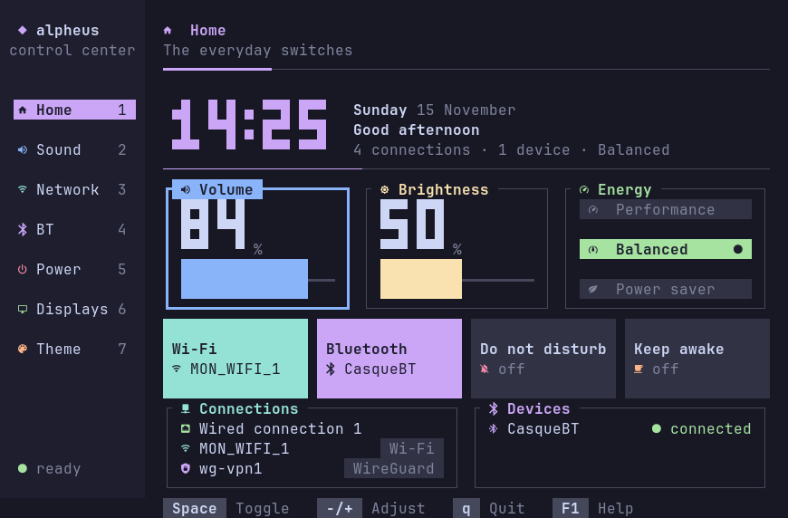
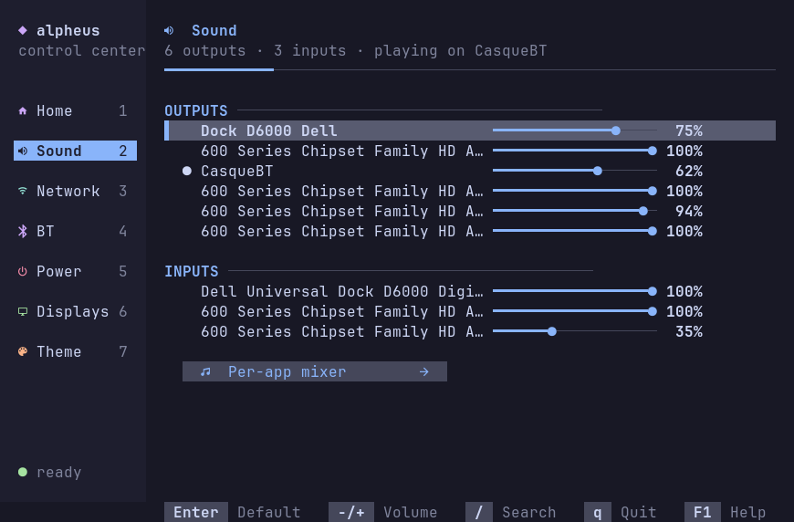

# The control center

`alpheus` is the terminal control center: a ratatui program with eight tabs (Home, Sound, Network,
Bluetooth (BT), Power, Displays, Theme, Diag). This page is written one tab at a time, in the order the
tabs are brought to the house standard (`docs/STYLE.md`); today it holds the Sound, Network,
Bluetooth, Power, Home, Displays, Theme and Diag tabs, which is all of them.

How the program is laid out, for every tab. The state lives in `crates/alpheus/src/app/` (one
`App` that every key, mouse event and worker answer changes, with no terminal and no thread of its
own) and the drawing in `crates/alpheus/src/ui/` (`render` draws the whole screen and returns the
map of clickable regions). A tab that has code of its own has a file of the same name in each
folder: `app/sound.rs` and `ui/sound.rs`, `app/network.rs` and `ui/network.rs`, and so on. What
every tab shares stays in `app/mod.rs`, `app/tab.rs` (one row of plain data per tab),
`ui/tabs.rs` (the item rows), `ui/rail.rs` (the rail, the tab hues) and `ui/mod.rs` (the frame
and the shortcut hints). The hints are drawn on the shortcut bar, the last row of the classic
layout; in the layout with the rail they are the keycaps row (`ui/rail.rs`). The status line, above
the shortcut bar, shows the tab's name and the last message.

The default keymap moves with the arrow keys. Dvorak navigation, `d`, `h`, `t`, `n` for left, down,
up and right, is off by default (`KeysConfig::default`, `dvorak_nav: false`); `[keys] dvorak_nav =
true` turns it on beside the arrows. The key tables below name the arrow keys only.

The next section, "How it is built (the whole program)", describes what every tab shares: the event
loop, the worker thread, the refresh rule, the keymap, the theme and the drawing. The sections
after it are one per tab.

## Keys, layout and shapes at a glance

| Key | Action |
|---|---|
| `1`…`8`, `Tab` / `Shift+Tab` | switch tabs |
| `Ctrl+P` | command palette (fuzzy search) |
| `/`, `Ctrl+F` | search a list |
| `F1`, `?` | help |
| `Esc` | go back; `q` quits |

`alpheus --tab <name>` opens directly on a tab (`home`, `sound`, `network`, `bluetooth`, `power`,
`displays`, `appearance`, `diagnostics`; `theme` is accepted for `appearance`, `diag` for
`diagnostics`; see [../cli.md](../cli.md)).

**Rail and hues.** In a terminal of at least 84 columns and 26 rows (an 87×26 window is enough) the
tabs become a left rail: the brand, then icon, name and number per tab, the active one filled with the
theme's accent container, and the status line at its foot. Each tab has its own hue (Home the accent,
Sound blue, Network cyan, BT purple, Power red, Displays green, Theme orange, Diag yellow) for its
header, headings, gauges and switches; a hue is only ever the ink of a glyph or a heading, never of text
on a fill (labels on a button, a chip or a tag are `fg`). Below that size the classic top tab bar and
rows are drawn, as before except for three changes: the keycaps' order, the Displays row dropping its
scale column at 80 columns, and the Theme tab's caption hiding when the rows need its room.

**Shapes.** The theme's `style` (see [Themes and bar styles](themes.md#bar-styles)) shapes the control
center too: `islands` cuts round caps and rounded frames, `powerline` arrow tips, `underline` drops the
fills for coloured, underlined text, `floating` draws double frames with drop shadows, and `flat` and
`translucent` stay square. `islands` and `powerline` use Nerd Font glyphs (U+E0B0, U+E0B4, U+E0B6),
like the bar: in a terminal without a Nerd Font they show as boxes; `flat` needs none.






The Home dashboard opens in well under 100 ms and shows only what the control center already reads:
the same keys and clicks reach the same items as in the classic rows.

The Diag tab's redaction is a safety net: it replaces the user name, home, host name and machine id,
MAC and IP addresses, UUIDs and anything shaped like an e-mail address; **Wi-Fi network names and USB
serial numbers are not touched**. Read the report before copying it.

## How it is built (the whole program)

The pieces, from the process outwards. Everything named here is in `crates/alpheus/src/`.

**One loop, one worker thread.** `app/run.rs` starts the program: it reads the command line
(`alpheus [--tab <name>]`), builds the `App` from the files in the config directory (`build_app`:
config.toml, the theme, the keys, displays.toml; a file that cannot be read gives its default and
a startup warning, never an error), starts the worker thread (`worker::spawn_with`) and a guard
thread, then runs `event_loop`. Each turn of the loop:

0. at the top of each turn it checks `should_exit` (a stop signal) and, if set, closes;
1. it sends the worker the requests the `App` has queued (`take_requests`);
2. it draws the whole screen (`ui::render`), which returns the map of clickable regions;
   If the `App` has quit (`should_quit`) it closes here, right after the draw;
3. if the `App` asked for an external tool (`take_external`: wiremix, nmtui, bluetui) or a system
   unit's action (`take_system_unit`), it hands the terminal over, runs it in the foreground
   and takes the screen back (`external_tools.rs`); the loop then starts its next turn and skips
   steps 4 to 6 for this one;
4. it waits up to 100 ms for a key or mouse event and gives it to the `App` (`on_key`, `on_mouse`);
5. it hands the `App` every answer the worker has sent (`on_update`);
6. it calls `App::on_tick`, which expires the toasts and decides what to read again.

The loop stops when the `App` says so (`should_quit`) or a stop signal arrived. Closing sends what
is queued, waits up to 2 seconds for a displays action still in the worker, then asks the daemon
to revert a display trial that is still open. A `Cleanup` guard restores the terminal and kills any
tool still running on every way out, a panic included; the guard thread ends the process shortly
after a stop signal if the loop is stuck.

The `App` itself holds no terminal and no thread: a key, a mouse event, a worker answer and a tick
are method calls, and what it wants done outside is mostly left in boxes the loop empties. Two
writes it makes itself, on the loop thread: theme.toml (the Theme tab's `appearance_apply`, which
then reloads the theme) and displays.toml (the Displays tab's save box, `profiles::save`). That is
why nearly everything is tested by calling methods on an `App` with no worker thread; the fake
backends are for the worker's own tests.

**The worker (`app/worker.rs`).** It is the only place that runs the backends, so a slow tool
never freezes the screen (a tool is killed after 2 seconds) while the program is up; at closing
`run.rs` itself asks the daemon to revert an open display trial. The `App` sends a `Request`:

- `Request::Refresh(domains)`: read these domains;
- `Request::Do(op)`: do this action (`Op`: set a volume, switch Wi-Fi, try a display layout,
  restart a user unit...);
- `Request::Diag(read)`: one of the Diag tab's reads that is not a repeated domain (crashes, the
  journal, the boot report, the bug report...).

and gets `Update`s back. The thread takes everything that has piled up, merges it (`coalesce`: the
last setting per slider wins, one refresh covers the union of the domains, a Diag read asked twice
is made once, a newer journal read replaces an older one), runs the requests in order and answers
each as soon as it is done. Every action the `App` counts in flight (those whose `Op::domains` is
not empty) gets exactly one answer, `Update::Done` or, for a setting dropped by the merge,
`Update::Superseded`, so that count always returns to zero. The failed-units poke
(`Op::FailedRefresh`) is not counted: it is sent once per burst and answered by `Update::Poke`. A
read streams an `Update` per domain as each is read (two for the failed units, one per systemd
manager). The functions that do the work (`fetch_with`, `diag_fetch`, `perform`) are plain
functions over the backends, called directly by tests.

**Domains and the refresh rule.** A `Domain` is a group of values read together: the volume, the
brightness, do not disturb, keep awake, the energy profiles, the network, Bluetooth, the audio
nodes, the displays, the failed units, and the session health. Each tab names the domains it
shows (`app/tab.rs`), and only the shown tab is read: nothing runs in the background, and nothing
when the window is closed (spec § 3, "Refresh"). `App::on_tick` asks for the shown tab's domains
once its period has passed: Home 1 second; Sound, Network, BT and Displays 2 seconds; Diag 5
seconds (held back while its journal view is open, which reads for itself); Power and Theme have
no period and are never read on a tick. A tab is also read when it is entered and after an action
(except after a slider that succeeded, so a drag does not jump back; a failed slider is read again,
which cancels the optimistic display). A domain whose read failed is not read on
the normal tick: it is tried again at most every 15 seconds (`FAILED_RETRY`; without it a failed
domain would be read again once per tab period, 1 to 5 seconds), and on entering the tab, on F5
(`Action::Refresh`), after an action, and on the return from an external tool (`external_done`).

While an action on a domain is in flight, reads of that domain are dropped (`App::on_update`),
because one launched before the action would bring the old state back over the new one that was
shown at once. A displays trial's end is the one thing still told from such a read.

**The keymap (`app/keymap.rs`).** `Keymap` maps a key press to an `Action`. The defaults are the
usual conventions (Ctrl+P, F1, Esc, the arrows, `1` to `8` for the tabs), plus the Dvorak
navigation keys when `[keys] dvorak_nav = true`; `[keys]` in config.toml overrides any action by name and takes its keys from every
other action, so one key never has two meanings. `app/input.rs` decides who gets a key first: an
open overlay (a confirmation, the command palette, help, the display trial's Keep box, an output's
settings panel, the save-profile box), then the search box, then the Diag tab's own views, then the
key table. `app/mouse.rs` does the same for the mouse, from the clickable regions of the last
drawn screen, and calls the same `App` methods, so a click and a key do the same thing. The
command palette (Ctrl+P) lists one entry per `Command` (`app/action.rs`: the toggles, going to a
tab, opening an external tool, the energy and display profiles, the power actions) and filters
them with the fuzzy search (`fuzzy.rs`).

**The palette of colours (`theme.rs`).** The control center resolves its theme at start, and again
after each write the Theme tab makes, through the same resolver the daemon uses (theme.toml, the mode, the colour files), and turns its
roles (16 colours and 7 hues) into ratatui colours (`Theme`). In mode `auto` it reads the mode the daemon
publishes in `$XDG_RUNTIME_DIR/alpheus/mode` (dark when there is no file); it never uses D-Bus. The
bar's `style` also gives the controls a `Shape` (square, round caps, arrow tips, underline, double
frames), which `ui/shape.rs` applies. The drawing only ever reads the `Theme`. The program writes two files of its own:
theme.toml (the Theme tab, `theme_file.rs`) and displays.toml (the Displays tab's save box,
`app/displays.rs` through `profiles::save`).

**The drawing (`ui/`).** `ui::render` draws two layouts: the classic one (tab bar, body, status
line, shortcut bar) in a small terminal, and from 84 by 26 the rail layout (`ui/rail.rs`: the
rail, a header, the keycaps row), where Home becomes a dashboard when its body is at least 64 by
20. The body of a tab is a list of rows (`ui/tabs.rs`) that the tab's own `ui/<tab>.rs` builds; the
overlays are drawn last so their regions win a click. Plain text is written through `ui/draw.rs`,
which clips to the area it was given (the frames of the overlays and the dashboard are ratatui
`Block`s rendered inside their rectangle, and the rail's buttons recolour one cell after their own
clip check), and every clickable region goes into the `HitMap` (`ui/hit.rs`).
Below 30 by 8 only a message is drawn.

## Sound

### What it does

The Sound tab lists the audio **outputs** (sinks), then the **inputs** (sources), each with a volume
slider, and a **Per-app mixer** button at the end. A dot marks the default output and the default
input. A node's name comes from `wpctl status`. While the audio data is loading the lists show
`…`; if the read failed they show its error; a list with nothing in it shows `none`.

```
 Outputs
 ▶   Dock D6000 Dell                 ██████████████████░░░░░░  75 %
   ● CasqueBT                        ███████████████░░░░░░░░░  62 %

 Inputs
   ● Stereo Microphone               ████████████████████████ 100 %

   [ Per-app mixer ]
```

(The classic layout, in a window narrower than 84 columns or shorter than 26 rows. From that size the tab is
drawn with the rail: a blue hue for its headings and gauges, the focused row as a band, and a
knob on each gauge. The items and their order are the same.)

### Using it

| Key (default) | What it does |
| --- | --- |
| ↑ ↓ | move to the previous or next item |
| ← → | lower or raise the volume of the focused node, like `-` and `+` |
| Enter | on an output or an input: make it the default; on the button: open the mixer |
| `-` `+` | lower or raise the volume of the focused node by 5 points |
| `/` or Ctrl+F | search: only the nodes whose name matches the text are listed (a fuzzy match) |
| Esc | clear the search; with an empty search, go back to Home |
| F5 | read the audio data again |

With the mouse: a click on a row selects it and makes it the default (the same as Enter); a click
or a drag on a gauge sets the volume; the wheel over a gauge changes it by 5 points, and the wheel
elsewhere moves the focus; a click on the button opens the mixer.

Two rules about the volume. It is never sent above 100 %: `wpctl` is called with `-l 1.0`. And a
node already above 100 % (wpctl allows it) is not lowered by `+`: a requested increase would be
clamped to 100 and would lower the sound (a comment in `App::set_slider`). The first `-` brings it
to 100 % (`set_slider` clamps; `volume_above_100_is_never_lowered_by_plus`). After a successful
volume change the tab is not read again: the value shown is already the new one,
and a read in the middle of a drag would make the slider jump (a comment in `App::op_done`).

The **Per-app mixer** button opens the program set under `[commands] mixer` in `config.toml`
(default `wiremix`) in alpheus's own window. The other keys (the number keys for the tabs, Ctrl+P
for the palette) are the same on every tab, and `[keys.bindings]` assigns other keys to any of them.

### Configuration

The tab has one setting of its own, in `config.toml`, read once when the control center starts:

| Key | Default | Meaning |
| --- | --- | --- |
| `[commands] mixer` | `["wiremix"]` | the program and arguments the Per-app mixer button runs |

The keys come from `[keys]` and `[keys.bindings]` (the names are `activate`, `increase`,
`decrease`, `search`, `refresh`; see [the action list](../configuration.md#configtoml)).

### How it is built

Two files, one per layer, and the tab's row in `app/tab.rs`.

- `app/sound.rs`: `items` (the focusable items, in drawing order), `App::visible_nodes` (the
  outputs and inputs that pass the search) and `App::set_default` (make a node the default). The
  audio data itself (`App::data.audio`) and the slider helpers (`slider_value`, `set_slider`,
  `nudge_slider`; a node's slider is a `SliderId::Node`) are in `app/mod.rs`, beside the volume
  and brightness sliders of Home.
- `ui/sound.rs`: `rows` (the heading, node and button rows) and `hints` (the keys named on the
  shortcut bar, or the keycaps row in the rail). A row is drawn by the shared item drawing in `ui/tabs.rs`.
- `app/tab.rs`: the tab's row says it is searchable, that it is read every 2 seconds while it is
  shown, from the `Domain::Audio` domain, and that its label column is 34 cells wide.

**Refresh.** Only the visible tab is read (`docs/specs/2026-10-02-alpheus-v1-design.md`, § 3:
nothing runs in the background and nothing runs when the window is closed). `App::on_tick` asks
the worker for `Domain::Audio` once the tab's period has passed; a failing read is tried again at
most every 15 seconds (a broken tool must not be relaunched every second: a comment in
`App::on_tick`).

**The path of one change**, choosing another output as the default:

1. Enter, or a click, reaches `App::activate`, which sees the focused item is a
   `SliderId::Node` and calls `set_default` (`app/sound.rs`).
2. `set_default` marks the node as default in its own list at once (when the audio data is
   loaded and holds the id), then calls `send_op` with
   `Op::SetDefault(id)`. `send_op` notes that `Domain::Audio` and `Domain::Volume` have a change in
   flight and leaves a `Request::Do` in the box the real loop empties.
3. The worker thread runs `wpctl set-default <id>` (`WpctlSound::set_default`), through the
   injectable command executor, and answers with `Update::Done`.
4. Until then a read of those domains that arrives is dropped (`App::on_update`). On the answer
   the tab is read again (`op_done`), so what is shown is what `wpctl` now says.

### Rules it keeps

- `activating_an_output_makes_it_the_default` (`app/tests.rs`): the output becomes the default, the
  default input does not move, and exactly one `SetDefault` is queued.
- `search_filter` (`app/tests.rs`): the search narrows the outputs and the items, and the focus is
  kept inside the list.
- `items_per_tab` (`app/tests.rs`): the order of the items, with the mixer button last.
- `volume_above_100_is_never_lowered_by_plus` (`app/tests.rs`).
- `the_sound_tab_shows_both_lists_the_mixer_button_and_its_hints` (`ui/tests.rs`): the rows, the clickable regions and the hints on the shortcut bar.
- `the_sound_tab_at_80_by_24_matches_its_snapshot` (`ui/sound/tests.rs`, its snapshot in
  `ui/sound/snapshots/`): the whole 80 by 24 screen.
- `every_launched_command_is_on_the_allowlist` (`tests/guardrails.rs`): every command the backends
  run is on the allowed list, `wpctl` included. That no test runs the real tool is CLAUDE.md's rule
  ("Never a real call in tests": the tests use the fake executor).

### What it costs

The control center is not measured tab by tab. What the specs fix for it as a whole: the first
render in under 100 milliseconds, and nothing read while a tab is not shown. This tab's reads are
one `wpctl status` every 2 seconds while it is shown, and nothing otherwise. (Reason for the 2
second period: not recorded.)

## Network

### What it does

The Network tab has the **Wi-Fi** switch, the list of **active connections**, and a **Choose a
network** button at the end. Each connection line gives its name, its kind (Wi-Fi, Ethernet,
WireGuard, VPN, Bluetooth, or the type NetworkManager reports) and the device it runs on; the
loopback connection is never listed. While the data is loading the list shows `…`; if the read
failed it shows its error; with no connection it shows `none`.

```
 ▶ Wi-Fi               [■] on

 Active connections
   Wi-Fi      MON_WIFI_1  (wlp0s1f01)
   Ethernet   Wired connection 1  (enp0s0u1u2i10)

   [ Choose a network ]
```

(The classic layout, in a window narrower than 84 columns or shorter than 26 rows. From that size the tab is
drawn with the rail: a cyan hue for its heading, the switch as an on/off switch, a glyph for each
kind of connection, and the button with a glyph. The items and their order are the same.)

### Using it

| Key (default) | What it does |
| --- | --- |
| ↑ ↓ | move to the previous or next item |
| Space or Enter | on the Wi-Fi switch: turn Wi-Fi on or off |
| Enter | on the button: open the network tool |
| `/` or Ctrl+F | search: only the connections whose name matches the text are listed (a fuzzy match) |
| Esc | clear the search; with an empty search, go back to Home |
| F5 | read the network data again |

With the mouse: a click on the switch's row turns Wi-Fi on or off; a click on the button opens the
tool. The search narrows the list of connections only; the two items stay.

The switch changes at once and the command follows: the value shown is already the new one, and
from the change until the worker answers, any read of that domain that arrives is dropped
(`App::is_pending`, `stale_read_ignored_during_a_toggle`), whether it was launched before the
change or after, so it cannot flip the switch back. If the state is not known yet (still loading,
or the read failed), the switch does nothing and a message says `Wi-Fi: unknown state`. If the
command fails, a message says `Wi-Fi: <error>` and the tab is read again, which puts back what
`nmcli` says (the comment in `App::op_done`: "cancels the optimistic display").

These commands are also in the palette (Ctrl+P, on any tab: `palette_entries`): **Wi-Fi** is the
same switch and **Choose a network** the same button, so they can be run from another tab.

The **Choose a network** button opens the program set under `[commands] network` in `config.toml`
(default `nmtui`) in alpheus's own window: alpheus leaves its screen, the tool runs, and alpheus
takes its screen back when it ends and reads the tab again, because the tool may have changed
anything. If the tool cannot start, the status line and a message say `Choose a network: <why>`.

### Configuration

The tab has one setting of its own, in `config.toml`, read once when the control center starts:

| Key | Default | Meaning |
| --- | --- | --- |
| `[commands] network` | `["nmtui"]` | the program and arguments the Choose a network button runs |

The keys come from `[keys]` and `[keys.bindings]` (the names are `toggle`, `activate`, `search`,
`refresh`; see [the action list](../configuration.md#configtoml)).

### How it is built

Two files, one per layer, and the tab's row in `app/tab.rs`.

- `app/network.rs`: `items` (the Wi-Fi switch, then the button). Three things are in `app/mod.rs`
  and `app/action.rs`, each because another place uses it: the switch's change (`App::toggle`,
  `ToggleId::Wifi`; Home has the same switch), the network data (`App::data.network`, a
  `NetStatus`; Home reads `Domain::Network` too) and the opening of the external tool
  (`Command::Open`, `External::Network`; the palette's "Choose a network" and Sound's mixer
  button run the same command).
- `ui/network.rs`: `rows` (the switch, the heading, the connection lines, the button) and `hints`
  (the keys named on the shortcut bar, or the keycaps row in the rail). The switch and the button
  are drawn by the shared item drawing in `ui/tabs.rs`. A connection line is the kind (padded to
  10), the name and the device in parentheses in the classic layout; in the rail, a glyph, the
  name (padded to 24), the kind (padded to 10) and the device.
- `app/tab.rs`: the tab's row says it is searchable, that it is read every 2 seconds while it is
  shown, from the `Domain::Network` domain, and that its label column is 20 cells wide.

**Refresh.** Only the visible tab is read (`docs/specs/2026-10-02-alpheus-v1-design.md`, § 3:
nothing runs in the background and nothing runs when the window is closed). `App::on_tick` asks
the worker for `Domain::Network` once the tab's period has passed; a failing read is tried again
at most every 15 seconds (a broken tool must not be relaunched every second: a comment in
`App::on_tick`).

**The path of one change**, turning Wi-Fi off:

1. Space, Enter or a click reaches `App::toggle` with `ToggleId::Wifi`.
2. `toggle` flips `wifi_enabled` in the loaded data at once, then calls `send_op` with
   `Op::SetWifi(false)`. `send_op` notes that the network domain has a change in flight and leaves
   a `Request::Do` in the box the real loop empties.
3. The worker thread runs `nmcli radio wifi off` (`NmCli::set_wifi`), through the injectable
   command executor, and answers with `Update::Done`.
4. Until then a read of that domain that arrives is dropped (`App::on_update`, `is_pending`). On
   the answer a message says `Wi-Fi: off` and the data is read again, so what is shown is what
   `nmcli` now says. If the command failed, the message is `Wi-Fi: <error>` and the same read
   cancels the optimistic display (`App::op_done`).

### Rules it keeps

- `items_per_tab` (`app/tests.rs`): the Network tab's items, the switch then the button.
- `optimistic_toggle`, `stale_read_ignored_during_a_toggle`, `two_toggles_wait_for_both_responses`
  (`app/tests.rs`): the switch shows the new value at once and a stale read does not undo it.
- `tick_refreshes_sound_network_bluetooth_every_two_seconds` (`app/tests.rs`): a read after 2
  seconds, none before, and the period restarts from the read.
- `network_bluetooth_power_tabs` (`ui/tests.rs`): the heading, a connection and the button are on
  screen.
- `headings_take_the_tab_hue` (`ui/tests.rs`): the heading is drawn in the tab's cyan.
- `the_network_tab_at_80_by_24_matches_its_snapshot` (`ui/network/tests.rs`, its snapshot in
  `ui/network/snapshots/`): the whole 80 by 24 screen.
- `exact_commands` (`alpheus-common`, `backends/network.rs`): the exact `nmcli` lines, and no
  other.
- `every_launched_command_is_on_the_allowlist` (`tests/guardrails.rs`): every command the backends
  run is on the allowed list, `nmcli` included. That no test runs the real tool is CLAUDE.md's rule
  ("Never a real call in tests": the tests use the fake executor).

### What it costs

The control center is not measured tab by tab. What the specs fix for it as a whole: the first
render in under 100 milliseconds, and nothing read while a tab is not shown. This tab's reads are
two `nmcli` commands every 2 seconds while it is shown (the Wi-Fi radio, and the active
connections), and nothing otherwise. (Reason for the 2 second period: not recorded.)

## Bluetooth

### What it does

The Bluetooth tab (named **BT** in the tab bar) has the **Bluetooth** switch, the list of
**connected devices**, and a **Pair a device** button at the end. Each device line gives its name
and its address. While the data is loading the list shows `…`; if the read failed it shows its
error; with the adapter off it shows `Bluetooth is off`; with nothing connected it shows `none`.

```
 ▶ Bluetooth           [■] on

 Connected devices
   CasqueBT  (AA:BB:CC:DD:EE:01)

   [ Pair a device ]
```

(The classic layout, in a window narrower than 84 columns or shorter than 26 rows. From that size the tab is
drawn with the rail: a purple hue for its heading, the switch as an on/off switch, a glyph before
each device, and the button with a glyph. The items and their order are the same.)

### Using it

| Key (default) | What it does |
| --- | --- |
| ↑ ↓ | move to the previous or next item |
| Space or Enter | on the Bluetooth switch: turn the adapter on or off |
| Enter | on the button: open the pairing tool |
| `/` or Ctrl+F | search: only the devices whose name matches the text are listed (a fuzzy match) |
| Esc | clear the search; with an empty search, go back to Home |
| F5 | read the Bluetooth data again |

With the mouse: a click on the switch's row turns the adapter on or off; a click on the button
opens the tool. The search narrows the list of devices only; the two items stay.

The switch behaves as the Wi-Fi switch of the Network tab: it changes at once, a stale read does
not undo it, with the state unknown it does nothing and a message says `Bluetooth: unknown state`,
and a failed command says `Bluetooth: <error>` and reads the tab again. The palette (Ctrl+P, on
any tab) has the same two commands: **Bluetooth** and **Pair a device**.

The **Pair a device** button opens the program set under `[commands] bluetooth` in `config.toml`
(default `bluetui`) in alpheus's own window, and reads the tab again when it ends. If the tool
cannot start, the status line and a message say `Pair a device: <why>`.

### Configuration

The tab has one setting of its own, in `config.toml`, read once when the control center starts:

| Key | Default | Meaning |
| --- | --- | --- |
| `[commands] bluetooth` | `["bluetui"]` | the program and arguments the Pair a device button runs |

The keys come from `[keys]` and `[keys.bindings]` (the names are `toggle`, `activate`, `search`,
`refresh`; see [the action list](../configuration.md#configtoml)).

### How it is built

Two files, one per layer, and the tab's row in `app/tab.rs`.

- `app/bluetooth.rs`: `items` (the Bluetooth switch, then the button). Three things are in
  `app/mod.rs` and `app/action.rs`, each because another place uses it: the switch's change
  (`App::toggle`, `ToggleId::Bluetooth`; Home has the same switch), the Bluetooth data
  (`App::data.bluetooth`, a `BtStatus`; Home reads `Domain::Bluetooth` too) and the opening of the
  external tool (`Command::Open`, `External::Bluetooth`; the palette's "Pair a device" and Sound's
  mixer button run the same command).
- `ui/bluetooth.rs`: `rows` (the switch, the heading, the device lines, the button) and `hints`
  (the keys named on the shortcut bar, or the keycaps row in the rail). The switch and the button
  are drawn by the shared item drawing in `ui/tabs.rs`. A device line is the name and the address
  in parentheses in the classic layout; in the rail, a glyph, the name (padded to 24) and the
  address.
- `app/tab.rs`: the tab's row says it is searchable, that it is read every 2 seconds while it is
  shown, from the `Domain::Bluetooth` domain, and that its label column is 20 cells wide.

**Refresh.** As for the Network tab: only the visible tab is read, `App::on_tick` asks the worker
for `Domain::Bluetooth` once the 2 seconds have passed, and a failing read is tried again at most
every 15 seconds.

**The path of one change**, turning Bluetooth off, is the Network tab's with `ToggleId::Bluetooth`
and `Op::SetBluetooth(false)`; the worker runs `bluetoothctl power off`
(`BluetoothCtl::set_power`), and the message on the answer is `Bluetooth: off`.

### Rules it keeps

- `items_per_tab` (`app/tests.rs`): the Bluetooth tab's items, the switch
  (`Toggle(Bluetooth)`) then the button (`Button(Open(Bluetooth))`).
  `network_bluetooth_power_tabs` (`ui/tests.rs`) checks that the heading, a device and the button
  are drawn.
- `optimistic_toggle`, `stale_read_ignored_during_a_toggle`, `two_toggles_wait_for_both_responses`
  (`app/tests.rs`): the switch rule, tested on the Wi-Fi switch, the same code.
- `tick_refreshes_sound_network_bluetooth_every_two_seconds` (`app/tests.rs`): a read after 2
  seconds, none before.
- `the_bluetooth_tab_at_80_by_24_matches_its_snapshot` (`ui/bluetooth/tests.rs`, its snapshot in
  `ui/bluetooth/snapshots/`): the whole 80 by 24 screen.
- `powered_off_does_not_list_devices` and `exact_commands` (`alpheus-common`,
  `backends/bluetooth.rs`): an adapter that is off lists no device, and the exact `bluetoothctl`
  lines.
- `every_launched_command_is_on_the_allowlist` (`tests/guardrails.rs`): every command the backends
  run is on the allowed list, `bluetoothctl` included.

### What it costs

The same as the Network tab: nothing read while the tab is not shown, and while it is shown one
`bluetoothctl show` every 2 seconds, plus one `bluetoothctl devices Connected` when the adapter is
on. (Reason for the 2 second period: not recorded.)

## Power

### What it does

The Power tab is five buttons: **Lock**, **Log out**, **Suspend**, **Reboot** and **Power off**.
It shows nothing else and reads nothing. Log out, Reboot and Power off ask first: a box
**Confirmation** with the question (`Log out of the session?`, `Restart the computer?`,
`Shut down the computer?`) and two buttons, **Cancel** and **Confirm**. Lock and Suspend run at
once.

```
 ▶ [ Lock ]

   [ Log out ]

   [ Suspend ]

   [ Reboot ]

   [ Power off ]
```

(The classic layout, in a window narrower than 84 columns or shorter than 26 rows. From that size the tab is
drawn with the rail: a red hue, and a glyph and an arrow on each button. The items and their
order are the same.)

### Using it

| Key (default) | What it does |
| --- | --- |
| ↑ ↓ | move to the previous or next button |
| Enter | run the focused button's action, after the question for the three that ask |
| ← → | in the question: move to Cancel (left) or Confirm (right), and stay at the end |
| Tab or Shift+Tab | in the question: switch between Cancel and Confirm |
| Enter | in the question: do what the focused button says |
| Esc or `q` | in the question: cancel (`q` does not quit while the question is open); with no question open, Esc goes back to Home |

There is no search on this tab. With the mouse: a click on a button is Enter on it; in the
question, a click on Cancel or Confirm answers it, and a click elsewhere does nothing.

The five actions are also in the palette (Ctrl+P, on any tab: `palette_entries`), and the palette
runs them through the same `App::run_command`: **Power off**, **Reboot** and **Log out** from the
palette get the same question, with the focus on Cancel.

In the question the focus starts on **Cancel**, so that an Enter pressed by reflex runs nothing (a
comment on `Confirm::yes_focused`). The spec asks for the confirmation on power off, reboot and
log out (`docs/specs/2026-10-02-alpheus-v1-design.md`, § 2); the code says the rule is "whatever
closes the session or the machine" (`PowerAction::needs_confirm`). Why Suspend does not ask: reason
not recorded.

### Configuration

None: the commands are fixed in the backend and the tab reads no setting of its own. The keys come
from `[keys]` and `[keys.bindings]` (the names are `activate`, `left`, `right`, `back`; see
[the action list](../configuration.md#configtoml)).

What each button runs (`SessionPower::perform`, through the injectable command executor):

| Button | Command |
| --- | --- |
| Lock | `hyprlock`, started and left to run on its own |
| Log out | `wm-set exit` |
| Suspend | `systemctl suspend` |
| Reboot | `systemctl reboot` |
| Power off | `systemctl poweroff` |

### How it is built

Two small files and the tab's row in `app/tab.rs`.

- `app/power.rs`: `items` (one button per `PowerAction`, in the order of `PowerAction::ALL`). The
  rest is shared, in `app/mod.rs`: `App::run_command` opens the question (`Overlay::Confirm`) for
  an action that needs it, and sends `Op::Power` straight away for the others;
  `App::close_confirm` sends `Op::Power` only when the question is answered Confirm (answered
  Cancel, it sends nothing). The question is drawn by `ui/overlays.rs`.
- `ui/power.rs`: `hints` only (the one key named on the shortcut bar, or the keycaps row in the
  rail). The rows are not here: Home and Power list one row per item with a blank row between
  them, and that one arm is in `ui/tabs.rs` (`Tab::Home | Tab::Power`).
- `app/tab.rs`: the tab's row says it is not searchable, that it is never read (no domain, no
  period), and that its label column is 20 cells wide.

**The path of one action**, Power off:

1. Enter, or a click, reaches `App::activate`, which sees a `Command::Power` button and calls
   `run_command`. (The palette's **Power off** entry calls `run_command` directly, and the path
   goes on from step 2.)
2. `run_command` sees that Power off needs a confirmation and opens `Overlay::Confirm` with
   the focus on Cancel. Nothing is sent.
3. Confirm, by Enter with the focus moved to it or by a click, reaches `close_confirm`, which
   sends `Op::Power(Poweroff)`.
4. The worker runs `systemctl poweroff` and answers with `Update::Done`.

### Rules it keeps

- `items_per_tab` (`app/tests.rs`): the Power tab's items are exactly one `Command::Power` button
  per `PowerAction::ALL`, in that order.
- `power_with_or_without_confirmation` (`app/tests.rs`): Power off opens the question and queues
  nothing; Lock queues `Op::Power` at once.
- `confirmation_from_the_keyboard`, `arrow_keys_in_the_confirmation` (`app/input/tests.rs`) and
  `confirmation_with_the_mouse` (`app/mouse.rs`): the question starts on Cancel. The keyboard
  test covers `q` (cancels, does not quit), Enter on Cancel (sends nothing), → then Enter on
  Confirm (queues `Op::Power`) and Esc; the arrow test covers ←, → and, with Dvorak navigation turned on, `d` and `n`, Tab and Shift+Tab, and that nothing is queued without Enter. The mouse test covers a
  click on Confirm (queues `Op::Power`), and that a click outside or on a tab under the question
  does nothing; a click on Cancel has no test.
- `tick_reads_nothing_on_power` and `changing_tab` (`app/tests.rs`): nothing is read on this tab,
  not even after a minute.
- `confirmation_for_logout_reboot_and_poweroff` and `exact_commands` (`alpheus-common`,
  `backends/power.rs`): the three actions that ask, and the exact commands.
- `power_buttons_with_glyphs` (`ui/tests.rs`): each button has its glyph, and the focused one is
  filled with the tab's red.
- `the_power_tab_at_80_by_24_matches_its_snapshot` (`ui/power/tests.rs`, its snapshot in
  `ui/power/snapshots/`): the whole 80 by 24 screen.
- `every_launched_command_is_on_the_allowlist` (`tests/guardrails.rs`): every command the backends
  run is on the allowed list, and none names a display power-off.

### What it costs

Nothing while the tab is shown or not: it reads no data. The first-render budget for the control
center as a whole is under 100 milliseconds (`docs/specs/2026-10-02-alpheus-v1-design.md`).

## Home

### What it does

Home is the first tab and the everyday one: two sliders (**Volume** and **Brightness**), four
switches (**Wi-Fi**, **Bluetooth**, **Do not disturb**, **Keep awake**) and the **Energy profile**
(the power profiles the system offers, one of them active). It reads these seven things and nothing
else, apart from the list of active connections and the connected Bluetooth devices, which the
dashboard shows.

With the rail and a body of at least 64 columns by 20 rows (an 87 by 26 window, the size it is
tested at, leaves a 67 by 20 body beside the rail), Home is a **dashboard**: a clock in large
block digits with the date, a greeting (`Good morning` from 5 to 11 o'clock, `Good afternoon` from 12
to 17, `Good evening` otherwise) and a one-line summary (`2 connections · 1 device · Balanced`); a card
for the volume, one for the brightness and one for the energy profile; four tiles for the switches,
filled with their colour when on and showing what is connected (the Wi-Fi network, the first
Bluetooth device); and the two lists, **Connections** and **Devices**. The cards and tiles take the
shape of the theme's `style` (round caps under `islands`, arrow tips under `powerline`, no fill under
`underline`, double frames under `floating`). In a smaller body the tab is plain rows (the classic
layout, or any window without the rail):

```
 ▶ Volume              ███████████████░░░░░░░░░  62 %

   Brightness          ████████████░░░░░░░░░░░░  50 %

   Wi-Fi               [■] on

   Bluetooth           [■] on

   Do not disturb      [ ] off

   Keep awake          [ ] off

   Energy profile       Balanced   Performance   Power saver
```

(What the rows say is the same on the dashboard: the same seven items in the same order, so the
keys, the palette and the mouse reach the same things.)

### Using it

| Key (default) | What it does |
| --- | --- |
| ↑ ↓ | move to the previous or next of the seven items |
| ← → or `-` `+` | on a slider: lower or raise it by 5 points; on the energy profile: the previous or next profile |
| Space | on a switch: turn it on or off |

There is no search on this tab. With the mouse: a click on a card or a tile selects it, and on a
tile switches it; a click or a drag on a gauge sets the value; a click on a profile chooses it.

The volume and brightness sliders follow the rules the Sound tab states (never above 100 % from here;
the brightness never goes below its minimum percentage, `brightness::MIN_PERCENT`).

### Configuration

None of its own. The keys come from `[keys]` and `[keys.bindings]` (the names are `toggle`,
`increase`, `decrease`, `left`, `right`). The dashboard's colours and shapes come from the theme
(`theme.toml`, the Theme tab below).

### How it is built

Two files and the tab's row in `app/tab.rs`.

- `app/home.rs`: `items`, the seven focusable items in the order they are drawn. What they do is
  shared, in `app/mod.rs`: `App::adjust` (sliders and profile), `App::toggle` (the four switches),
  `Command::SetProfile`. Their data is in `App::data` (volume, brightness, Wi-Fi, Bluetooth, Dnd,
  Keep awake, profiles, and the two lists).
- `ui/home.rs`: the dashboard (`render`, and one function per card, tile and list), the clock
  (`LocalTime`, passed in by `ui::render_at` so a test can draw at any time) and the shortcut hints.
  The rows used without the rail or below 64 by 20 are the shared arm `Tab::Home | Tab::Power` of `ui/tabs.rs`, which
  stays there because Power draws its rows with the same code (see the Power section); the items are
  drawn by the shared item drawing in the same file.
- `app/tab.rs`: the tab's row says it is not searchable, that it is read every second while it is
  shown (the Volume, Brightness, Dnd, KeepAwake, Profiles, Network and Bluetooth domains) and that its
  label column is 20 cells wide.

**The dashboard's seven positions.** `ui/home.rs` names the items by position (`VOLUME` is 0, `WIFI`
is 2, and so on) and a test (`home_item_indices_match_the_app`) fails if `app/home.rs` reorders them.

**The layout.** `bands` gives the heights: at 20 rows a 4-row clock, 7-row cards, 4-row tiles and what
is left for the lists. Each row more goes, in the order cards, gap, cards, tiles, gap, clock, cards,
tiles, cards, tiles (`ORDER`); it stops after ten rows, and any further row goes to the lists. The two
lists are drawn only if four rows are left for them. The clock tries three arrangements in turn
(two-cell digits with the date beside them, one-cell digits beside them, two-cell digits with the date
stacked) and takes the first that fits; when none does, it falls back to one-cell digits with the
date, greeting and summary stacked.

### Rules it keeps

- `items_per_tab` (`app/tests.rs`): seven items on Home.
- `home_item_indices_match_the_app` (`ui/home/tests.rs`): the positions the dashboard names are the
  app's.
- `the_dashboard_needs_a_64x20_body` and `small_bodies_keep_the_rows` (`ui/home/tests.rs`): the
  thresholds, and the rows below them.
- `dashboard_hits_reach_today_s_actions` (`ui/home/tests.rs`): a click on a tile, on a gauge and on a
  profile option reaches the same action as the rows.
- `an_87_by_26_window_shows_the_whole_dashboard` and `a_clock_strip_that_just_fits_gets_the_two_cell_digits`
  (`ui/home/tests.rs`): the dashboard whole at 87 by 26, and the clock's choice at its edge.
- `the_dashboards_hints_follow_the_keymap` (`ui/home/tests.rs`): the hints read the keymap's labels.
- `the_dashboard_at_120_by_36_matches_its_snapshot` and `the_home_tab_at_80_by_24_matches_its_snapshot`
  (`ui/home/tests.rs`, their snapshots in `ui/home/snapshots/`).

### What it costs

The first render of the dashboard is checked to take under 100 milliseconds even when the tools are
slow (`first_render_of_the_dashboard_under_100_ms_even_with_slow_tools`, `tests/first_render.rs`;
[measurements](../measurements.md): 218–300 µs). Home is read once a second while it is shown and never otherwise (the period:
the spec's, § 3).

## Displays

### What it does

The Displays tab shows the screens and changes them: a **profile bar** (the saved profiles, then
`+ Save current`), a **map** of the enabled screens drawn to scale (each with its number and short
name; `●` marks the one focused in the list), and **one row per output** with its number and short
name, its connector (`⚠` for a DisplayLink output), a switch (`[■] on`, `[■] only on` for the last
active screen, `[ ] off`), its mode, its scale and where it is placed (`origin`, `right of Alpha`,
`below Alpha, centered`, `position 0, 1080`).

Every change is a **trial**: the change is applied and a box, **Keep these settings?**, shows what
changed and `Automatic rollback in N s` (15 seconds). The focus starts on **Cancel**. Keep makes the
change permanent; Cancel, the end of the countdown, or closing alpheus puts the previous settings
back. The tab is locked while a trial or another change is in progress, and after one until a fresh
read has come: a change is never planned on screens that may have been rolled back.

```
 ▶ Profiles   [ Laptop seul ]  [ Bureau ]  [ + Save current ]

 Map
    ┌──Alpha───┐┌──Bravo──┐
    │    2     ││    3    │
    └──────────┘└─────────┘
   ┌───Laptop────┐
   │             │
   │      1      │
   │             │
   └─────────────┘

 Displays
   1 Laptop     eDP-1     [■] on        2560×1600@60  position 0, 1080
   2 Alpha      DVI-I-1 ⚠ [■] on        1920×1080@60  origin
   3 Bravo      HDMI-A-1  [■] on        1920×1080@240 right of Alpha
```

(The classic layout at 80 columns, copied from the snapshot of
`the_displays_tab_at_80_by_24_matches_its_snapshot` in `ui/displays/tests.rs`. From 84 columns by 26 rows the tab is drawn with the rail, in green; at 80
columns the scale column is dropped, and when the placement text still does not fit the connector
too: the placement is what the tab is for, a comment in `ui/displays.rs`.)

The settings panel of an output has the fields **Mode**, **Scale**, **Rotation**, **Placement** and,
for a placement relative to another screen, **Reference** and **Alignment**, then **Cancel** and
**Apply**. If the geometry refuses the draft, Apply is greyed out and the reason is shown.

### Using it

| Key (default) | What it does |
| --- | --- |
| ↑ ↓ | move over the profile bar and the outputs |
| ← → | on the profile bar: choose a profile (or `+ Save current`) |
| Enter | on the profile bar: apply the profile, or open the name entry for `+ Save current`; on an output: open its settings panel |
| Space | on an output: switch it on or off (never the last active one) |
| ↑ ↓, ← → or `-` `+` | in the panel: the previous or next field; the value of the field |
| `/` | in the panel, on Mode: search a mode (a substring, so `1280` does not find `1920x1080`) |
| Enter | in the panel: on Apply, apply; on Cancel, close; on another field, move to Apply |
| ← → or Tab, Enter, Esc | in the Keep box: choose Cancel or Keep; answer; cancel |

With the mouse: a click on a chip chooses and applies a profile, on a switch changes the output, on
a row opens its panel; in the panel a click on a field selects it, on `◀` `▶` steps its value; in the
box a click on Cancel or Keep answers it. The command palette (Ctrl+P) lists `Display profile: <name>`
for each profile and `Go to: Displays`; a profile chosen there from another tab is applied once the
tab has a fresh read, and dropped after 10 seconds (`Displays: profile not applied (busy)`) if it
never gets one.

A change that touches a DisplayLink output adds `⚠ DisplayLink output: known freeze risk on this
machine` to the box. A profile whose screens are not all connected still applies: the missing ones are
listed as `<name> missing, ignored`.

### Configuration

Profiles are in `displays.toml` (in the config directory), written by `+ Save current` and applied by
the daemon on hotplug when `[displays] auto = true` in `bar.toml` (the default; see [`[displays]`](../configuration.md#displays)). A
`displays.toml` that could not be read at startup is never overwritten: saving says
`invalid displays.toml: fix it before saving`. The keys come from `[keys]` and `[keys.bindings]`.

### How it is built

The daemon, not this tab, owns the screens: it speaks the Wayland output protocol, applies a plan,
holds the 15-second trial and rolls it back by itself (`docs/specs/2026-10-30-alpheus-displays-protocol-design.md`).
The tab sends the daemon's socket verbs through the worker (`Op::TryDisplays`, `Op::KeepDisplays`,
`Op::RevertDisplays`, and `Domain::Displays` for the read) and runs no command.

- `app/displays.rs`: the state (`DisplaysTab`, `Trial`, `Panel`, `SaveDialog`), `items` (the profile
  bar, then one item per output), the plans (`enable_plan`, `App::panel_preview`, `kept_in_place`, the
  geometry from `crate::displays::geometry`) and every answer: the daemon's snapshot
  (`displays_read`), its trial (`trial_read`, `trial_gone`), the worker's answer (`displays_done`),
  the countdown (`displays_tick`), Keep and Cancel (`keep_answer`).
- `ui/displays.rs`: `rows`, `hints`, the map (`map_canvas`), `draw_profiles`, `draw_output` and the
  three boxes (`keep`, `panel`, `save`), which `ui/overlays.rs` calls. The item rows are drawn by the
  shared item drawing in `ui/tabs.rs`.
- `app/tab.rs`: the tab's row says it is not searchable, that it is read every 2 seconds while
  shown, from `Domain::Displays`, and that its label column is 20 cells wide.

**The path of one change**, switching an output off:

1. Space reaches `toggle_output`, which refuses if a change is in progress or the output is the last
   active one, and otherwise builds a `Plan` with one step.
2. `start_trial` keeps the plan as the `Trial`, opens the Keep box and sends `Op::TryDisplays`.
3. The worker sends the plan to the daemon; its answer (`displays_done`) starts the countdown from
   this tab's own clock. The daemon's `seconds left` in each 2-second read only brings it forward.
4. Keep (`keep_answer(true)`) sends `Op::KeepDisplays`; Cancel or the end of the countdown sends
   `Op::RevertDisplays`. Either way no further change is planned until a read with no trial has come.

### Rules it keeps

- `locked_until_a_fresh_read`, `locked_while_the_daemon_is_busy` and `another_trial_open_locks_the_tab`
  (`app/displays/tests.rs`): no change is planned on a stale read.
- `profile_applied_with_countdown`, `automatic_rollback_after_fifteen_seconds`, `the_countdown_follows_the_daemon`
  and `cancel_reverts_at_once_and_keep_leaves_nothing_to_revert`: the trial and its countdown.
- `the_last_active_screen_cannot_be_switched_off`, `a_trial_that_touches_a_displaylink_output_says_so`
  and `saving_refused_if_the_file_is_invalid`: the three protections.
- `layout_off_origin_panel_with_no_change`, `never_a_negative_coordinate_after_anchoring` and
  `scaling_the_origin_neighbors_follow`: the placement rules.
- `the_rightmost_screen_skips_the_adjusted_one_and_the_last_of_equal_right_edges_wins` and
  `the_reference_field_wraps_round_the_other_screens`: where an enabled screen goes, and the reference
  field's wrapping.
- `an_output_row_gives_up_its_scale_then_its_connector_as_the_placement_needs_room`,
  `a_reference_screen_that_is_not_connected_shows_the_brand_from_its_description` and
  `the_displays_tab_at_80_by_24_matches_its_snapshot` (`ui/displays/tests.rs`, its snapshot in
  `ui/displays/snapshots/`); the rest of the tab's drawing in `ui/tests.rs` (`displays_tab_rendering`,
  `displays_fit_an_87_by_26_window`, `displays_snapshots`).

### What it costs

One read of the daemon's model, answered from its memory, every 2 seconds while the tab is shown, and
nothing otherwise (`docs/specs/2026-10-30-alpheus-displays-protocol-design.md`). The daemon's own
costs (the trial's one timer, the hotplug debounce) are in the [component table](../measurements.md#alpheus-component-by-component).

## Theme

### What it does

The Theme tab (the seventh; `--tab theme`, or `--tab appearance`) chooses how alpheus looks, for the
control center and for the bar, and writes the choice to `theme.toml`. It has a **list of themes**
(the wallpaper's colours, then the 15 presets; a `●` marks the one in effect, `dark only` the
presets with no light variant), a **preview** of the theme under the cursor (a mini bar in the chosen
style and a mini menu, drawn with that theme's own colours), and three rows of chips under the list:
**Mode** (`Auto`, `Dark`, `Light`), **Module colours** (`None`, `Icons`, `Full`, `Pills`) and
**Style** (`Flat`, `Islands`, `Powerline`, `Floating`, `Underline`, `Translucent`).

Moving the cursor or a chip changes the preview and nothing else. Applying writes `theme.toml`,
reloads the control center's own theme at once, and the daemon, which watches the file, reloads the
bar, the popups and the launcher with no restart.

```
 Theme
 ❯ ● Catppuccin     Preview — Catppuccin, dark
     Tokyo Night    ┌──────────────────────────────────────┐
     Gruvbox        │ 1  2  3! notes.md      ♪ 84% ≈ ▮ 15% │
     ...            └──────────────────────────────────────┘
 Mode             Auto  Dark  Light
 Module colours   None  Icons  Full  Pills
 Style            Flat  Islands  Powerline  Floating  Underline  Translucent
```

(Sketch of the layout; the real one has the 16 themes and a mini menu under the mini bar. The
preview is dropped when the body is too narrow for it.)

### Using it

| Key (default) | What it does |
| --- | --- |
| ↑ ↓ | in the list: move the cursor; past the last theme: onto the chip rows, one row at a time |
| PgUp PgDn Home End | in the list: move by 5, or to the first or last theme |
| ← → or `-` `+` | on a chip row: the previous or next value (previewed, not written) |
| Enter | write `theme.toml` (see below) |

What Enter writes: the **theme** when the list has the focus or when the cursor is not on the theme
in effect; the **mode**, the **module colours** and the **style** each when their row has the focus or
when the chosen value differs from the one in effect. A setting left alone is not written. The status
line then reads `Theme: <name>, <mode>` and, if they were written, `, module colours <x>` and
`, style <x>`. Walking down past the last theme puts the cursor back on the theme in effect, so Enter
on a chip row applies that row and not a theme the cursor only passed over.

With the mouse: a click on a theme selects it and a click on the one already under the cursor applies
it; a click on a chip applies that value at once (the mode, the module colours or the style).

### Configuration

The tab reads and writes `theme.toml` in the config directory (`theme`, `mode`, `module_colors`,
`style`, written by the same safe `set_keys` as the spec says; the file's other keys, such as `opacity`
and the `[colors]` overrides, are not part of what the tab writes, and the overrides are applied in the
preview), and
reads `colors.toml` for the wallpaper theme. In mode `Auto` the preview follows the mode the daemon
publishes in `$XDG_RUNTIME_DIR/alpheus/mode` (dark when the daemon is not running). The themes, their
roles and the styles are described in [the `theme.toml` reference](../configuration.md#themetoml) ([roles](../configuration.md#roles), [`style`](../configuration.md#style)) and in the themes and shapes specs.

### How it is built

- `app/appearance.rs`: the state (`AppearanceTab`), what the tab reads when it opens
  (`appearance_open`), its keys (`appearance_action`), its clicks (`appearance_click_*`) and the write
  (`appearance_apply`, with `Dirty` saying which settings to write). The roles to preview are resolved
  by `refresh_preview`; presets read nothing and the wallpaper's files are read once per mode.
- `ui/appearance.rs`: `render` (the list, the chip rows and their regions), `hints`, and the preview
  (`mini_bar` for the flat line, `mini_blocks` for the other five styles, `mini_menu`).
- `app/tab.rs`: the tab's row says it is not searchable, that it is never read on a timer (no domain,
  no period: nothing is computed until it is shown) and that its label column is 20 cells wide.

**The path of one change**, choosing `Islands`:

1. A click on the `Islands` chip reaches `appearance_click_style`, which sets the style and calls
   `appearance_apply`.
2. `appearance_apply` asks `dirty` which settings to write (the style, because its row has the focus),
   and `write_settings` updates `theme.toml`; a failed write sets one status line and changes nothing.
3. On success `commit` makes what was chosen the setting in effect, and the control center reloads
   its theme (`Theme::load`), so the next draw already shows the new style.
4. The daemon sees the file change through its inotify watch and repaints the bar.

### Rules it keeps

- `nothing_is_computed_until_the_tab_is_shown`, `it_opens_on_the_theme_in_effect` (`app/appearance/tests.rs`):
  the tab reads nothing before it is shown, and opens on what is in effect.
- `enter_in_the_list_also_applies_a_mode_that_was_chosen`,
  `enter_in_the_list_also_applies_module_colours_that_were_chosen`,
  `enter_on_a_setting_row_also_applies_a_theme_the_cursor_moved_to` and
  `a_failed_write_is_one_status_line_and_changes_nothing_else`: exactly what Enter writes.
- `the_wallpaper_is_read_once_per_mode_not_per_move`: the wallpaper's files are not read on each move.
- `the_style_row_is_drawn_under_the_colours_with_six_values_and_regions`,
  `the_module_colours_row_is_drawn_with_its_four_values_and_regions` and
  `short_terminals_scroll_the_list_and_never_expose_a_hidden_hit` (`ui/appearance/tests.rs`): the rows,
  their regions, and no clickable region outside what is drawn.
- `every_style_preview_matches_its_snapshot`, `every_block_style_preview_at_80_columns_matches_its_snapshot`
  and `the_appearance_tab_at_80_by_24_matches_its_snapshot` (snapshots in `ui/appearance/snapshots/`):
  the six styles' previews and the tab's whole screen.
- `the_title_gives_way_first_then_the_clock_then_the_modules` and
  `a_multibyte_title_is_shortened_by_characters`: how the mini bar gives way in a narrow preview.

### What it costs

Nothing until the tab is shown; then one read of `theme.toml` and the mode file, and the wallpaper's
colour file for the mode in use, once. Presets are compiled in. Nothing runs on a timer.

## Diag

### What it does

The Diag tab (the eighth; `--tab diagnostics`, or `--tab diag`) answers "why does my session not work?"
without leaving the control center. Nothing is read until it is shown, and leaving it stops the reads
not yet sent. It is one list in sections:

- **Session health**: the compositor's socket answers, `WAYLAND_DISPLAY` is reachable, the systemd user
  environment names this session's display and compositor, no failed user unit, the alpheus daemon
  answers, then up to 8 checks of your own (`[[diagnostics.checks]]`). A failing row shows what would
  fix it as text, and never runs it.
- **Failed units** of both managers (system and user), the units **restarting in a loop**, the
  **crashes** of the last seven days (`coredumpctl`) and the **boot** time (`systemd-analyze`).
- The eight **journal presets** and the **Bug report** row.

Three views open over the list. The **journal view** shows the journal for a preset, a unit or the
minute around a crash: a header (what is asked, the filters), a row for the state of the read
(reading, failed, more lines waiting) and the entries with the newest at the bottom. The **boot report** shows `systemd-analyze`'s time, the slowest units and the
critical chain. The **bug report** is a text of versions, failed units, loops, crashes and this boot's
errors, **redacted**, shown in full, and copied only when you ask.

```
 Session health                                                    ✗ 2 problems
   ✓ Mango answers
   ✓ WAYLAND_DISPLAY wayland-1 reachable
 ▶ ✗ systemd --user has WAYLAND_DISPLAY=wayland-0 (this session: wayland-1)
       fix: systemctl --user import-environment WAYLAND_DISPLAY
   ✗ 1 failed user unit
   ✓ the alpheus daemon answers

 Failed units (3)
   ● mnt-data.mount                  system  /mnt/data
   ● example-app.service             user    Example app

 Restarting in a loop
   ↻ example-sync.service            user    7 restarts, activating

 Crashes (7 days)
   ✗ Nov 20 14:02  example-app       SIGSEGV core present

   Boot   Startup finished in 18.1s (firmware) + 3.3s (loader) + 0.9s (kernel)…
```

(The overview at 80 by 24, from the snapshot `diag_overview_problems_80x24` and shortened (the list of failed units has three rows),
without the journal presets and the bug report row
that follow the boot line; the health row that fails shows its fix.)

### Using it

| Key (default) | What it does |
| --- | --- |
| ↑ ↓ | move over the rows |
| Enter | on a failed or looping unit: open its journal; on a crash: the journal of the minute around it; on the boot row, a preset or the bug report: open it |
| `r` | restart the unit under the cursor (asked first) |
| `c` | clear its failed state (asked first on a system unit) |
| F5 | read everything again (not in the journal view, which reads for itself) |
| Esc | in a view: back to the overview; in a question: cancel |

A user unit's action runs through the tab's worker. A system unit's action runs in the control
center's **own window**, so that systemd's password prompt (polkit) appears there: alpheus never runs
`sudo` or `pkexec`. The question names the unit, with the middle of a long name cut so its end still
tells two apart, and the focus starts on Cancel. With `[diagnostics] system_actions = false` the two keys
do nothing on a system unit.

With the mouse, a click on a row selects it. On a failed or looping unit the first click selects and a
second one on the same row opens its journal; a crash, the boot row, a preset or the bug report open
at the first click; a health row only gets selected (`diag_click`).

In the **journal view**: `u` filters by unit (a picker), `p` cycles the priority, `/` filters the text
(case and accents folded), `f` follows (one bounded read a second while the view is open; asking again
after a failed read reads again), PgUp, PgDn, Home, End and the wheel scroll. Esc clears a filter first
and then goes back; in the picker it closes the picker (and goes back to the overview if no unit was
chosen yet), and Backspace on an empty picker clears the unit. `/` always opens the text filter; `u`, `p` and `f` are the view's own
letters, and a key the user bound to another action wins over them (`the_views_letters_never_shadow_a_users_binding` covers `p`). The view holds at most 2,000 entries, the oldest
dropped first; scrolled up, it stays where it is and counts the new entries below.

In the **bug report**: PgUp and PgDn scroll, Enter (or a click on `[ Copy ]`) copies exactly the text
on screen through `[diagnostics] copy`, with the text on its standard input; Esc closes and copies
nothing. An Enter typed within 0.4 seconds of the text appearing is ignored, so one typed ahead does not
copy a report nobody has read. Redaction is a safety net, not a promise (diagnostics spec § 5). It replaces the user name, the home directory, the host name and
machine id, MAC and IP addresses, UUIDs and anything shaped like an e-mail address; **Wi-Fi network
names and USB serial numbers are not touched**, so the first line of the view says `Read before
copying: logs can name things`.

### Configuration

`[diagnostics]` in `config.toml` (the control center's file, not the daemon's `bar.toml`; diagnostics spec § 7): `copy` (the clipboard program, default `["wl-copy"]`; `[]` turns Copy
off), `system_actions` (default true), `restart_loop` (the `NRestarts` count from which a unit is
"restarting in a loop", default 3), `journal_lines` (entries read when the journal view opens, default
500), and up to 8 `[[diagnostics.checks]]` (`name`, `run` as an argv, `fix` shown and never run).
Reading the system journal needs the `wheel`, `adm` or `systemd-journal` group; without it the header
says "your own messages only".

### How it is built

Three pairs of files and the tab's row in `app/tab.rs`.

- `app/diagnostics.rs` and `ui/diagnostics.rs`: the overview. The state keeps the last good list of
  each section (`Section`: a failed read keeps the old list and shows its error above it), the health
  rows are a pure function of what was read (`health_rows`), the items are `App::diag_items`, and the
  unit actions are `unit_action`, `run_unit` and `system_unit_*`. The drawing builds a list of lines
  (`lines`) and draws it with a scroll that keeps the focused row in view.
- `app/journal.rs` and `ui/journal.rs`: the journal view and its follow.
- `app/report_views.rs` and `ui/report_views.rs`: the boot and the bug report.
- `app/tab.rs`: the tab's row says it is not searchable, that it is read every 5 seconds while shown
  from the `Failed` and `Health` domains, and that its label column is 20 cells wide.

**Refresh.** Every 5 seconds while the tab is shown, three reads: the failed units of the system manager
and of the user manager, and the health (`systemctl --user show-environment`, a connection to the
compositor's socket, and a look at the Wayland socket's file); the
loops, the crashes, the boot line, the declared checks and the daemon check are read once per showing and
on F5 (`diagnostics_reads`). While the journal view is open the 5-second refresh is held back
(`diagnostics_refresh_held`): the view makes its own reads, one at a time, so the single worker thread
is never queued behind more than one of them.

**Outside text.** Every string from systemd, the journal or the user's config passes `clean_line` in the
parser and again in `ui/` (`cell`, `cell_mid`), so nothing a unit can name reaches the terminal as an
escape sequence.

**The path of one action**, restarting a system unit:

1. `r` reaches `unit_action`, which refuses unless the row is a unit and the action is allowed, and
   opens `Overlay::UnitConfirm` with the focus on Cancel.
2. Confirm reaches `run_unit`, which checks the name again (`valid_unit`) and leaves the job in
   `system_unit`.
3. The loop takes it (`take_system_unit`) and runs `systemctl restart -- <unit>` in the control
   center's own window; `system_unit_done` reports the result and asks for a `failed-refresh` and a
   read of the tab.

### Rules it keeps

- `the_reads`, `opening_on_the_diag_tab_reads_only_its_domains`, `the_five_second_refresh_skips_the_once_reads`
  and `no_refresh_while_the_journal_view_is_open` (`app/diagnostics/tests.rs`): what is read, and when.
- `health_rows_cases`, `the_compositor_socket_is_never_written`,
  `the_wayland_socket_is_looked_up_where_it_should_be` and
  `an_empty_wayland_display_is_unset_and_an_empty_variable_is_left_out_of_own_env`: the health rows, and a
  compositor's socket is only connected to and closed.
- `system_restart_asks_then_runs_in_the_window`, `a_system_unit_name_is_checked_again_before_it_is_an_argument`
  and `system_actions_off_hides_the_keys`: the system-unit rules.
- `follow_reads_after_the_last_cursor_once_a_second`, `one_follow_read_in_flight`,
  `leaving_the_view_stops_the_follow`, `the_buffer_keeps_2000` and `the_views_letters_never_shadow_a_users_binding`
  (`app/journal/tests.rs`): the follow and the buffer.
- `enter_just_after_the_text_arrives_copies_nothing`, `no_copy_program_means_no_copy`,
  `enter_after_the_delay_copies_nothing_when_there_is_no_copy_program` and
  `the_report_is_shown_before_copy` (`app/report_views/tests.rs`): copying.
- `diag_overview_hostile_description` and `journal_view_hostile_message` (`ui/diagnostics/tests.rs`,
  `ui/journal/tests.rs`): text that came from outside never reaches a cell as it is.
- `an_entry_shows_its_date_unless_it_is_from_today_by_both_day_and_month`,
  `every_focusable_row_is_drawn_and_clickable` and
  `the_diagnostics_tab_at_80_by_24_matches_its_snapshot` (snapshot in `ui/diagnostics/snapshots/`): the
  drawing.

### What it costs

Nothing while the tab is not shown. Shown, three reads every 5 seconds (the failed units of both managers and the health, the spec's
refresh); the once-per-showing reads run through the executor's `capture` on the
tab's worker, with the deadlines and caps the diagnostics spec states. The tab's first render is
209–491 µs ([measurements](../measurements.md)). The journal view makes no read while it is closed and no child outlives it.
