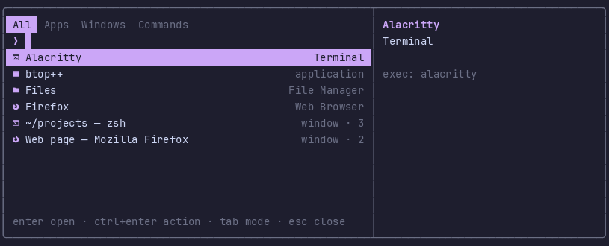

# The launcher

A centred box (apps, open windows, `$PATH` commands, a script/dmenu mode
for shell scripts), opened and closed by the daemon itself — nothing of
it stays resident while closed, not even a thread.

`Tab`/`Shift+Tab` switches modes (All, Apps, Windows, Commands); typing
ranks results with [nucleo](https://github.com/helix-editor/nucleo)
(Helix's fuzzy matcher) plus frecency (most-used first on an empty
query). `Enter` runs a command or typed shell text in a held terminal
(stays open to read the output); `Ctrl+Enter` runs it detached. `alpheus-launch`
bridges to it over an owner-only socket (`toggle`, `close`, `--dmenu`
with fuzzel's exit codes, plus exit code 3 — daemon unreachable — the
only case where a script falls back to another menu). Measured in
**release** (headless sway, 300 synthetic apps): opening costs ≈ 1.9–2.1 MB
of PSS over closed, median open latency ≈ 0.8–1.3 ms, 50 open/close cycles
grow PSS by well under the 1 MB budget (measured 148–220 KB across runs),
0 wake-ups in 5 s at rest after use (2 in one of three runs). A 100,000-line dmenu peaks at
+6.6–6.8 MB and drops back to +0.5 MB a second after it is cancelled.

**Calculator.** A query that looks like arithmetic shows one row above the other results (or alone with `alpheus-launch --calc`). `+ - * / % ^`, parentheses, `x` as a multiplication, `0x`/`0b`/`0o` and `_` in numbers, `pi` and `e`, and `sqrt`, `cbrt`, `abs`, `ln`, `log`, `log2`, `exp`, `sin`, `cos`, `tan`, `asin`, `acos`, `atan`, `round`, `floor`, `ceil`, `min`, `max`. Integers are exact (128 bits) and fall back to floating point on overflow; results keep 12 significant digits. `%` is the truncated remainder, as in C and Rust: `-7 % 3` is `-1`. A result computed from hexadecimal, binary or octal input also shows `0x…` and `0b…`. Units convert with `<value> <unit> to <unit>` (or `in`): length (`mm cm m km inch ft yd mi`), mass (`mg g kg t oz lb`), temperature (`c f k`), data (`b kb mb gb tb pb`, `kib … pib`) and time (`ms s min h d`). Inches are typed `inch` (or `inches`): `in` is the keyword, so `12 in to cm` gives no row. A word such as `e`, `pi`, `2048`, `7zip` or `1password` never shows the row. `Enter` copies the answer (`3.10685596119 mi`), `Ctrl+Enter` copies `5 km to mi = 3.10685596119 mi`, through `copy = ["wl-copy"]` in `launcher.toml` (`[]` hides the action); the copy is not recorded in the history. Nothing resident, nothing per keystroke beyond the parse.

**Prefixes.** A query that starts with `?`, `:` or `$` in the All mode lists only that prefix's rows (never under `--password`, in the Apps, Windows and Commands modes, or in script and dmenu menus, where they are plain text). A prefix alone shows a hint line, not a row.

- `? rust ratatui` shows `Search the web: rust ratatui`; Enter opens `search` (default `https://duckduckgo.com/?q={query}`, the text percent-encoded as one parameter) through `open` (default `["xdg-open"]`, the URL as the last argument), in a systemd scope like an app, so the browser never dies with the bar. `search = ""` or `open = []` turns the prefix off, and a `?` query is then searched as text. Never recorded in the history.
- `:heart` lists the emoji whose name matches (Unicode 16.0, the 1,906 fully-qualified ones without skin tones, a table in the binary's read-only data, paged in only when used; the launcher's fuzzy matcher over the name, at most `rows`). Enter copies the emoji through `copy` (`wl-copy`), `Ctrl+Enter` copies its name. Sequences (a family, a flag, a keycap) show as their pieces but are copied whole. Colour needs an emoji font in `[font] fallback` of `bar.toml` (for example `["DejaVu Sans Mono", "Noto Color Emoji"]`, the key replacing the default): the default monospace font has few. `:!x` is the matcher's negation, and an accented needle matches literally.
- `"` lists the clipboard history (see [Clipboard history](clipboard.md)); only while `[clipboard] enabled = true`, otherwise plain text.
- `$ sleep 5 && notify-send hi` shows `Run in a shell: …`; Enter runs `sh -c -- <text>` detached in a scope, `Ctrl+Enter` in `terminal_hold`. The text is never recorded or logged.

`:` and `$` are always claimed as prefixes: a query that starts with one never ranks apps (set `[prefixes]` to something else if you search names that start with them, a configured mode prefix is taken first). The attribution of the emoji names is in `NOTICE`.

**Window switcher.** `alpheus-launch --windows` (bind it to Alt+Tab in your compositor: `bind=ALT,Tab,spawn,alpheus-launch --windows` in Mango, `bindsym Mod1+Tab exec alpheus-launch --windows` in Sway) opens the windows with the previous one selected, so Enter goes back to the last window. A second `--windows` while it is open, and `Tab`, step down (`Shift+Tab` up), wrapping, so holding the modifier and pressing the key again walks the list; only a `--windows` within 250 ms of the switcher's own open is ignored (Hyprland re-fires a press bind on release). Esc closes. No modes row, no thumbnails, no scan of apps or `$PATH`, nothing resident.

**Command sources.** A menu script's lines can be searched next to the apps.
A `[[sources]]` table in `launcher.toml` names a `list` command and a `run` command. `list` runs once per open, on the thread that already scans the applications, after them: 1 s at most, 2,000 lines, 256 KiB. `run` receives the chosen line as one argument, never through a shell; it is the cleaned line (controls and invisible formatting characters removed, U+2028 and U+2029 turned into a space), not the script's raw bytes.

A line `Captures · Screenshot zone` shows as **Screenshot zone**, then `Captures` dimmed. It is found by typing either part. It is never listed on an empty query, in another mode or behind a prefix. Its use is remembered for the ranking like an app's.

The keys of a `[[sources]]` table are in [`docs/configuration.md`](../configuration.md#sources).

A source that fails, hangs or floods is cut off and logged once. The launcher opens as usual.
Whatever the list command started is killed with it when the read ends. If the daemon itself is
killed mid-read, the list command dies too, but processes it left in the background do not; a
systemd unit with `KillMode=control-group` (the default) cleans them up.

While the launcher is open, each kept line costs about three times its text (the line, its entry
and its path): ≈ 6–8 MB at the bounds (8 sources × 256 KiB) plus the ranker, released on close. A
300-line source costs ≈ 0.5 MB ([the memory table](../measurements.md#alpheus-component-by-component)).

`alpheus-launch --dmenu` takes fuzzel's dmenu options that scripts use:

| Option | What it does |
|---|---|
| `-p`, `--prompt TEXT` | text shown before the input |
| `--index` | print the chosen line's 0-based position on standard input instead of its text, empty lines counted as fuzzel does (`-1`, exit 0, for typed text that matches no line, as fuzzel) |
| `--password` | draw one `•` per typed character, show no list (standard input is read and ignored), print the text as typed; never logged nor kept in the history, wiped from memory on close; not with `--index` |
| `--visible N` | with an empty query, list only the first N non-empty lines; typing searches every line (a script's home menu: its categories first, every entry by typing); not with `--password` |
| `--placeholder TEXT`, `--width N`, `--lines N` | accepted and ignored (the box keeps its own size) |

A running `alpheus-demon` older than `--index`/`--password`/`--visible` (upgraded but not restarted) refuses
them: `alpheus-launch` then exits 3, like an unreachable daemon, so a script falls back to another
menu with the same options.
