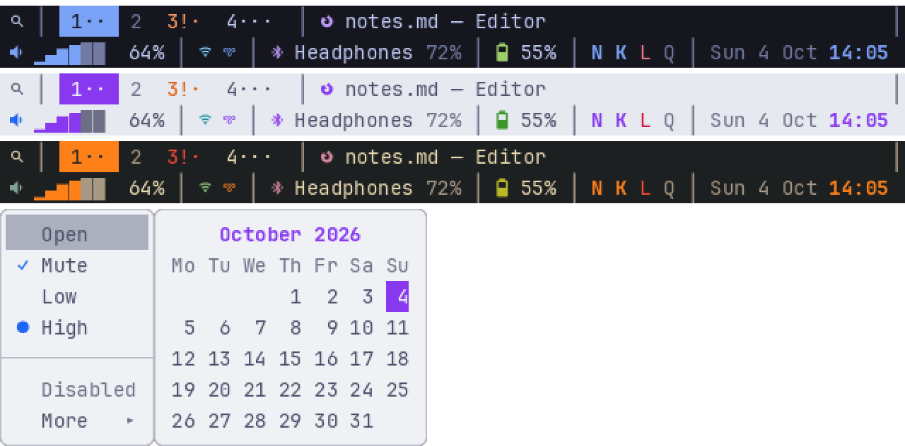
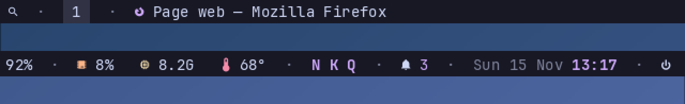
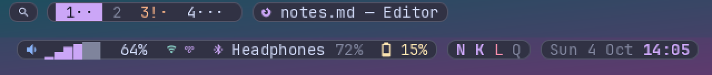
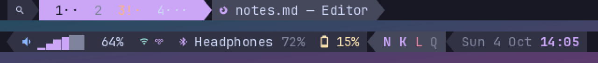
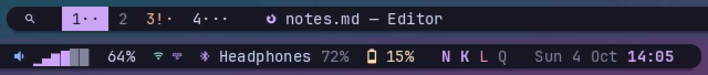
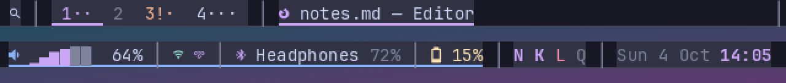
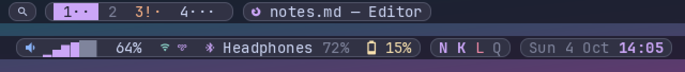
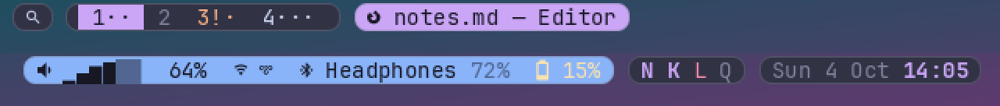

# Themes and bar styles

The colours everything alpheus draws takes, and the six shapes the bar can have. This page says what
it does, how to use it, how to configure it, how it is built, which rules the tests enforce on it,
and what it costs. It describes the code as it is today.

## What it does

Colours come from a **theme**: one of fifteen compiled-in presets, or your wallpaper through
[matugen](https://github.com/InioX/matugen). Each preset has a dark variant and, but for Nord,
Dracula and Phosphor, a light one; a preset with no light variant stays dark in light mode. The bar,
its popups, the launcher and the control center change together.

A theme is 16 colours named by use (the roles are listed in
[`docs/configuration.md`](../configuration.md#roles)) plus **seven hues**: `red`, `orange`, `yellow`,
`green`, `cyan`, `blue` and `purple`. Each preset takes its roles and its hues from its own palette,
in darker shades in the light variants where the official colour is too pale to read (3:1 on the bar
at least): Nord's bar sits on `nord0` rather than `nord1`, so that its red stays readable.

The **mode** follows the desktop (the portal's `org.freedesktop.appearance` `color-scheme`, read by
the bar, which passes it on to the control center) or is fixed.



### Module colours

`module_colors` in `theme.toml` decides how much of each module wears its hue (its values are in
[`docs/configuration.md`](../configuration.md#module_colors)). The mapping is fixed:

| Module | Hue |
| --- | --- |
| window title (its icon) | purple |
| media | purple |
| sound | blue |
| network | cyan |
| Bluetooth | purple |
| battery | green |
| CPU (its icon and figure) | orange |
| RAM | yellow |
| temperature | red |
| network rates (`net`) | cyan |
| disk | blue |
| GPU temperature | purple |
| the timer chip | yellow |

Workspaces, the clock, the tray icons, the notification bell (its count in the accent), the launcher
button and the separators keep their colours, and so do the three indicators the privacy module
draws, the Shield glyph (always green), the failed-units count (always the error colour) and the
power button (the bar's own text colour). **States win over the hue**: a low (`warn`) or critical
(`error`) battery, a hot temperature, a network with limited connectivity, a muted volume, an offline
or down module, an urgent workspace and a tray item that needs attention keep their state colours
whatever `module_colors` says. A charging battery is green at any level (its glyph shows it charges,
so it never warns); under `none` it keeps the accent.

### Bar styles

The bar has six shapes. `flat`, the default, is the bar as it always was; the six values of `style`
are described in [`docs/configuration.md`](../configuration.md#style). Only `translucent` uses
`opacity`.








*The six styles on catppuccin (dark), over a fictional wallpaper (sample data, real font, zoomed ×2,
each bar split in two halves).*

The groups are the workspaces, the window title, the status modules (sound, network, Bluetooth,
battery, the bell), the resources, the tray, the clock and the launcher button, and one block each
for media, the privacy indicators, the Shield glyph, the failed-units count, the timer chip and the
power button. A module that is absent makes no block. The text inside each block is the same in
every style; only the background changes.

`module_colors = "pills"` fills each block with the hue of its first module. Its text and icons take
whichever of the bar colour or the text colour reads better on that hue, and states still win (a low
battery stays `warn`). Pills apply to `islands`, `powerline`, `floating` and `translucent`; under
`flat` and `underline`, `pills` looks like `full`.



## Using it

**Changing the colours or the shape.** Edit `theme.toml`, or use the Theme tab of the control center,
which edits the same keys and has a `Module colours` row (None, Icons, Full, Pills) and a `Style`
row, each with a preview. The preview is drawn in terminal cells, so it is an approximation, not the
real pixels.

**A change applies at once.** The bar picks up a new `theme.toml`, `colors.toml` or
`colors-light.toml` by itself, with no restart: one inotify watch, and nothing wakes at rest. A new
style applies at once too; `floating` moves the bar 6 px down and in from the sides, and windows
start right under it (6 px lower than under the other styles), then their usual gaps.

**Clicks.** Clicks in the transparent gaps between `islands` blocks still reach the bar. The shadow
under `floating` lets clicks through to the window below.

**Blur.** alpheus never asks for blur. On Hyprland, a layer rule on the bar's namespace blurs what is
behind the `translucent` bar, and behind the `islands` and `floating` blocks:

```
# hyprland.conf
layerrule = blur on, ignore_alpha 0, match:namespace alpheus-bar
```

**Known limits.**

- An empty `theme.toml` fixes the colour source: if `colors.toml` appears afterwards, it is not
  picked up until the file is edited or the daemon restarts.
- If `~/.config/alpheus` is itself a symlink (home-manager), the watch follows it to its target, so
  replacing the link is not seen until the bar restarts (the bar logs it once at start).
- In solarized dark, the hues and the secondary text stay under 3:1 on the `raised` fill.
- In the Theme tab, each Enter that applies a theme shows its own toast, so several stack over the
  preview.

## Configuration

`theme.toml` in alpheus's configuration directory; every key of it is in
[`docs/configuration.md`](../configuration.md#themetoml), the fifteen presets in
[Presets](../configuration.md#presets), and the matugen template, its two configurations and the
commands in [Wallpaper colours](../configuration.md#wallpaper-colours-matugen).

The file is read live, and it is lenient: an unknown key, or a value of the wrong kind, is ignored
with one warning and the rest applies.

- With no `theme.toml`, or no `theme` key in it, alpheus uses `wallpaper` when
  `~/.config/alpheus/colors.toml` exists, and `catppuccin` otherwise.
- An unknown name falls back to `catppuccin`, with one line in the log.
- `theme = "wallpaper"` reads the colour files matugen writes, `colors.toml` for the dark mode and
  `colors-light.toml` for the light one.
- An `opacity` out of range is clamped with one log line, under any style, even one that does not
  use it; it is set in the file only, never from the Theme tab.

```toml
# ~/.config/alpheus/theme.toml
theme = "nord"
mode = "dark"
style = "islands"
module_colors = "pills"
```

## How it is built

The colours are shared by the daemon and the control center, so they live in
`crates/alpheus-common/src/theme/`:

- `mod.rs`: the 16 roles and the 7 hues, read from a colour file holding either the 16 roles or the
  7 keys of earlier versions (the rest derived per mode). It is independent of any display: the
  control center converts them to ratatui colours, the daemon to pixels.
- `presets.rs`: the compiled-in themes, each a dark half and (but for Nord, Dracula and Phosphor) a
  light half, taken from the official palettes, with the last six designed for alpheus rather than
  taken from a palette. Role choices follow Catppuccin's UI style guide and map the other families
  by analogy; where an official colour failed the contrast test, the nearest passing palette colour
  is used and the comment says so.
- `settings.rs`: `theme.toml` — which theme, which mode, how the modules take the hues, the per-role
  and per-hue overrides — the resolver that turns them and the wallpaper colour files into `Roles`,
  with one log line per fallback and never a fatal error, and the portal's `color-scheme` value.
- `contrast.rs`: WCAG 2 contrast (relative luminance and the ratio), which the presets' legibility
  test uses.
- `mode_file.rs`: the mode in effect as the daemon publishes it for the control center,
  `$XDG_RUNTIME_DIR/alpheus/mode` holding `dark` or `light`; the control center reads it in mode
  `auto`, so it needs no D-Bus of its own.

In the daemon:

- `watch.rs`: the hot reload. One inotify instance on the configuration directory, one descriptor on
  the event loop, no thread and no timer. A write, rename, creation or removal of `theme.toml`,
  `colors.toml` or `colors-light.toml` re-resolves the roles once per loop dispatch (the callback
  drains every queued record first), and every surface is repainted once, only when the roles
  changed. While the directory does not exist its parent is watched until it appears, and when it
  goes the watch falls back to the parent; with inotify unavailable, one line is logged and the theme
  files are read at startup only. Nothing here writes to the directory.
- `appearance.rs`: the desktop's light or dark preference. With `mode = "auto"` the portal's
  `color-scheme` is read once (a 2 s deadline, auto-start off) and then followed through one match
  rule narrowed to that key. It rides the tray's session-bus connection when the tray module is on,
  otherwise the bar's own session link, which it may share with the media module: either way there is
  one connection. It also writes the mode file.
- `placement.rs`: where a bar's layer surface sits, per style. `floating` moves it 6 px off the
  output's top, left and right edges, makes the surface taller by its shadow, and keeps input to the
  bar; every other style keeps the usual placement.
- `painter/blocks.rs`: the block styles' passes — `islands` and `translucent` (each group a rounded
  `pill_bg` block with a 1 px border, inset 2 px from the bar's top and bottom), the `pills` fill and
  its text colour, and the premultiplied pixel helpers the powerline and floating passes share.

## Rules it keeps

These are enforced by tests, so a change that breaks one fails the build.

- `every_preset_is_legible_in_both_modes` (`theme/presets.rs`): in every preset and both modes (a
  dark-only preset is checked again as the light mode's fallback), text reaches 4.5:1 on the bar and
  on the popups, text on an accent reaches 4.5:1 on `accent_container`, and secondary text, the four
  state colours and the seven hues reach 3:1 on the bar.
- `fg_is_legible_on_raised_and_pill_bg`: `fg` reaches 3.5:1 on the `raised` and `pill_bg` fills, in
  every preset half.
- `the_new_presets_pass_the_extra_ratios`: the six newest presets keep secondary
  text and every module hue at 3:1 on `pill_bg`, and secondary text on `raised` too.
- `on_accent_is_legible_on_every_hue`: the text on an accent fill reads on every hue and on `warn`.
- `the_rail_and_its_tabs_keep_their_contrast_on_every_fill` (the control center's
  `ui/contrast_tests.rs`): where a hue or secondary text falls short on a fill, the control center
  draws that glyph or word in `fg` instead; the test checks every pair the rail and its tabs draw, in
  every preset and mode.
- `a_preset_is_a_few_hundred_bytes`: a `Roles` is 69 bytes and a `Preset` at most 160, so the fifteen
  presets stay read-only data.
- `the_theme_and_camera_watches_only_read` (`tests/guardrails.rs`): `watch.rs` and `inotify.rs` never
  write, create or remove a file, and no other file of the daemon names inotify.
- The headless tests run the real daemon on an isolated compositor:
  `writing_theme_toml_repaints_the_bar_in_the_new_bar_bg`,
  `a_module_colours_change_alone_repaints_the_bar`,
  `a_truncated_colour_file_keeps_the_colours_until_the_full_one`,
  `a_style_set_at_startup_is_painted`,
  `an_invalid_style_warns_once_and_falls_back_to_flat`,
  `an_empty_theme_toml_repaints_on_a_new_wallpaper`,
  `a_truncated_theme_toml_keeps_the_style_and_still_reads_a_new_wallpaper`,
  `mode_auto_follows_the_portal_without_the_tray`,
  `a_fixed_mode_without_the_tray_never_opens_the_session_bus`,
  `switching_to_auto_turns_the_bar_light_and_the_mode_file_follows`,
  `an_empty_theme_toml_follows_the_portal_and_the_mode_file_too` and
  `a_restyle_closes_the_media_popup_on_the_second_output_once`.

Measured in release, back to back with the version before it (the full tables are in
[measurements](../measurements.md); the tests that measure are named here).

- **The themes, linked in** (the presets, the resolver, the inotify watch and the portal following):
  +144–224 KB, a one-time cost; the binary grew from 5.11 to 5.18 MiB (+76 KiB stripped). The
  fifteen presets are about 1.9 KB of read-only data in all, so an unused one costs nothing more.
- **50 reloads** (3 outputs repainted each time): +0–444 KB (`theme_reloads_no_growth`: 0 KB in four
  of five runs, 444 KB in the first run after a build), and 0 loop wake-ups at rest after a reload.
- **The six shapes, linked in:** within noise (−48…+156 KB); the binary grew from 5.20 to 5.24 MiB
  (+44 KiB stripped). `flat` pays only the style match.
- **Per style at start** (all modules, 3 outputs, `startup_pss_per_style`): flat ≈ 8.0 MB, the others
  −76…+116 KB over flat; the corner masks on first use −32…+88 KB (islands − flat) and +36…+116 KB
  (floating − flat, its taller buffer included).
- **48 style switches** (3 outputs; `floating` reconfigures every bar): +20 KB in each of 3 runs
  (`style_switches_no_growth`).
- **At rest:** 0 loop wake-ups under each of the six styles
  (`at_rest_no_wakeups_under_each_style`), and the theme watch adds none.
